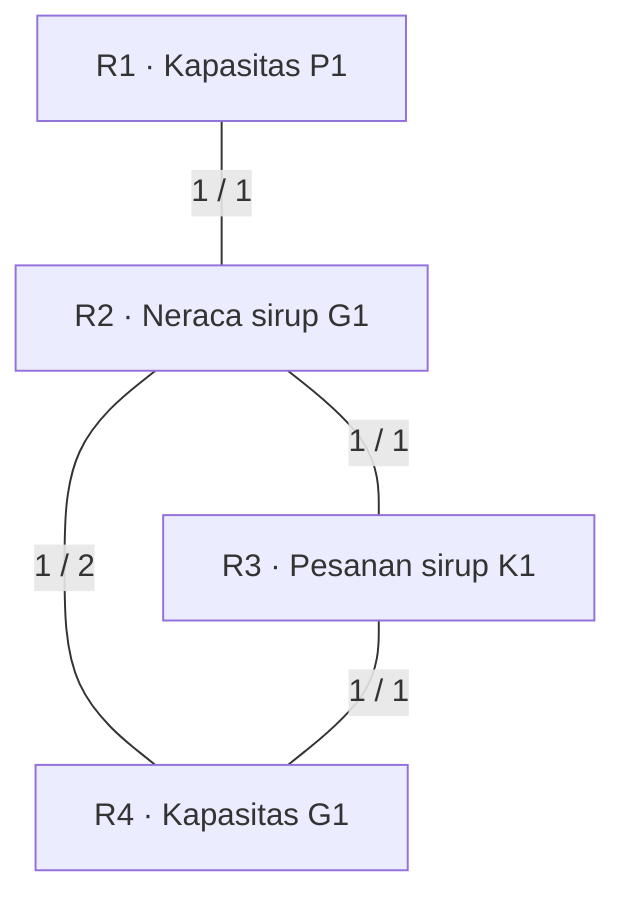

# Menghitung Weighted Constraint Coupling

*Weighted Constraint Coupling* (WCC) mengukur seberapa banyak kendala dalam model memakai variabel keputusan yang sama. Ukurannya dibandingkan dengan satu daftar rute acuan agar skor Low, Medium, dan High memakai skala yang sama.

## 1. Rumus dan cara menghitung

Untuk satu pasangan kendala, **bobotnya adalah jumlah variabel yang muncul di kedua baris**. Jika keduanya berbagi dua variabel, bobotnya 2. Jika keduanya tidak berbagi variabel, bobotnya 0. Huruf variabel dan seluruh indeksnya harus cocok. Nilai koefisien boleh berbeda selama keduanya bukan nol.

$$
\mathrm{WCC}
=\frac{\text{jumlah bobot semua pasangan pada tingkat yang dihitung}}
       {\text{jumlah bobot semua pasangan pada acuan bersama}}
 \times 100\%.
$$

1. **Tentukan pasangan kendala.** Pasangkan R1 dengan baris sesudahnya, lalu R2 dengan baris sesudahnya, dan seterusnya. R1–R2 dihitung sekali.
2. **Hitung pembilang.** Pakai daftar rute yang diizinkan pada tingkat yang dinilai. Hitung variabel bersama untuk setiap pasangan, kemudian jumlahkan bobotnya.
3. **Hitung penyebut.** Pakai baris kendala yang sama dengan daftar rute acuan. Hitung kembali bobot setiap pasangan, kemudian jumlahkan. Untuk rancangan ini, acuan mencakup semua rute yang diuji, jadi bobot tiap pasangan pada acuan menjadi batas bagi pasangan itu di Low, Medium, dan High.

Jika dua baris linear punya masing-masing 2 dan 5 koefisien bukan nol (*number of nonzeros* atau **NNZ**), keduanya bisa berbagi paling banyak 2 variabel. Untuk tahu bobot pada acuan, tetap cek **variabel mana yang sama**. Jika keduanya hanya berbagi satu variabel, pasangan itu menyumbang 1 ke penyebut.

## 2. Contoh kecil dan hitungannya

Ambil empat potongan kendala dari jaringan PT XYZ untuk sirup gula cair (produk B). Potongan ini hanya memuat keputusan berikut, agar enam pasangannya bisa diperiksa satu per satu.

| Simbol | Keputusan yang diwakili | Tersedia di Low | Tersedia di acuan contoh |
| --- | --- | --- | --- |
| $a$ | Ton sirup dari pabrik P1 ke gudang G1 | Ya | Ya |
| $b$ | Ton sirup dari gudang G1 ke zona K1 | Ya | Ya |
| $c$ | Ton sirup dari gudang G1 ke zona K2 | Tidak | Ya |
| $y$ | Buka G1, dengan 1 berarti buka dan 0 berarti tutup | Ya | Ya |

| Baris | Aturan | Potongan di Low | Potongan di acuan |
| --- | --- | --- | --- |
| R1 | Kapasitas pabrik P1 | $a\le 8$ | $a\le 8$ |
| R2 | Neraca sirup di G1 | $a=b$ | $a=b+c$ |
| R3 | Pesanan sirup di K1 | $b=1$ | $b=1$ |
| R4 | Kapasitas tonase G1 | $b\le16y$ | $b+c\le16y$ |

Hitung bobot pasangan dari variabel yang muncul pada kedua baris. Misalnya, R2 dan R4 sama-sama memakai $b$ di Low. Di acuan, keduanya juga memakai $c$.

| Pasangan | Variabel bersama di Low | Bobot Low | Variabel bersama di acuan | Bobot acuan |
| --- | --- | ---: | --- | ---: |
| R1–R2 | $a$ | 1 | $a$ | 1 |
| R1–R3 | Tidak ada | 0 | Tidak ada | 0 |
| R1–R4 | Tidak ada | 0 | Tidak ada | 0 |
| R2–R3 | $b$ | 1 | $b$ | 1 |
| R2–R4 | $b$ | 1 | $b,c$ | 2 |
| R3–R4 | $b$ | 1 | $b$ | 1 |
| **Total** | | **4** | | **5** |

Graf ini menampilkan bobot **Low / acuan**. Pasangan berbobot nol tidak digambar.

- **Pembilang Low = 4.** Ada empat pasangan berbobot 1 dan dua pasangan berbobot 0.
- **Penyebut = 5.** Di acuan ada tiga pasangan berbobot 1, satu pasangan berbobot 2, dan dua pasangan berbobot 0. Jadi 3 × 1 + 1 × 2 + 2 × 0 = 5.

$$
\mathrm{WCC}_{\mathrm{contoh,\ Low}}=\frac{4}{5}\times100\%=80\%.
$$

R2 dan R4 di acuan memiliki NNZ 3 dan 3. Batas berdasarkan ukuran kedua baris adalah 3. Irisan variabelnya hanya berisi $b,c$, sehingga bobot acuan yang masuk ke penyebut adalah **2**.

## 3. Kasus utama PT XYZ

### 3.1 Beri nomor 43 baris operasi

Audit mengambil satu kondisi permintaan sebelum penyederhanaan model oleh solver. Nomor baris dan jenis aturannya sama untuk semua tingkat rute.

| Nomor baris | Aturan | Cara memberi nomor | Jumlah |
| --- | --- | --- | ---: |
| R1–R6 | Kapasitas pabrik | P1 sampai P6 | 6 |
| R7–R17 | Neraca gudang–produk | G1 untuk A dan B. G2, G3, dan G4 masing-masing untuk A, B, C. | 11 |
| R18–R35 | Pesanan zona–produk | K1 sampai K6, masing-masing untuk A, B, C | 18 |
| R36–R39 | Kapasitas tonase gudang | G1 sampai G4 | 4 |
| R40–R43 | Batas waktu kerja gudang | G1 sampai G4 | 4 |
| **Total** | | | **43** |

Ada **43 × 42 ÷ 2 = 903 pasangan baris**. Satu rute menentukan asal, tujuan, dan produk. Contohnya, $`x_{1,1,B}`$ adalah kiriman sirup dari P1 ke G1, sedangkan $`z_{1,3,B}`$ adalah kiriman sirup dari G1 ke K3. Produk A adalah minyak goreng dan produk C adalah susu. [Gambar jaringan dan data kasus](case/Kasus_Dasar.md#rute-low-medium-dan-high)

### 3.2 Tetapkan daftar rute untuk Low dan acuan

| Daftar | Rute masuk pabrik → gudang | Rute keluar gudang → zona |
| --- | ---: | ---: |
| Low | 16 | 36 |
| Acuan bersama | 35, diambil dari daftar rute masuk High | 66, dari 11 pasangan gudang–produk × 6 zona |

Sebelas pasangan gudang–produk ditentukan dari rute masuk acuan. G1 dapat menerima 2 produk, dan G2, G3, serta G4 masing-masing dapat menerima 3. Perhitungan acuan mengizinkan setiap pasangan itu melayani keenam zona, sehingga ada (2 + 3 + 3 + 3) × 6 = 66 rute keluar.

### 3.3 Telusuri beberapa pasangan baris pada Low

| Pasangan | Variabel bersama di Low | Bobot Low | Variabel bersama di acuan | Bobot acuan |
| --- | --- | ---: | --- | ---: |
| R1–R8. Kapasitas P1 dan neraca sirup G1 | Sirup P1 → G1 | 1 | Sirup P1 → G1 | 1 |
| R1–R19. Kapasitas P1 dan pesanan sirup K1 | Tidak ada. R1 memakai kiriman masuk dan R19 memakai kiriman keluar. | 0 | Tidak ada | 0 |
| R8–R19. Neraca sirup G1 dan pesanan sirup K1 | Sirup G1 → K1 | 1 | Sirup G1 → K1 | 1 |
| R8–R36. Neraca sirup G1 dan kapasitas tonase G1 | Sirup G1 → K1, K3, K5 | **3** | Sirup G1 → K1 sampai K6 | **6** |
| R36–R40. Kapasitas tonase dan waktu kerja G1 | 9 kiriman keluar G1 dan keputusan buka G1 | 10 | 12 kiriman keluar G1 dan keputusan buka G1 | 13 |

Periksa lebih dekat **R8–R36**, yaitu pasangan yang diambil dari contoh kecil. Dalam model lengkap Low, R8 memuat 3 kiriman sirup masuk dan 3 kiriman sirup keluar (**NNZ 6**). R36 memuat 3 kiriman sirup keluar, 6 kiriman minyak keluar, dan 1 keputusan buka gudang (**NNZ 10**). Dari kedua daftar itu, tiga kiriman sirup keluar sama persis, yaitu $`z_{1,1,B}`$, $`z_{1,3,B}`$, dan $`z_{1,5,B}`$.

Di acuan, R8 memuat 4 kiriman sirup masuk dan 6 kiriman sirup keluar (**NNZ 10**). R36 memuat 6 kiriman sirup keluar, 6 kiriman minyak keluar, dan 1 keputusan buka (**NNZ 13**). Batas dari NNZ adalah 10. Saat dicocokkan satu per satu, kedua baris berbagi 6 kiriman sirup keluar. Jadi pasangan ini menyumbang **3 ke pembilang Low** dan **6 ke penyebut acuan**.

## 4. Jumlahkan bobot pada jaringan lengkap

Cara membaca tabel ini sama dengan contoh kecil. Hitung bobot tiap pasangan, lalu jumlahkan menurut jenis kendalanya. Misalnya, 6 baris kapasitas pabrik bisa dipasangkan dengan 11 baris neraca, sehingga ada 66 pasangan untuk kelompok pertama. Enam belas rute masuk Low menyumbang total bobot 16 pada kelompok itu. Setiap rute masuk dipakai oleh satu baris kapasitas pabrik dan satu baris neraca.

Untuk kelompok tonase–waktu, setiap rute keluar dipakai pada kedua baris milik gudang yang sama. Keputusan buka tiap gudang juga dipakai oleh kedua barisnya. Total bobot kelompok itu adalah **36 + 4 = 40** di Low dan **66 + 4 = 70** di acuan. Pasangan tonase dan waktu dari gudang yang berbeda berbobot 0.

| Kelompok pasangan kendala | Pasangan yang diperiksa | Jumlah bobot Low | Jumlah bobot acuan |
| --- | ---: | ---: | ---: |
| Kapasitas pabrik × neraca | 66 | 16 | 35 |
| Neraca × pesanan | 198 | 36 | 66 |
| Neraca × tonase | 44 | 36 | 66 |
| Neraca × waktu | 44 | 36 | 66 |
| Pesanan × tonase | 72 | 36 | 66 |
| Pesanan × waktu | 72 | 36 | 66 |
| Tonase × waktu | 16 | 40 | 70 |
| Pasangan lain, misalnya kapasitas pabrik × pesanan | 391 | 0 | 0 |
| **Total** | **903** | **236** | **435** |

Kelima kelompok dari neraca–pesanan sampai pesanan–waktu masing-masing mendapat satu sumbangan dari setiap rute keluar. Contohnya, sirup G1 → K1 menghubungkan neraca sirup G1 dengan pesanan sirup K1. Dengan aturan yang sama, 36 rute keluar menyumbang total bobot 36 pada kelompok neraca–pesanan di Low, dan 66 rute keluar menyumbang 66 di acuan.

$$
\mathrm{WCC}_{\mathrm{Low}}=\frac{236}{435}\times100\%
\approx54{,}25\%.
$$

## 5. Hasil Low, Medium, dan High

| Tingkat | Rute masuk | Rute keluar | Pembilang | Penyebut bersama | WCC |
| --- | ---: | ---: | ---: | ---: | ---: |
| Low | 16 | 36 | 236 | 435 | **54,25%** |
| Medium | 21 | 43 | 283 | 435 | **65,06%** |
| High | 35 | 57 | 381 | 435 | **87,59%** |

Ketiga tingkat memakai 43 baris operasi yang sama. Tambahan rute memasukkan variabel kiriman baru pada baris yang relevan. Variabel itu dapat membentuk hubungan baru atau memperbesar bobot hubungan yang sudah ada. Pada satu tingkat rute, nilai WCC operasi sama untuk P1–P8. Audit memeriksa skenario stokastik satu per satu. Batas emisi, domain variabel, langkah pemilihan emisi saat biaya sama, dan garis singgung solver berada di luar 43 baris yang diukur.

[Data rute](case/Data_Bersama.json) · [Model matematika](math_model_acuan/Model_Matematika.md) · [Audit 24 kombinasi](math_model_acuan/hasil/WCC.csv) · [Halaman utama](README.md)
