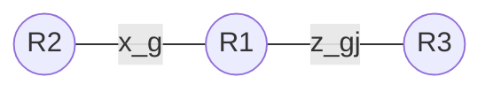

# Cara menghitung WCC di PT XYZ

## 1. Ilustrasi perhitungan WCC

### a. Apa itu WCC?

WCC (*Weighted Constraint Coupling*) mengukur seberapa banyak **variabel keputusan yang sama muncul pada dua baris kendala**. Jika kedua baris memuat satu variabel yang sama, pasangan itu mendapat bobot 1. Jika kedua baris memuat dua variabel yang sama, bobotnya 2.

### b. Rumus WCC

$$
\mathrm{WCC}
=\frac{\text{jumlah bobot semua pasangan pada versi yang dinilai}}
       {\text{jumlah bobot semua pasangan pada daftar pembanding}}
\times 100\%.
$$

Pada setiap versi, cocokkan variabel hingga ke indeksnya. Hitung setiap pasangan baris satu kali, lalu jumlahkan bobotnya. Daftar pembanding menunjukkan kombinasi rute yang boleh dipakai sebagai patokan dan ditetapkan sekali untuk semua versi yang dibandingkan.

### c. Bagaimana menghitung WCC?

**1. Tulis tiga jenis kendala.** Ada satu pabrik P1, dua gudang G1 dan G2, dua pelanggan K1 dan K2, serta satu produk. Variabel $`x_g`$ menyatakan kiriman dari P1 ke gudang $`g`$. Variabel $`z_{g,j}`$ menyatakan kiriman dari gudang $`g`$ ke pelanggan $`j`$.

| Simpul | Kendala | Persamaan |
| --- | --- | --- |
| R1 | Keseimbangan aliran di setiap gudang | $`x_g=\sum_j z_{g,j}`$ |
| R2 | Kapasitas setiap gudang | $`x_g\le V_g`$ |
| R3 | Permintaan setiap pelanggan | $`\sum_g z_{g,j}=d_j`$ |

$`V_g`$ adalah kapasitas gudang $`g`$, dan $`d_j`$ adalah permintaan pelanggan $`j`$. R2 membatasi arus masuk. Karena R1 menyamakan arus masuk dan arus keluar, batas kapasitas itu juga dapat ditulis $`\sum_j z_{g,j}\le V_g`$. Ilustrasi ini memakai bentuk arus masuk agar hubungan $`x_g`$ terlihat langsung. Gunakan bentuk kendala yang sama saat menghitung bobot versi Low dan pembanding.

Pada notasi model PT XYZ, $`\sum_{g,p}x_{igp}\le U_i`$ adalah **kapasitas pabrik** $`i`$. Penjumlahannya mencakup semua gudang dan produk yang dikirim oleh pabrik tersebut.

**2. Gambar hubungan dari variabel yang sama.** R1 dan R2 sama-sama memuat $`x_g`$. R1 dan R3 sama-sama memuat $`z_{g,j}`$.

Tiga simpul mewakili **jenis kendala**. Setelah gudang dan pelanggan diberi nomor, R1 punya satu baris untuk setiap gudang, R2 punya satu baris untuk setiap gudang, dan R3 punya satu baris untuk setiap pelanggan. Bobot dihitung dari baris yang sudah berindeks itu.

**3. Hitung bobot garis R1–R2.** Pada daftar pembanding, P1 dapat mengirim barang ke G1 dan G2. Pada Low, rute masuk yang tersedia hanya P1 → G1.

| Kombinasi rute masuk | Variabel | Dua baris yang memuatnya | Bobot pembanding | Bobot Low |
| --- | --- | --- | ---: | ---: |
| P1 → G1 | $`x_1`$ | R1 untuk G1 dan R2 untuk G1 | 1 | 1 |
| P1 → G2 | $`x_2`$ | R1 untuk G2 dan R2 untuk G2 | 1 | 0 |
| **Total R1–R2** | | | **2** | **1** |

Jadi, contoh **1 ÷ 2 = 50% benar untuk garis R1–R2**. Kombinasi P1 → G1 menyumbang satu poin melalui $`x_1`$. Kombinasi P1 → G2 menyumbang satu poin pembanding melalui $`x_2`$.

**4. Jumlahkan bobot seluruh graf.** Pada Low, G1 melayani K1 dan K2 dengan kapasitas yang cukup untuk dua pesanan. Pada daftar pembanding, kedua gudang dapat melayani kedua pelanggan. Setiap rute gudang → pelanggan memberi 1 poin pada garis R1–R3 karena variabel kiriman yang sama muncul di baris neraca gudang asal dan baris permintaan pelanggan tujuan.

| Kombinasi rute keluar | Variabel | Dua baris yang memuatnya | Bobot pembanding | Bobot Low |
| --- | --- | --- | ---: | ---: |
| G1 → K1 | $`z_{1,1}`$ | R1 untuk G1 dan R3 untuk K1 | 1 | 1 |
| G1 → K2 | $`z_{1,2}`$ | R1 untuk G1 dan R3 untuk K2 | 1 | 1 |
| G2 → K1 | $`z_{2,1}`$ | R1 untuk G2 dan R3 untuk K1 | 1 | 0 |
| G2 → K2 | $`z_{2,2}`$ | R1 untuk G2 dan R3 untuk K2 | 1 | 0 |
| **Total R1–R3** | | | **4** | **2** |

| Pasangan jenis kendala | Bobot pembanding | Bobot Low |
| --- | ---: | ---: |
| R1–R2 | 2 | 1 |
| R1–R3 | 4 | 2 |
| R2–R3 | 0 | 0 |
| **Total** | **6** | **3** |

Masing-masing baris di dalam jenis kendala yang sama memakai indeks yang berbeda, sehingga sumbangannya nol pada ilustrasi ini. WCC seluruh ilustrasi adalah **(1 + 2) ÷ (2 + 4) × 100% = 50%**. Dalam contoh ini, hasil seluruh ilustrasi kebetulan sama dengan persentase pada garis R1–R2.

## 2. Perhitungan WCC pada kasus PT XYZ

Tabel ini menjumlahkan bobot dari semua pasangan di antara **43 baris operasi**. Daftar pembanding yang sama memberi **435 poin** dari 35 rute masuk, 66 rute keluar, dan 4 variabel keputusan buka gudang.

| Versi | Bobot yang dipakai | Bobot pembanding | WCC |
| --- | ---: | ---: | ---: |
| Low | 236 | 435 | **54,25%** |
| Medium | 283 | 435 | **65,06%** |
| High | 381 | 435 | **87,59%** |

**Neraca gudang sudah masuk hitungan WCC.** Sejak versi awal, solver memakai satu baris neraca per pasangan gudang–produk yang kompatibel dalam setiap skenario. Baris itu menyamakan total kiriman masuk $`\sum_i x_{igp}`$ dan total kiriman keluar $`\sum_j z_{gjp}`$. Tanda $`q_{gp}`$ di dokumentasi adalah singkatan untuk total kiriman keluar. Menulis ketiganya dalam satu persamaan hanya memperjelas cara baca model. Audit WCC tetap menghitung 43 baris operasi, termasuk neraca, dan hasil optimum serta waktu komputasi merujuk pada formulasi solver yang sama.

[Lihat persamaan R1–R43, contoh R8–R36, dan hitungan lengkap](math_model_acuan/Persamaan_WCC.md) · [Rincian 903 pasangan](math_model_acuan/hasil/Audit_WCC_Pasangan.csv) · [Model matematika](math_model_acuan/Model_Matematika.md) · [Gambar jaringan PT XYZ](case/Kasus_Dasar.md) · [Data rute](case/Data_Bersama.json) · [Halaman utama](README.md)
