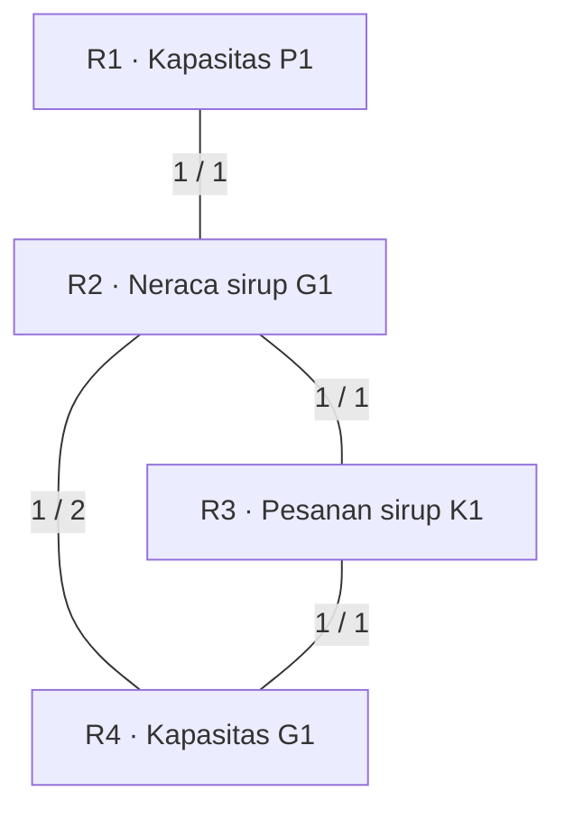

# Menghitung Weighted Constraint Coupling

*Weighted Constraint Coupling* (WCC) mengukur seberapa banyak kendala dalam model memakai variabel keputusan yang sama. Ukurannya dibandingkan dengan satu daftar rute acuan agar skor Low, Medium, dan High memakai skala yang sama.

## 1. Rumus dan cara menghitung

Untuk satu pasangan kendala, **bobotnya adalah jumlah variabel yang muncul di kedua baris**. Jika keduanya berbagi dua variabel, bobotnya 2. Jika keduanya tidak berbagi variabel, bobotnya 0. Huruf variabel dan seluruh indeksnya harus cocok. Nilai koefisien boleh berbeda selama keduanya bukan nol.

$$
\mathrm{WCC}
=\frac{\text{jumlah bobot semua pasangan pada tingkat yang dihitung}}
       {\text{jumlah bobot semua pasangan pada acuan bersama}}
 \times 100\%.
$$

1. **Tentukan pasangan kendala.** Pasangkan R1 dengan baris sesudahnya, lalu R2 dengan baris sesudahnya, dan seterusnya. R1–R2 dihitung sekali.
2. **Hitung pembilang.** Pakai daftar rute yang diizinkan pada tingkat yang dinilai. Hitung variabel bersama untuk setiap pasangan, kemudian jumlahkan bobotnya.
3. **Hitung penyebut.** Pakai baris kendala yang sama dengan daftar rute acuan. Hitung kembali bobot setiap pasangan, kemudian jumlahkan. Untuk rancangan ini, acuan mencakup semua rute yang diuji, jadi bobot tiap pasangan pada acuan menjadi batas bagi pasangan itu di Low, Medium, dan High.

Jika dua baris linear punya masing-masing 2 dan 5 koefisien bukan nol (*number of nonzeros* atau **NNZ**), keduanya bisa berbagi paling banyak 2 variabel. Untuk tahu bobot pada acuan, tetap cek **variabel mana yang sama**. Jika keduanya hanya berbagi satu variabel, pasangan itu menyumbang 1 ke penyebut.

## 2. Contoh kecil dengan indeks lengkap

Ambil empat potongan kendala PT XYZ untuk sirup gula cair (produk B). Contoh ini memakai empat variabel berikut. Baris R1–R4 diberi nomor khusus untuk contoh. Model lengkap di Bagian 3 juga memuat rute dan variabel lain.

| Variabel | Cara membaca indeks |
| --- | --- |
| $`x_{1,1,B}`$ | Ton sirup dari **pabrik P1** ke **gudang G1**. Indeksnya pabrik, gudang, produk. |
| $`z_{1,1,B}`$ | Ton sirup dari **gudang G1** ke **zona K1**. Indeksnya gudang, zona, produk. |
| $`z_{1,2,B}`$ | Ton sirup dari **gudang G1** ke **zona K2**. |
| $`y_1`$ | Keputusan buka gudang **G1**. Nilai 1 berarti buka dan 0 berarti tutup. |

**Low** memuat rute sirup P1 → G1 dan G1 → K1. **Acuan contoh** memuat kedua rute itu serta rute sirup G1 → K2. Tambahan rute membuat $`z_{1,2,B}`$ muncul di dua baris, yaitu neraca sirup G1 (R2) dan kapasitas G1 (R4).

| Baris | Aturan | Potongan persamaan Low | Potongan persamaan acuan |
| --- | --- | --- | --- |
| R1 | Kapasitas pabrik P1 | $`x_{1,1,B}\le 8`$ | $`x_{1,1,B}\le 8`$ |
| R2 | Neraca sirup di G1 | $`x_{1,1,B}=z_{1,1,B}`$ | $`x_{1,1,B}=z_{1,1,B}+z_{1,2,B}`$ |
| R3 | Pesanan sirup di K1 | $`z_{1,1,B}=1`$ | $`z_{1,1,B}=1`$ |
| R4 | Kapasitas tonase G1 | $`z_{1,1,B}\le16y_1`$ | $`z_{1,1,B}+z_{1,2,B}\le16y_1`$ |

Ambil **R2–R4**. Baca ke kiri dan ke kanan tanda sama dengan atau tanda kurang dari. Pada Low, cari variabel yang tertulis di kedua baris. Hanya $`z_{1,1,B}`$ yang cocok, jadi **bobot Low = 1**. Lakukan hal yang sama pada kolom acuan. Sekarang $`z_{1,1,B}`$ dan $`z_{1,2,B}`$ muncul di kedua baris, jadi **bobot acuan = 2**. Variabel $`x_{1,1,B}`$ hanya muncul di R2, sedangkan $`y_1`$ hanya muncul di R4.

| Pasangan | Variabel bersama di Low | Bobot Low | Variabel bersama di acuan | Bobot acuan |
| --- | --- | ---: | --- | ---: |
| R1–R2 | $`x_{1,1,B}`$ | 1 | $`x_{1,1,B}`$ | 1 |
| R1–R3 | Tidak ada | 0 | Tidak ada | 0 |
| R1–R4 | Tidak ada | 0 | Tidak ada | 0 |
| R2–R3 | $`z_{1,1,B}`$ | 1 | $`z_{1,1,B}`$ | 1 |
| R2–R4 | $`z_{1,1,B}`$ | **1** | $`z_{1,1,B}`$, $`z_{1,2,B}`$ | **2** |
| R3–R4 | $`z_{1,1,B}`$ | 1 | $`z_{1,1,B}`$ | 1 |
| **Total** | | **4** | | **5** |

Pada graf, angka pertama di tiap garis adalah bobot Low dan angka kedua adalah bobot acuan. Pasangan yang tidak berbagi variabel tidak memiliki garis.

- **Pembilang Low** adalah $1+0+0+1+1+1=4$.
- **Penyebut acuan** adalah $1+0+0+1+2+1=5$.

$$
\mathrm{WCC}_{\mathrm{contoh,\ Low}}=\frac{4}{5}\times100\%=80\%.
$$

Dalam kolom acuan, R2 dan R4 masing-masing mempunyai NNZ 3. Itu memberi batas atas 3 menurut ukuran baris. Pencocokan indeks menemukan dua variabel bersama, sehingga pasangan R2–R4 menyumbang **2** ke penyebut.

## 3. Kasus utama PT XYZ

### 3.1 Beri nomor 43 baris operasi

Audit mengambil satu kondisi permintaan sebelum penyederhanaan model oleh solver. Nomor baris dan jenis aturannya sama untuk semua tingkat rute.

| Nomor baris | Aturan | Cara memberi nomor | Jumlah |
| --- | --- | --- | ---: |
| R1–R6 | Kapasitas pabrik | P1 sampai P6 | 6 |
| R7–R17 | Neraca gudang–produk | G1 untuk A dan B. G2, G3, dan G4 masing-masing untuk A, B, C. | 11 |
| R18–R35 | Pesanan zona–produk | K1 sampai K6, masing-masing untuk A, B, C | 18 |
| R36–R39 | Kapasitas tonase gudang | G1 sampai G4 | 4 |
| R40–R43 | Batas waktu kerja gudang | G1 sampai G4 | 4 |
| **Total** | | | **43** |

Ada **43 × 42 ÷ 2 = 903 pasangan baris**. Satu rute menentukan asal, tujuan, dan produk. Contohnya, $`x_{1,1,B}`$ adalah kiriman sirup dari P1 ke G1, sedangkan $`z_{1,3,B}`$ adalah kiriman sirup dari G1 ke K3. Produk A adalah minyak goreng dan produk C adalah susu. [Gambar jaringan dan data kasus](case/Kasus_Dasar.md#rute-low-medium-dan-high)

### 3.2 Tetapkan daftar rute untuk Low dan acuan

| Daftar | Rute masuk pabrik → gudang | Rute keluar gudang → zona |
| --- | ---: | ---: |
| Low | 16 | 36 |
| Acuan bersama | 35, diambil dari daftar rute masuk High | 66, dari 11 pasangan gudang–produk × 6 zona |

Sebelas pasangan gudang–produk ditentukan dari rute masuk acuan. G1 dapat menerima 2 produk, dan G2, G3, serta G4 masing-masing dapat menerima 3. Perhitungan acuan mengizinkan setiap pasangan itu melayani keenam zona, sehingga ada (2 + 3 + 3 + 3) × 6 = 66 rute keluar.

### 3.3 Lihat variabel yang sama pada persamaan lengkap

#### R36–R40. Kapasitas tonase dan waktu kerja G1

Contoh ini memakai bentuk linear pada P1. R36 membatasi volume kiriman G1 sampai **16 ton** saat gudang dibuka. R40 membatasi waktu kerja sampai **19,2 jam** saat gudang dibuka. Setiap ton membutuhkan satu jam kerja, sehingga koefisien setiap kiriman pada R40 adalah 1.

**Low.** G1 dapat mengirim minyak (A) ke K1–K6 dan sirup (B) ke K1, K3, serta K5.

$$
\begin{aligned}
\mathrm{R36}\quad &z_{1,1,A}+z_{1,2,A}+z_{1,3,A}\\
                  &{}+z_{1,4,A}+z_{1,5,A}+z_{1,6,A}\\
                  &{}+z_{1,1,B}+z_{1,3,B}+z_{1,5,B}\le 16y_1,\\[3pt]
\mathrm{R40}\quad &z_{1,1,A}+z_{1,2,A}+z_{1,3,A}\\
                  &{}+z_{1,4,A}+z_{1,5,A}+z_{1,6,A}\\
                  &{}+z_{1,1,B}+z_{1,3,B}+z_{1,5,B}\le 19{,}2y_1.
\end{aligned}
$$

Cocokkan kedua persamaan. Keenam variabel minyak dan ketiga variabel sirup di ruas kiri muncul di kedua baris. Variabel buka gudang $`y_1`$ juga muncul di kedua ruas kanan. Koefisien 16 dan 19,2 berbeda, tetapi variabelnya sama. Jadi **bobot Low = 6 + 3 + 1 = 10**.

**Acuan.** G1 juga dapat mengirim sirup ke K2, K4, dan K6. Ketiga variabel baru itu muncul di kedua baris.

$$
\begin{aligned}
\mathrm{R36}\quad &z_{1,1,A}+z_{1,2,A}+z_{1,3,A}\\
                  &{}+z_{1,4,A}+z_{1,5,A}+z_{1,6,A}\\
                  &{}+z_{1,1,B}+z_{1,2,B}+z_{1,3,B}\\
                  &{}+z_{1,4,B}+z_{1,5,B}+z_{1,6,B}\le 16y_1,\\[3pt]
\mathrm{R40}\quad &z_{1,1,A}+z_{1,2,A}+z_{1,3,A}\\
                  &{}+z_{1,4,A}+z_{1,5,A}+z_{1,6,A}\\
                  &{}+z_{1,1,B}+z_{1,2,B}+z_{1,3,B}\\
                  &{}+z_{1,4,B}+z_{1,5,B}+z_{1,6,B}\le 19{,}2y_1.
\end{aligned}
$$

Tiga variabel bersama yang bertambah adalah $`z_{1,2,B}`$, $`z_{1,4,B}`$, dan $`z_{1,6,B}`$. Jadi **bobot acuan = 10 + 3 = 13**. Dalam hitungan jaringan, pasangan R36–R40 menyumbang **10 ke pembilang Low** dan **13 ke penyebut**.

#### R8–R36. Neraca sirup dan kapasitas tonase G1

R8 menyatakan sirup yang masuk ke G1 sama dengan sirup yang keluar dari G1. Bandingkan persamaan R8 di bawah dengan R36 yang sudah ditulis di atas.

$$
\begin{aligned}
\text{Low}\quad &x_{1,1,B}+x_{2,1,B}+x_{3,1,B}\\
                &\qquad=z_{1,1,B}+z_{1,3,B}+z_{1,5,B},\\[3pt]
\text{Acuan}\quad &x_{1,1,B}+x_{2,1,B}+x_{3,1,B}+x_{4,1,B}\\
                  &\qquad=z_{1,1,B}+z_{1,2,B}+z_{1,3,B}\\
                  &\qquad\phantom{=}{}+z_{1,4,B}+z_{1,5,B}+z_{1,6,B}.
\end{aligned}
$$

| Daftar rute | NNZ R8 | NNZ R36 | Variabel yang muncul di kedua persamaan | Bobot R8–R36 |
| --- | ---: | ---: | --- | ---: |
| Low | 6 | 10 | $`z_{1,1,B}`$, $`z_{1,3,B}`$, $`z_{1,5,B}`$ | **3** |
| Acuan | 10 | 13 | $`z_{1,1,B}`$, $`z_{1,2,B}`$, $`z_{1,3,B}`$, $`z_{1,4,B}`$, $`z_{1,5,B}`$, $`z_{1,6,B}`$ | **6** |

Kiriman masuk $`x_{4,1,B}`$ pada acuan hanya muncul di R8. Jadi variabel itu menambah NNZ R8 dan tidak menyumbang bobot R8–R36. Pasangan ini menyumbang **3 ke pembilang Low** dan **6 ke penyebut**.

## 4. Jumlahkan bobot pada jaringan lengkap

Cara membaca tabel ini sama dengan contoh kecil. Hitung bobot tiap pasangan, lalu jumlahkan menurut jenis kendalanya. Misalnya, 6 baris kapasitas pabrik bisa dipasangkan dengan 11 baris neraca, sehingga ada 66 pasangan untuk kelompok pertama. Enam belas rute masuk Low menyumbang total bobot 16 pada kelompok itu. Setiap rute masuk dipakai oleh satu baris kapasitas pabrik dan satu baris neraca.

Untuk kelompok tonase–waktu, setiap rute keluar dipakai pada kedua baris milik gudang yang sama. Keputusan buka tiap gudang juga dipakai oleh kedua barisnya. Total bobot kelompok itu adalah **36 + 4 = 40** di Low dan **66 + 4 = 70** di acuan. Pasangan tonase dan waktu dari gudang yang berbeda berbobot 0.

| Kelompok pasangan kendala | Pasangan yang diperiksa | Jumlah bobot Low | Jumlah bobot acuan |
| --- | ---: | ---: | ---: |
| Kapasitas pabrik × neraca | 66 | 16 | 35 |
| Neraca × pesanan | 198 | 36 | 66 |
| Neraca × tonase | 44 | 36 | 66 |
| Neraca × waktu | 44 | 36 | 66 |
| Pesanan × tonase | 72 | 36 | 66 |
| Pesanan × waktu | 72 | 36 | 66 |
| Tonase × waktu | 16 | 40 | 70 |
| Pasangan lain, misalnya kapasitas pabrik × pesanan | 391 | 0 | 0 |
| **Total** | **903** | **236** | **435** |

Kelima kelompok dari neraca–pesanan sampai pesanan–waktu masing-masing mendapat satu sumbangan dari setiap rute keluar. Contohnya, sirup G1 → K1 menghubungkan neraca sirup G1 dengan pesanan sirup K1. Dengan aturan yang sama, 36 rute keluar menyumbang total bobot 36 pada kelompok neraca–pesanan di Low, dan 66 rute keluar menyumbang 66 di acuan.

$$
\mathrm{WCC}_{\mathrm{Low}}=\frac{236}{435}\times100\%
\approx54{,}25\%.
$$

## 5. Hasil Low, Medium, dan High

| Tingkat | Rute masuk | Rute keluar | Pembilang | Penyebut bersama | WCC |
| --- | ---: | ---: | ---: | ---: | ---: |
| Low | 16 | 36 | 236 | 435 | **54,25%** |
| Medium | 21 | 43 | 283 | 435 | **65,06%** |
| High | 35 | 57 | 381 | 435 | **87,59%** |

Ketiga tingkat memakai 43 baris operasi yang sama. Tambahan rute memasukkan variabel kiriman baru pada baris yang relevan. Variabel itu dapat membentuk hubungan baru atau memperbesar bobot hubungan yang sudah ada. Pada satu tingkat rute, nilai WCC operasi sama untuk P1–P8. Audit memeriksa skenario stokastik satu per satu. Batas emisi, domain variabel, langkah pemilihan emisi saat biaya sama, dan garis singgung solver berada di luar 43 baris yang diukur.

[Data rute](case/Data_Bersama.json) · [Model matematika](math_model_acuan/Model_Matematika.md) · [Audit 24 kombinasi](math_model_acuan/hasil/WCC.csv) · [Halaman utama](README.md)
