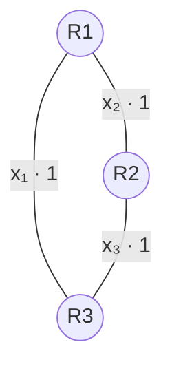

# Lampiran — Weighted Constraint Coupling (WCC)

Weighted Constraint Coupling (WCC) mengukur seberapa banyak variabel keputusan dipakai bersama oleh kendala. Hubungan yang memakai enam variabel mendapat bobot enam. Hubungan yang memakai satu variabel mendapat bobot satu. Pada kasus ini, WCC membandingkan satu blok operasi yang sepadan pada P1–P8. [Model matematika acuan](math_model_acuan/Model_Matematika.md)

## 1. Cara membaca bobot pasangan

Ambil tiga persamaan ini.

```math
\begin{aligned}
\text{R1}\quad &x_1+x_2=5,\\
\text{R2}\quad &x_2+x_3=4,\\
\text{R3}\quad &x_1+x_3=7.
\end{aligned}
```

Setiap lingkaran adalah satu baris kendala. Label pada garis menunjukkan variabel yang digunakan bersama dan bobot garis.



| Pasangan | Variabel yang muncul di kedua baris | Bobot |
| --- | --- | ---: |
| R1–R2 | $x_2$ | 1 |
| R1–R3 | $x_1$ | 1 |
| R2–R3 | $x_3$ | 1 |

Bobot aktual totalnya $1+1+1=3$. Dengan tiga baris, ada tiga pasangan. Secara umum, $m$ baris menghasilkan $m(m-1)/2$ pasangan. Setiap baris bisa dipasangkan dengan $m-1$ baris lain, lalu hasilnya dibagi dua karena pasangan R1–R2 dan R2–R1 dihitung satu kali. Pasangan dengan irisan kosong tetap terdaftar dengan bobot nol.

Untuk kendala linear, gabungkan dahulu semua suku dengan variabel berindeks sama. Ambil variabel dengan koefisien akhir selain nol. Suku $2x_1$ menyumbang satu kemunculan $x_1$, sama seperti suku $x_1$. Pada model berindeks, $z_{1,1,A}$ dan $z_{2,1,A}$ adalah dua keputusan berbeda karena gudangnya berbeda.

## 2. Cara menetapkan penyebut bersama

### 2.1 Contoh empat kendala dengan NNZ berbeda

NNZ (*number of nonzeros*) adalah jumlah koefisien selain nol setelah suku sejenis digabungkan. Pada satu baris kendala linear, ini sama dengan jumlah variabel yang muncul pada baris.

```math
\begin{aligned}
\text{R1}\quad &x_1+x_2=2,\\
\text{R2}\quad &2x_1+x_2+x_3=4,\\
\text{R3}\quad &x_1+x_4+x_5+x_6=4,\\
\text{R4}\quad &x_3+x_4+x_5+x_6+x_7=5.
\end{aligned}
```

Misalkan desain contoh ini menetapkan batas NNZ acuan R1–R4 sebesar **2, 3, 4, dan 5**. Jika yang diketahui hanya batas NNZ, dua baris paling banyak bisa berbagi sebanyak ukuran daftar yang lebih pendek. R1–R2, misalnya, paling banyak berbagi 2 variabel karena R1 hanya memuat 2. Batas tersebut dihitung untuk setiap pasangan.

| Pasangan | Batas NNZ kedua baris | Batas bobot dari NNZ | Variabel bersama aktual | Bobot aktual |
| --- | ---: | ---: | --- | ---: |
| R1–R2 | 2 dan 3 | 2 | $x_1,x_2$ | 2 |
| R1–R3 | 2 dan 4 | 2 | $x_1$ | 1 |
| R1–R4 | 2 dan 5 | 2 | — | 0 |
| R2–R3 | 3 dan 4 | 3 | $x_1$ | 1 |
| R2–R4 | 3 dan 5 | 3 | $x_3$ | 1 |
| R3–R4 | 4 dan 5 | 4 | $x_4,x_5,x_6$ | 3 |
| **Total** | | **16** | | **8** |

Penyebutnya $2+2+2+3+3+4=16$. WCC contoh ini adalah $8/16\times100\%=50\%$. Batas 2, 3, atau 4 mengikuti kemampuan masing-masing pasangan. Jika keempat batas NNZ itu menjadi bagian dari satu desain tingkat Low, Medium, dan High, ketiganya menggunakan penyebut 16. Isi kendala aktual pada masing-masing tingkat menentukan pembilangnya.

### 2.2 Perketat batas dengan daftar variabel yang diizinkan

Dalam kasus nyata, aturan jaringan bisa lebih informatif daripada NNZ. Kapasitas P1 dan kapasitas P4, misalnya, hanya memakai variabel pengiriman dari pabriknya masing-masing. Indeks pabrik berbeda, sehingga batas pasangan itu memang **0**, berapa pun NNZ kedua baris.

Untuk setiap posisi baris $r$, tetapkan $U_r^{\mathrm{ref}}$, yaitu daftar variabel yang diizinkan muncul oleh desain acuan. Bila desain juga mempunyai batas NNZ independen, sebut $d_r^{\mathrm{ref}}$ sebagai batasnya. Maka batas satu pasangan dapat dihitung sebagai berikut.

```math
b_{rs}^{\mathrm{ref}}=
\min\!\left(
d_r^{\mathrm{ref}},
d_s^{\mathrm{ref}},
\lvert U_r^{\mathrm{ref}}\cap U_s^{\mathrm{ref}}\rvert
\right).
```

Pada kasus distribusi ini, jalur yang diizinkan menentukan seluruh daftar variabel per baris. Nilai $d_r^{\mathrm{ref}}$ sama dengan ukuran daftar $U_r^{\mathrm{ref}}$, sehingga kita cukup menghitung irisannya. Bekukan daftar acuan dan pemetaan ID sebelum penilaian. Untuk setiap tingkat $\ell$, $S_r^{(\ell)}$ adalah daftar variabel dari kendala yang benar-benar ditulis pada tingkat itu.

```math
\begin{aligned}
w_{rs}^{(\ell)} &= \lvert S_r^{(\ell)}\cap S_s^{(\ell)}\rvert,\\
B_\ell &= \sum_{(r,s)\in P} w_{rs}^{(\ell)},\\
D_{\mathrm{ref}} &= \sum_{(r,s)\in P} b_{rs}^{\mathrm{ref}},\\
\mathrm{WCC}_\ell &= 100\%\times\frac{B_\ell}{D_{\mathrm{ref}}}.
\end{aligned}
```

Di sini $P$ adalah daftar pasangan posisi baris yang sama untuk semua tingkat. Pembaginya positif selama sedikitnya satu pasangan bisa berbagi variabel.

## 3. Audit blok operasi P1–P8

### Langkah 1 · Tetapkan baris yang dibandingkan

Satu blok operasi mewakili satu kondisi permintaan. Audit memakai urutan baris berikut untuk semua profil dan tingkat.

| ID audit | Keluarga kendala | Banyak posisi |
| --- | --- | ---: |
| R1–R6 | Kapasitas pabrik, urut P1 hingga P6 | 6 |
| R7–R17 | Neraca gudang–produk, urut gudang lalu produk pada jaringan acuan | 11 |
| R18–R35 | Pesanan pelanggan–produk, urut pelanggan lalu A, B, C | 18 |
| R36–R39 | Kapasitas fisik gudang, urut G1 hingga G4 | 4 |
| R40–R43 | Batas waktu penanganan, urut G1 hingga G4 | 4 |
| **Total** | | **43** |

Terdapat 43 × 42 ÷ 2 = **903 pasangan**. Posisi neraca yang belum memiliki rute memiliki daftar variabel kosong. Pasangan dengan irisan kosong mendapat bobot nol. Batas emisi agregat berada di luar cakupan ini karena pada profil stokastik satu batas tersebut berlaku bersama di tiga blok.

### Langkah 2 · Cocokkan variabel sampai ke indeksnya

Pada Low, ambil R8 dan R36 dari blok yang sama. R8 menyeimbangkan arus produk B di G1. R36 membatasi kapasitas fisik G1 untuk semua produk. Keduanya memuat kiriman B dari G1 ke K1, K2, K3, K4, K5, dan K6. Keenam variabel identik pada kedua baris, sehingga bobot R8–R36 adalah **6**.

Sebagai pembanding, R1 dan R4 memakai arus dari pabrik yang berbeda. Bahkan jika keduanya mengirim produk yang sama ke gudang yang sama, indeks pabriknya berbeda. Irisannya kosong dan bobot pasangan itu **0**.

Pada model stokastik, kiriman ke pelanggan yang sama pada Sepi dan Ramai adalah dua variabel berbeda. Untuk audit lintas profil, bandingkan **satu blok pada satu waktu** dan selaraskan label kondisi. Pemeriksaan ini dilakukan untuk tiap blok yang benar-benar digunakan P1–P8.

### Langkah 3 · Hitung total bobot

Setiap variabel yang muncul pada dua baris menyumbang satu pasangan. Variabel yang muncul pada empat baris menyumbang enam pasangan, karena empat baris memiliki enam kombinasi dua baris. Cara ini memberi total yang sama dengan menjumlahkan irisan dari tabel 903 pasangan.

| Variabel keputusan dalam satu blok | Baris tempat muncul | Bobot yang ditambahkan per variabel |
| --- | --- | ---: |
| Buka gudang | Kapasitas fisik dan waktu penanganan | 1 |
| Kiriman masuk | Kapasitas pabrik dan neraca gudang–produk | 1 |
| Kiriman keluar | Neraca gudang–produk, pesanan pelanggan, kapasitas fisik gudang, dan waktu penanganan | 6 |

Pada Low, ada 4 keputusan gudang, 16 rute masuk, dan 31 rute keluar. Totalnya **4 × 1 + 16 × 1 + 31 × 6 = 206**. Medium memberi **4 + 22 + 40 × 6 = 266**. High memberi **4 + 34 + 54 × 6 = 362**.

### Langkah 4 · Bagi dengan bobot acuan yang sama

Jaringan pembanding memakai 34 rute masuk yang diizinkan pada High. Untuk rute keluar, setiap satu dari 11 kombinasi gudang–produk yang tersedia dapat secara acuan terhubung ke enam pelanggan. Jadi ada 11 × 6 = 66 rute keluar acuan.

```math
D_{\mathrm{ref}}=4\times1+34\times1+66\times6=434.
```

Penyebut 434 sama untuk setiap tingkat dan profil. Pasangan yang mustahil berbagi variabel menyumbang nol pada acuan. Pasangan yang memungkinkan berbagi variabel pada jaringan acuan tetap menyumbang ke penyebut walaupun jalurnya belum tersedia pada jaringan aktual.

| Tingkat | Pasangan berbobot positif | Bobot aktual | Bobot acuan | Perhitungan WCC | WCC P1–P8 |
| --- | ---: | ---: | ---: | --- | ---: |
| Low | 129 | 206 | 434 | 206 ÷ 434 × 100% | **47,47%** |
| Medium | 162 | 266 | 434 | 266 ÷ 434 × 100% | **61,29%** |
| High | 222 | 362 | 434 | 362 ÷ 434 × 100% | **83,41%** |

Selisih Low ke Medium adalah 13,82 poin persentase. Selisih Medium ke High adalah 22,12 poin persentase. Keduanya dihitung sebelum pembulatan.

### Langkah 5 · Periksa kesamaan graf

Pada jaringan yang sama, audit membandingkan daftar variabel per posisi kendala pada semua profil dan kondisi. Daftarnya identik. Akibatnya, setiap pasangan memiliki irisan dan bobot yang sama. Suku kuadratik waktu penanganan memakai variabel yang juga muncul pada bagian linear baris yang sama. Perubahan nilai pesanan pada profil stokastik mengubah ruas kanan pemenuhan permintaan dan tetap memakai daftar rute yang sama.

Kesimpulan ini berlaku pada **blok operasi jaringan**. Formulasi lengkap yang diselesaikan solver mempunyai satu blok pada profil pasti dan tiga blok pada profil stokastik. Waktu dan kerja solver dalam laporan diukur menggunakan formulasi lengkap masing-masing profil.

[Audit seluruh 903 pasangan](math_model_acuan/hasil/Audit_WCC_Pasangan.csv) · [Ringkasan WCC](math_model_acuan/hasil/Ringkasan_WCC.json) · [Kembali ke daftar isi](README.md)
