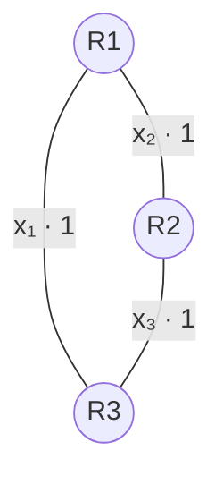

# Lampiran — Weighted Constraint Coupling (WCC)

WCC menghitung berapa banyak variabel keputusan yang dipakai bersama oleh kendala. P1–P8 memakai **graf kendala lengkap yang sama pada setiap tingkat**. Lihat [hasil penghitungan P1–P8](#3-audit-formulasi-p1p8). Pembagi diperoleh dengan menjumlahkan batas bobot yang benar-benar diizinkan untuk setiap pasangan baris. [Model matematika Profil 1](math_model_acuan/Model_Matematika.md)

## 1. Cara membaca bobot pasangan

Ambil tiga persamaan ini.

```math
\begin{aligned}
\text{R1}\quad &x_1+x_2=5,\\
\text{R2}\quad &x_2+x_3=4,\\
\text{R3}\quad &x_1+x_3=7.
\end{aligned}
```

Setiap lingkaran adalah satu baris kendala. Label pada garis menunjukkan variabel yang digunakan bersama dan bobot garis.



| Pasangan | Variabel yang muncul di kedua baris | Bobot |
| --- | --- | ---: |
| R1–R2 | $x_2$ | 1 |
| R1–R3 | $x_1$ | 1 |
| R2–R3 | $x_3$ | 1 |

Bobot aktual totalnya $1+1+1=3$. Dengan tiga baris, ada tiga pasangan. Secara umum, $m$ baris menghasilkan $m(m-1)/2$ pasangan. Setiap baris bisa dipasangkan dengan $m-1$ baris lain, lalu hasilnya dibagi dua karena pasangan R1–R2 dan R2–R1 dihitung satu kali. Pasangan dengan irisan kosong tetap terdaftar dengan bobot nol.

Untuk kendala linear, gabungkan dahulu semua suku dengan variabel berindeks sama. Ambil variabel dengan koefisien akhir selain nol. Suku $2x_1$ menyumbang satu kemunculan $x_1$, sama seperti suku $x_1$. Pada model berindeks, $z_{1,1,A}$ dan $z_{2,1,A}$ adalah dua keputusan berbeda karena gudangnya berbeda.

## 2. Cara menetapkan penyebut bersama

### 2.1 Contoh empat kendala dengan NNZ berbeda

NNZ (*number of nonzeros*) adalah jumlah koefisien selain nol setelah suku sejenis digabungkan. Pada satu baris kendala linear, ini sama dengan jumlah variabel yang muncul pada baris.

```math
\begin{aligned}
\text{R1}\quad &x_1+x_2=2,\\
\text{R2}\quad &2x_1+x_2+x_3=4,\\
\text{R3}\quad &x_1+x_4+x_5+x_6=4,\\
\text{R4}\quad &x_3+x_4+x_5+x_6+x_7=5.
\end{aligned}
```

Misalkan desain contoh ini menetapkan batas NNZ acuan R1–R4 sebesar **2, 3, 4, dan 5**. Jika yang diketahui hanya batas NNZ, dua baris paling banyak bisa berbagi sebanyak ukuran daftar yang lebih pendek. R1–R2, misalnya, paling banyak berbagi 2 variabel karena R1 hanya memuat 2. Batas tersebut dihitung untuk setiap pasangan.

| Pasangan | Batas NNZ kedua baris | Batas bobot dari NNZ | Variabel bersama aktual | Bobot aktual |
| --- | ---: | ---: | --- | ---: |
| R1–R2 | 2 dan 3 | 2 | $x_1,x_2$ | 2 |
| R1–R3 | 2 dan 4 | 2 | $x_1$ | 1 |
| R1–R4 | 2 dan 5 | 2 | — | 0 |
| R2–R3 | 3 dan 4 | 3 | $x_1$ | 1 |
| R2–R4 | 3 dan 5 | 3 | $x_3$ | 1 |
| R3–R4 | 4 dan 5 | 4 | $x_4,x_5,x_6$ | 3 |
| **Total** | | **16** | | **8** |

Penyebutnya $2+2+2+3+3+4=16$. WCC contoh ini adalah $8/16\times100\%=50\%$. Batas 2, 3, atau 4 mengikuti kemampuan masing-masing pasangan. Jika keempat batas NNZ itu menjadi bagian dari satu desain tingkat Low, Medium, dan High, ketiganya menggunakan penyebut 16. Isi kendala aktual pada masing-masing tingkat menentukan pembilangnya.

### 2.2 Perketat batas dengan daftar variabel yang diizinkan

Dalam kasus nyata, aturan jaringan bisa lebih informatif daripada NNZ. Kapasitas P1 dan kapasitas P4, misalnya, hanya memakai variabel pengiriman dari pabriknya masing-masing. Indeks pabrik berbeda, sehingga batas pasangan itu memang **0**, berapa pun NNZ kedua baris.

Untuk setiap posisi baris $r$, tetapkan $U_r^{\mathrm{ref}}$, yaitu daftar variabel yang diizinkan muncul oleh desain acuan. Bila desain juga mempunyai batas NNZ independen, sebut $d_r^{\mathrm{ref}}$ sebagai batasnya. Maka batas satu pasangan dapat dihitung sebagai berikut.

```math
b_{rs}^{\mathrm{ref}}=
\min\!\left(
d_r^{\mathrm{ref}},
d_s^{\mathrm{ref}},
\lvert U_r^{\mathrm{ref}}\cap U_s^{\mathrm{ref}}\rvert
\right).
```

Pada Profil 1, jalur yang diizinkan menentukan seluruh daftar variabel per baris. Nilai $d_r^{\mathrm{ref}}$ sama dengan ukuran daftar $U_r^{\mathrm{ref}}$, sehingga kita cukup menghitung irisannya. Bekukan daftar acuan dan pemetaan ID sebelum penilaian. Untuk setiap tingkat $\ell$, $S_r^{(\ell)}$ adalah daftar variabel dari kendala yang benar-benar ditulis pada tingkat itu.

```math
\begin{aligned}
w_{rs}^{(\ell)} &= \lvert S_r^{(\ell)}\cap S_s^{(\ell)}\rvert,\\
B_\ell &= \sum_{(r,s)\in P} w_{rs}^{(\ell)},\\
D_{\mathrm{ref}} &= \sum_{(r,s)\in P} b_{rs}^{\mathrm{ref}},\\
\mathrm{WCC}_\ell &= 100\%\times\frac{B_\ell}{D_{\mathrm{ref}}}.
\end{aligned}
```

Di sini $P$ adalah daftar pasangan posisi baris yang sama untuk semua tingkat. Pembaginya positif selama sedikitnya satu pasangan bisa berbagi variabel.

## 3. Audit formulasi P1–P8

Tiap model acuan memiliki 130 posisi baris. Sebanyak 117 posisi berasal dari 39 kendala operasi pada masing-masing dari tiga blok skenario. R118 membatasi emisi. R119–R130 membatasi waktu penanganan di empat gudang, masing-masing per skenario.

| Tingkat | Variabel | Pasangan berbobot positif | Bobot aktual | Bobot acuan | WCC P1–P8 |
| --- | ---: | ---: | ---: | ---: | ---: |
| Low | 145 | 555 | 1.158 | 2.370 | 48,86% |
| Medium | 190 | 657 | 1.482 | 2.370 | 62,53% |
| High | 268 | 843 | 2.010 | 2.370 | 84,81% |

Batas bobot berasal dari jaringan acuan dengan 34 rute masuk dan 66 rute keluar di setiap skenario. Keputusan membuka gudang muncul pada tujuh baris. Tiap variabel arus masuk muncul pada tiga baris. Tiap variabel arus keluar muncul pada lima baris. Variabel yang muncul pada tujuh baris menyumbang 21 pasangan, pada tiga baris menyumbang tiga pasangan, dan pada lima baris menyumbang sepuluh pasangan. Maka pembagi bersama adalah $4(21)+3(34)(3)+3(66)(10)=2370$.

Sebagai contoh, variabel $x_{1,1,A,1}$ muncul pada kapasitas P1 dan neraca G1–A di skenario Sepi. Kedua baris ini terhubung karena keduanya memakai kiriman yang sama. Batas emisi juga memuat kiriman itu. R1 dan R7 berbobot satu dari variabel tersebut. Pasangan R1–R118 dan R7–R118 masing-masing juga memperoleh satu unit bobot dari variabel yang sama.

Audit mencatat semua 8.385 pasangan, termasuk pasangan berbobot nol. Identitas arus mencakup jenis arus, fasilitas, produk, dan skenario. Pada tiap tingkat, semua profil mempunyai pola kemunculan variabel yang sama pada setiap baris. Suku kuadratik waktu memakai arus yang sudah tercakup dalam suku linear waktu, sehingga pergantian linearitas mempertahankan graf.

[CSV audit pasangan](math_model_acuan/hasil/Audit_WCC_Pasangan.csv) · [Model acuan P1–P8](math_model_acuan/Model_Matematika.md)
