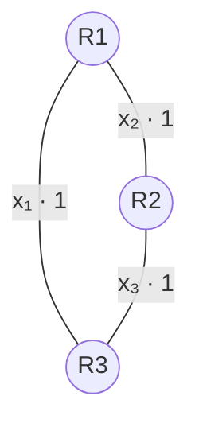

# Lampiran — Weighted Constraint Coupling (WCC)

WCC menghitung berapa banyak variabel keputusan yang dipakai bersama oleh kendala. Pada Profil 1, seluruh tingkat dinilai pada **satu skala acuan**. Pembagi diperoleh dengan menjumlahkan batas bobot yang benar-benar diizinkan untuk setiap pasangan baris. [Model matematika Profil 1](math_model_acuan/P1/Model_Matematika.md)

## 1. Cara membaca bobot pasangan

Ambil tiga persamaan ini.

```math
\begin{aligned}
\text{R1}\quad &x_1+x_2=5,\\
\text{R2}\quad &x_2+x_3=4,\\
\text{R3}\quad &x_1+x_3=7.
\end{aligned}
```

Setiap lingkaran adalah satu baris kendala. Label pada garis menunjukkan variabel yang digunakan bersama dan bobot garis.



| Pasangan | Variabel yang muncul di kedua baris | Bobot |
| --- | --- | ---: |
| R1–R2 | $x_2$ | 1 |
| R1–R3 | $x_1$ | 1 |
| R2–R3 | $x_3$ | 1 |

Bobot aktual totalnya $1+1+1=3$. Dengan tiga baris, ada tiga pasangan. Secara umum, $m$ baris menghasilkan $m(m-1)/2$ pasangan. Setiap baris bisa dipasangkan dengan $m-1$ baris lain, lalu hasilnya dibagi dua karena pasangan R1–R2 dan R2–R1 dihitung satu kali. Pasangan dengan irisan kosong tetap terdaftar dengan bobot nol.

Untuk kendala linear, gabungkan dahulu semua suku dengan variabel berindeks sama. Ambil variabel dengan koefisien akhir selain nol. Suku $2x_1$ menyumbang satu kemunculan $x_1$, sama seperti suku $x_1$. Pada model berindeks, $z_{1,1,A}$ dan $z_{2,1,A}$ adalah dua keputusan berbeda karena gudangnya berbeda.

## 2. Cara menetapkan penyebut bersama

### 2.1 Contoh empat kendala dengan NNZ berbeda

NNZ (*number of nonzeros*) adalah jumlah koefisien selain nol setelah suku sejenis digabungkan. Pada satu baris kendala linear, ini sama dengan jumlah variabel yang muncul pada baris.

```math
\begin{aligned}
\text{R1}\quad &x_1+x_2=2,\\
\text{R2}\quad &2x_1+x_2+x_3=4,\\
\text{R3}\quad &x_1+x_4+x_5+x_6=4,\\
\text{R4}\quad &x_3+x_4+x_5+x_6+x_7=5.
\end{aligned}
```

Misalkan desain contoh ini menetapkan batas NNZ acuan R1–R4 sebesar **2, 3, 4, dan 5**. Jika yang diketahui hanya batas NNZ, dua baris paling banyak bisa berbagi sebanyak ukuran daftar yang lebih pendek. R1–R2, misalnya, paling banyak berbagi 2 variabel karena R1 hanya memuat 2. Batas tersebut dihitung untuk setiap pasangan.

| Pasangan | Batas NNZ kedua baris | Batas bobot dari NNZ | Variabel bersama aktual | Bobot aktual |
| --- | ---: | ---: | --- | ---: |
| R1–R2 | 2 dan 3 | 2 | $x_1,x_2$ | 2 |
| R1–R3 | 2 dan 4 | 2 | $x_1$ | 1 |
| R1–R4 | 2 dan 5 | 2 | — | 0 |
| R2–R3 | 3 dan 4 | 3 | $x_1$ | 1 |
| R2–R4 | 3 dan 5 | 3 | $x_3$ | 1 |
| R3–R4 | 4 dan 5 | 4 | $x_4,x_5,x_6$ | 3 |
| **Total** | | **16** | | **8** |

Penyebutnya $2+2+2+3+3+4=16$. WCC contoh ini adalah $8/16\times100\%=50\%$. Batas 2, 3, atau 4 mengikuti kemampuan masing-masing pasangan. Jika keempat batas NNZ itu menjadi bagian dari satu desain tingkat Low, Medium, dan High, ketiganya menggunakan penyebut 16. Isi kendala aktual pada masing-masing tingkat menentukan pembilangnya.

### 2.2 Perketat batas dengan daftar variabel yang diizinkan

Dalam kasus nyata, aturan jaringan bisa lebih informatif daripada NNZ. Kapasitas P1 dan kapasitas P4, misalnya, hanya memakai variabel pengiriman dari pabriknya masing-masing. Indeks pabrik berbeda, sehingga batas pasangan itu memang **0**, berapa pun NNZ kedua baris.

Untuk setiap posisi baris $r$, tetapkan $U_r^{\mathrm{ref}}$, yaitu daftar variabel yang diizinkan muncul oleh desain acuan. Bila desain juga mempunyai batas NNZ independen, sebut $d_r^{\mathrm{ref}}$ sebagai batasnya. Maka batas satu pasangan dapat dihitung sebagai berikut.

```math
b_{rs}^{\mathrm{ref}}=
\min\!\left(
d_r^{\mathrm{ref}},
d_s^{\mathrm{ref}},
\lvert U_r^{\mathrm{ref}}\cap U_s^{\mathrm{ref}}\rvert
\right).
```

Pada Profil 1, jalur yang diizinkan menentukan seluruh daftar variabel per baris. Nilai $d_r^{\mathrm{ref}}$ sama dengan ukuran daftar $U_r^{\mathrm{ref}}$, sehingga kita cukup menghitung irisannya. Bekukan daftar acuan dan pemetaan ID sebelum penilaian. Untuk setiap tingkat $\ell$, $S_r^{(\ell)}$ adalah daftar variabel dari kendala yang benar-benar ditulis pada tingkat itu.

```math
\begin{aligned}
w_{rs}^{(\ell)} &= \lvert S_r^{(\ell)}\cap S_s^{(\ell)}\rvert,\\
B_\ell &= \sum_{(r,s)\in P} w_{rs}^{(\ell)},\\
D_{\mathrm{ref}} &= \sum_{(r,s)\in P} b_{rs}^{\mathrm{ref}},\\
\mathrm{WCC}_\ell &= 100\%\times\frac{B_\ell}{D_{\mathrm{ref}}}.
\end{aligned}
```

Di sini $P$ adalah daftar pasangan posisi baris yang sama untuk semua tingkat. Pembaginya positif selama sedikitnya satu pasangan bisa berbagi variabel.

## 3. Studi kasus P1 · seluruh kendala berindeks

Enam pabrik memasok empat calon gudang yang melayani enam pelanggan dan tiga produk. Pesanan tetap sama pada setiap tingkat. Rute pengiriman bertambah dari Low ke Medium dan dari Medium ke High. R1–R39 adalah daftar posisi bersama untuk audit. Ada enam batas kapasitas pabrik, sebelas neraca gudang–produk, delapan belas persamaan permintaan dan empat batas kapasitas gudang.

### 3.1 Pecah setiap keluarga menjadi baris

R1–R6 mengikuti urutan pabrik. R7–R17 mengikuti urutan gudang dan produk. R18–R35 mengikuti urutan pelanggan dan produk. R36–R39 mengikuti urutan gudang.

<details open>
<summary>Low · kendala R1–R39</summary>

| ID | Fungsi baris | Kendala | NNZ |
| --- | --- | --- | ---: |
| R1 | Kapasitas P1 | $x_{1,1,A}+x_{1,2,A}+x_{1,4,A}\le 8$ | 3 |
| R2 | Kapasitas P2 | $x_{2,1,B}+x_{2,3,B}+x_{2,4,B}\le 8$ | 3 |
| R3 | Kapasitas P3 | $x_{3,1,B}+x_{3,3,B}+x_{3,4,B}\le 8$ | 3 |
| R4 | Kapasitas P4 | $x_{4,2,C}+x_{4,3,C}\le 8$ | 2 |
| R5 | Kapasitas P5 | $x_{5,1,A}+x_{5,2,A}+x_{5,4,A}\le 8$ | 3 |
| R6 | Kapasitas P6 | $x_{6,2,C}+x_{6,3,C}\le 8$ | 2 |
| R7 | Neraca G1–A | $x_{1,1,A}+x_{5,1,A}=z_{1,1,A}$ | 3 |
| R8 | Neraca G1–B | $x_{2,1,B}+x_{3,1,B}=z_{1,1,B}+z_{1,2,B}+z_{1,3,B}+z_{1,4,B}+z_{1,5,B}+z_{1,6,B}$ | 8 |
| R9 | Neraca G2–A | $x_{1,2,A}+x_{5,2,A}=z_{2,1,A}+z_{2,2,A}+z_{2,3,A}+z_{2,4,A}+z_{2,5,A}+z_{2,6,A}$ | 8 |
| R10 | Neraca G2–B | $0=0$ | 0 |
| R11 | Neraca G2–C | $x_{4,2,C}+x_{6,2,C}=z_{2,1,C}+z_{2,2,C}+z_{2,3,C}+z_{2,4,C}+z_{2,5,C}+z_{2,6,C}$ | 8 |
| R12 | Neraca G3–A | $0=0$ | 0 |
| R13 | Neraca G3–B | $x_{2,3,B}+x_{3,3,B}=z_{3,1,B}+z_{3,2,B}+z_{3,3,B}+z_{3,4,B}+z_{3,5,B}+z_{3,6,B}$ | 8 |
| R14 | Neraca G3–C | $x_{4,3,C}+x_{6,3,C}=z_{3,2,C}+z_{3,4,C}$ | 4 |
| R15 | Neraca G4–A | $x_{1,4,A}+x_{5,4,A}=z_{4,2,A}$ | 3 |
| R16 | Neraca G4–B | $x_{2,4,B}+x_{3,4,B}=z_{4,2,B}+z_{4,4,B}+z_{4,6,B}$ | 5 |
| R17 | Neraca G4–C | $0=0$ | 0 |
| R18 | Permintaan K1–A | $z_{1,1,A}+z_{2,1,A}=3$ | 2 |
| R19 | Permintaan K1–B | $z_{1,1,B}+z_{3,1,B}=1$ | 2 |
| R20 | Permintaan K1–C | $z_{2,1,C}=1$ | 1 |
| R21 | Permintaan K2–A | $z_{2,2,A}+z_{4,2,A}=3$ | 2 |
| R22 | Permintaan K2–B | $z_{1,2,B}+z_{3,2,B}+z_{4,2,B}=1$ | 3 |
| R23 | Permintaan K2–C | $z_{2,2,C}+z_{3,2,C}=1$ | 2 |
| R24 | Permintaan K3–A | $z_{2,3,A}=1$ | 1 |
| R25 | Permintaan K3–B | $z_{1,3,B}+z_{3,3,B}=3$ | 2 |
| R26 | Permintaan K3–C | $z_{2,3,C}=1$ | 1 |
| R27 | Permintaan K4–A | $z_{2,4,A}=1$ | 1 |
| R28 | Permintaan K4–B | $z_{1,4,B}+z_{3,4,B}+z_{4,4,B}=3$ | 3 |
| R29 | Permintaan K4–C | $z_{2,4,C}+z_{3,4,C}=1$ | 2 |
| R30 | Permintaan K5–A | $z_{2,5,A}=1$ | 1 |
| R31 | Permintaan K5–B | $z_{1,5,B}+z_{3,5,B}=1$ | 2 |
| R32 | Permintaan K5–C | $z_{2,5,C}=3$ | 1 |
| R33 | Permintaan K6–A | $z_{2,6,A}=1$ | 1 |
| R34 | Permintaan K6–B | $z_{1,6,B}+z_{3,6,B}+z_{4,6,B}=1$ | 3 |
| R35 | Permintaan K6–C | $z_{2,6,C}=3$ | 1 |
| R36 | Kapasitas G1 | $z_{1,1,A}+z_{1,1,B}+z_{1,2,B}+z_{1,3,B}+z_{1,4,B}+z_{1,5,B}+z_{1,6,B}\le 16y_{1}$ | 8 |
| R37 | Kapasitas G2 | $z_{2,1,A}+z_{2,1,C}+z_{2,2,A}+z_{2,2,C}+z_{2,3,A}+z_{2,3,C}+z_{2,4,A}+z_{2,4,C}+z_{2,5,A}+z_{2,5,C}+z_{2,6,A}+z_{2,6,C}\le 20y_{2}$ | 13 |
| R38 | Kapasitas G3 | $z_{3,1,B}+z_{3,2,B}+z_{3,2,C}+z_{3,3,B}+z_{3,4,B}+z_{3,4,C}+z_{3,5,B}+z_{3,6,B}\le 18y_{3}$ | 9 |
| R39 | Kapasitas G4 | $z_{4,2,A}+z_{4,2,B}+z_{4,4,B}+z_{4,6,B}\le 14y_{4}$ | 5 |

</details>

<details>
<summary>Medium · kendala R1–R39</summary>

| ID | Fungsi baris | Kendala | NNZ |
| --- | --- | --- | ---: |
| R1 | Kapasitas P1 | $x_{1,1,A}+x_{1,1,B}+x_{1,2,A}+x_{1,2,B}+x_{1,3,B}+x_{1,4,A}+x_{1,4,B}\le 8$ | 7 |
| R2 | Kapasitas P2 | $x_{2,1,B}+x_{2,2,B}+x_{2,3,B}+x_{2,4,B}\le 8$ | 4 |
| R3 | Kapasitas P3 | $x_{3,1,B}+x_{3,2,B}+x_{3,3,B}+x_{3,4,B}\le 8$ | 4 |
| R4 | Kapasitas P4 | $x_{4,2,C}+x_{4,3,C}\le 8$ | 2 |
| R5 | Kapasitas P5 | $x_{5,1,A}+x_{5,2,A}+x_{5,4,A}\le 8$ | 3 |
| R6 | Kapasitas P6 | $x_{6,2,C}+x_{6,3,C}\le 8$ | 2 |
| R7 | Neraca G1–A | $x_{1,1,A}+x_{5,1,A}=z_{1,1,A}+z_{1,2,A}+z_{1,3,A}+z_{1,4,A}+z_{1,5,A}+z_{1,6,A}$ | 8 |
| R8 | Neraca G1–B | $x_{1,1,B}+x_{2,1,B}+x_{3,1,B}=z_{1,1,B}+z_{1,2,B}+z_{1,3,B}+z_{1,4,B}+z_{1,5,B}+z_{1,6,B}$ | 9 |
| R9 | Neraca G2–A | $x_{1,2,A}+x_{5,2,A}=z_{2,1,A}+z_{2,2,A}+z_{2,3,A}+z_{2,4,A}+z_{2,5,A}+z_{2,6,A}$ | 8 |
| R10 | Neraca G2–B | $x_{1,2,B}+x_{2,2,B}+x_{3,2,B}=0$ | 3 |
| R11 | Neraca G2–C | $x_{4,2,C}+x_{6,2,C}=z_{2,1,C}+z_{2,2,C}+z_{2,3,C}+z_{2,4,C}+z_{2,5,C}+z_{2,6,C}$ | 8 |
| R12 | Neraca G3–A | $0=0$ | 0 |
| R13 | Neraca G3–B | $x_{1,3,B}+x_{2,3,B}+x_{3,3,B}=z_{3,1,B}+z_{3,2,B}+z_{3,3,B}+z_{3,4,B}+z_{3,5,B}+z_{3,6,B}$ | 9 |
| R14 | Neraca G3–C | $x_{4,3,C}+x_{6,3,C}=z_{3,1,C}+z_{3,2,C}+z_{3,3,C}+z_{3,4,C}+z_{3,5,C}+z_{3,6,C}$ | 8 |
| R15 | Neraca G4–A | $x_{1,4,A}+x_{5,4,A}=z_{4,2,A}$ | 3 |
| R16 | Neraca G4–B | $x_{1,4,B}+x_{2,4,B}+x_{3,4,B}=z_{4,2,B}+z_{4,4,B}+z_{4,6,B}$ | 6 |
| R17 | Neraca G4–C | $0=0$ | 0 |
| R18 | Permintaan K1–A | $z_{1,1,A}+z_{2,1,A}=3$ | 2 |
| R19 | Permintaan K1–B | $z_{1,1,B}+z_{3,1,B}=1$ | 2 |
| R20 | Permintaan K1–C | $z_{2,1,C}+z_{3,1,C}=1$ | 2 |
| R21 | Permintaan K2–A | $z_{1,2,A}+z_{2,2,A}+z_{4,2,A}=3$ | 3 |
| R22 | Permintaan K2–B | $z_{1,2,B}+z_{3,2,B}+z_{4,2,B}=1$ | 3 |
| R23 | Permintaan K2–C | $z_{2,2,C}+z_{3,2,C}=1$ | 2 |
| R24 | Permintaan K3–A | $z_{1,3,A}+z_{2,3,A}=1$ | 2 |
| R25 | Permintaan K3–B | $z_{1,3,B}+z_{3,3,B}=3$ | 2 |
| R26 | Permintaan K3–C | $z_{2,3,C}+z_{3,3,C}=1$ | 2 |
| R27 | Permintaan K4–A | $z_{1,4,A}+z_{2,4,A}=1$ | 2 |
| R28 | Permintaan K4–B | $z_{1,4,B}+z_{3,4,B}+z_{4,4,B}=3$ | 3 |
| R29 | Permintaan K4–C | $z_{2,4,C}+z_{3,4,C}=1$ | 2 |
| R30 | Permintaan K5–A | $z_{1,5,A}+z_{2,5,A}=1$ | 2 |
| R31 | Permintaan K5–B | $z_{1,5,B}+z_{3,5,B}=1$ | 2 |
| R32 | Permintaan K5–C | $z_{2,5,C}+z_{3,5,C}=3$ | 2 |
| R33 | Permintaan K6–A | $z_{1,6,A}+z_{2,6,A}=1$ | 2 |
| R34 | Permintaan K6–B | $z_{1,6,B}+z_{3,6,B}+z_{4,6,B}=1$ | 3 |
| R35 | Permintaan K6–C | $z_{2,6,C}+z_{3,6,C}=3$ | 2 |
| R36 | Kapasitas G1 | $z_{1,1,A}+z_{1,1,B}+z_{1,2,A}+z_{1,2,B}+z_{1,3,A}+z_{1,3,B}+z_{1,4,A}+z_{1,4,B}+z_{1,5,A}+z_{1,5,B}+z_{1,6,A}+z_{1,6,B}\le 16y_{1}$ | 13 |
| R37 | Kapasitas G2 | $z_{2,1,A}+z_{2,1,C}+z_{2,2,A}+z_{2,2,C}+z_{2,3,A}+z_{2,3,C}+z_{2,4,A}+z_{2,4,C}+z_{2,5,A}+z_{2,5,C}+z_{2,6,A}+z_{2,6,C}\le 20y_{2}$ | 13 |
| R38 | Kapasitas G3 | $z_{3,1,B}+z_{3,1,C}+z_{3,2,B}+z_{3,2,C}+z_{3,3,B}+z_{3,3,C}+z_{3,4,B}+z_{3,4,C}+z_{3,5,B}+z_{3,5,C}+z_{3,6,B}+z_{3,6,C}\le 18y_{3}$ | 13 |
| R39 | Kapasitas G4 | $z_{4,2,A}+z_{4,2,B}+z_{4,4,B}+z_{4,6,B}\le 14y_{4}$ | 5 |

</details>

<details>
<summary>High · kendala R1–R39</summary>

| ID | Fungsi baris | Kendala | NNZ |
| --- | --- | --- | ---: |
| R1 | Kapasitas P1 | $x_{1,1,A}+x_{1,1,B}+x_{1,2,A}+x_{1,2,B}+x_{1,3,A}+x_{1,3,B}+x_{1,4,A}+x_{1,4,B}\le 8$ | 8 |
| R2 | Kapasitas P2 | $x_{2,1,B}+x_{2,2,B}+x_{2,3,B}+x_{2,4,B}\le 8$ | 4 |
| R3 | Kapasitas P3 | $x_{3,1,A}+x_{3,1,B}+x_{3,2,A}+x_{3,2,B}+x_{3,3,A}+x_{3,3,B}+x_{3,4,A}+x_{3,4,B}\le 8$ | 8 |
| R4 | Kapasitas P4 | $x_{4,1,B}+x_{4,2,B}+x_{4,2,C}+x_{4,3,B}+x_{4,3,C}+x_{4,4,B}+x_{4,4,C}\le 8$ | 7 |
| R5 | Kapasitas P5 | $x_{5,1,A}+x_{5,2,A}+x_{5,3,A}+x_{5,4,A}\le 8$ | 4 |
| R6 | Kapasitas P6 | $x_{6,2,C}+x_{6,3,C}+x_{6,4,C}\le 8$ | 3 |
| R7 | Neraca G1–A | $x_{1,1,A}+x_{3,1,A}+x_{5,1,A}=z_{1,1,A}+z_{1,2,A}+z_{1,3,A}+z_{1,4,A}+z_{1,5,A}+z_{1,6,A}$ | 9 |
| R8 | Neraca G1–B | $x_{1,1,B}+x_{2,1,B}+x_{3,1,B}+x_{4,1,B}=z_{1,1,B}+z_{1,2,B}+z_{1,3,B}+z_{1,4,B}+z_{1,5,B}+z_{1,6,B}$ | 10 |
| R9 | Neraca G2–A | $x_{1,2,A}+x_{3,2,A}+x_{5,2,A}=z_{2,1,A}+z_{2,2,A}+z_{2,3,A}+z_{2,4,A}+z_{2,5,A}+z_{2,6,A}$ | 9 |
| R10 | Neraca G2–B | $x_{1,2,B}+x_{2,2,B}+x_{3,2,B}+x_{4,2,B}=z_{2,1,B}+z_{2,3,B}+z_{2,5,B}$ | 7 |
| R11 | Neraca G2–C | $x_{4,2,C}+x_{6,2,C}=z_{2,1,C}+z_{2,2,C}+z_{2,3,C}+z_{2,4,C}+z_{2,5,C}+z_{2,6,C}$ | 8 |
| R12 | Neraca G3–A | $x_{1,3,A}+x_{3,3,A}+x_{5,3,A}=z_{3,1,A}+z_{3,3,A}+z_{3,5,A}$ | 6 |
| R13 | Neraca G3–B | $x_{1,3,B}+x_{2,3,B}+x_{3,3,B}+x_{4,3,B}=z_{3,1,B}+z_{3,2,B}+z_{3,3,B}+z_{3,4,B}+z_{3,5,B}+z_{3,6,B}$ | 10 |
| R14 | Neraca G3–C | $x_{4,3,C}+x_{6,3,C}=z_{3,1,C}+z_{3,2,C}+z_{3,3,C}+z_{3,4,C}+z_{3,5,C}+z_{3,6,C}$ | 8 |
| R15 | Neraca G4–A | $x_{1,4,A}+x_{3,4,A}+x_{5,4,A}=z_{4,2,A}+z_{4,4,A}+z_{4,6,A}$ | 6 |
| R16 | Neraca G4–B | $x_{1,4,B}+x_{2,4,B}+x_{3,4,B}+x_{4,4,B}=z_{4,1,B}+z_{4,2,B}+z_{4,3,B}+z_{4,4,B}+z_{4,5,B}+z_{4,6,B}$ | 10 |
| R17 | Neraca G4–C | $x_{4,4,C}+x_{6,4,C}=z_{4,2,C}+z_{4,4,C}+z_{4,6,C}$ | 5 |
| R18 | Permintaan K1–A | $z_{1,1,A}+z_{2,1,A}+z_{3,1,A}=3$ | 3 |
| R19 | Permintaan K1–B | $z_{1,1,B}+z_{2,1,B}+z_{3,1,B}+z_{4,1,B}=1$ | 4 |
| R20 | Permintaan K1–C | $z_{2,1,C}+z_{3,1,C}=1$ | 2 |
| R21 | Permintaan K2–A | $z_{1,2,A}+z_{2,2,A}+z_{4,2,A}=3$ | 3 |
| R22 | Permintaan K2–B | $z_{1,2,B}+z_{3,2,B}+z_{4,2,B}=1$ | 3 |
| R23 | Permintaan K2–C | $z_{2,2,C}+z_{3,2,C}+z_{4,2,C}=1$ | 3 |
| R24 | Permintaan K3–A | $z_{1,3,A}+z_{2,3,A}+z_{3,3,A}=1$ | 3 |
| R25 | Permintaan K3–B | $z_{1,3,B}+z_{2,3,B}+z_{3,3,B}+z_{4,3,B}=3$ | 4 |
| R26 | Permintaan K3–C | $z_{2,3,C}+z_{3,3,C}=1$ | 2 |
| R27 | Permintaan K4–A | $z_{1,4,A}+z_{2,4,A}+z_{4,4,A}=1$ | 3 |
| R28 | Permintaan K4–B | $z_{1,4,B}+z_{3,4,B}+z_{4,4,B}=3$ | 3 |
| R29 | Permintaan K4–C | $z_{2,4,C}+z_{3,4,C}+z_{4,4,C}=1$ | 3 |
| R30 | Permintaan K5–A | $z_{1,5,A}+z_{2,5,A}+z_{3,5,A}=1$ | 3 |
| R31 | Permintaan K5–B | $z_{1,5,B}+z_{2,5,B}+z_{3,5,B}+z_{4,5,B}=1$ | 4 |
| R32 | Permintaan K5–C | $z_{2,5,C}+z_{3,5,C}=3$ | 2 |
| R33 | Permintaan K6–A | $z_{1,6,A}+z_{2,6,A}+z_{4,6,A}=1$ | 3 |
| R34 | Permintaan K6–B | $z_{1,6,B}+z_{3,6,B}+z_{4,6,B}=1$ | 3 |
| R35 | Permintaan K6–C | $z_{2,6,C}+z_{3,6,C}+z_{4,6,C}=3$ | 3 |
| R36 | Kapasitas G1 | $z_{1,1,A}+z_{1,1,B}+z_{1,2,A}+z_{1,2,B}+z_{1,3,A}+z_{1,3,B}+z_{1,4,A}+z_{1,4,B}+z_{1,5,A}+z_{1,5,B}+z_{1,6,A}+z_{1,6,B}\le 16y_{1}$ | 13 |
| R37 | Kapasitas G2 | $z_{2,1,A}+z_{2,1,B}+z_{2,1,C}+z_{2,2,A}+z_{2,2,C}+z_{2,3,A}+z_{2,3,B}+z_{2,3,C}+z_{2,4,A}+z_{2,4,C}+z_{2,5,A}+z_{2,5,B}+z_{2,5,C}+z_{2,6,A}+z_{2,6,C}\le 20y_{2}$ | 16 |
| R38 | Kapasitas G3 | $z_{3,1,A}+z_{3,1,B}+z_{3,1,C}+z_{3,2,B}+z_{3,2,C}+z_{3,3,A}+z_{3,3,B}+z_{3,3,C}+z_{3,4,B}+z_{3,4,C}+z_{3,5,A}+z_{3,5,B}+z_{3,5,C}+z_{3,6,B}+z_{3,6,C}\le 18y_{3}$ | 16 |
| R39 | Kapasitas G4 | $z_{4,1,B}+z_{4,2,A}+z_{4,2,B}+z_{4,2,C}+z_{4,3,B}+z_{4,4,A}+z_{4,4,B}+z_{4,4,C}+z_{4,5,B}+z_{4,6,A}+z_{4,6,B}+z_{4,6,C}\le 14y_{4}$ | 13 |

</details>

### 3.2 Contoh irisan dari baris yang sudah ditulis

Pada Low, R1 memuat $x_{1,1,A}$, $x_{1,2,A}$, dan $x_{1,4,A}$. R7 memuat $x_{1,1,A}$, $x_{5,1,A}$, dan $z_{1,1,A}$. Irisan R1–R7 adalah $x_{1,1,A}$ sehingga bobotnya satu.

R18 memenuhi kebutuhan A di K1. Variabel $z_{1,1,A}$ muncul di R18, neraca G1–A pada R7, dan kapasitas G1 pada R36. Variabel itu menyumbang satu bobot pada masing-masing pasangan R7–R18, R7–R36, dan R18–R36. Arus masuk dan keluar dibedakan berdasarkan identitas variabel dan seluruh indeksnya.

R1 dan R2 masing-masing mempunyai variabel kiriman dari pabrik berbeda. Keduanya tidak punya variabel bersama. Batas bobot pasangannya nol di jaringan acuan, sehingga sumbangannya ke pembagi juga nol. Pasangan tetap tercatat pada CSV.

### 3.3 Jumlahkan 741 pasangan

| Kelompok pasangan | Jumlah pasangan | Bobot Low | Bobot Medium | Bobot High | Batas acuan |
| --- | ---: | ---: | ---: | ---: | ---: |
| Kapasitas pabrik × kapasitas pabrik | 15 | 0 | 0 | 0 | 0 |
| Kapasitas pabrik × neraca gudang–produk | 66 | 16 | 22 | 34 | 34 |
| Kapasitas pabrik × permintaan | 108 | 0 | 0 | 0 | 0 |
| Kapasitas pabrik × kapasitas gudang | 24 | 0 | 0 | 0 | 0 |
| Neraca × neraca | 55 | 0 | 0 | 0 | 0 |
| Neraca × permintaan | 198 | 31 | 40 | 54 | 66 |
| Neraca × kapasitas gudang | 44 | 31 | 40 | 54 | 66 |
| Permintaan × permintaan | 153 | 0 | 0 | 0 | 0 |
| Permintaan × kapasitas gudang | 72 | 31 | 40 | 54 | 66 |
| Kapasitas gudang × kapasitas gudang | 6 | 0 | 0 | 0 | 0 |
| **Total** | 741 | 109 | 142 | 196 | 232 |

Setiap rute masuk menyumbang satu dan setiap rute keluar menyumbang tiga. Pada Low, pembilangnya $16+3(31)=109$. Pada Medium, hasilnya $22+3(40)=142$. Pada High, hasilnya $34+3(54)=196$. Untuk penyebut, jaringan kompatibilitas penuh memuat 34 rute masuk dan 66 rute keluar, sehingga $34+3(66)=232$.

| Tingkat | Bobot aktual | Penyebut bersama | WCC |
| --- | ---: | ---: | ---: |
| Low | 109 | 232 | 46,98% |
| Medium | 142 | 232 | 61,21% |
| High | 196 | 232 | 84,48% |

[CSV seluruh pasangan P1](math_model_acuan/P1/Audit_WCC_Pasangan.csv)

## 4. Perbandingan P1, P2, dan P3

| Cakupan | Low | Medium | High | Audit rinci |
| --- | ---: | ---: | ---: | --- |
| Jaringan P1 (R1–R39) | 46,98% | 61,21% | 84,48% | [Audit P1](math_model_acuan/P1/Audit_WCC.md) |
| Formulasi P2 tiga skenario | 47,88% | 61,86% | 84,75% | [Audit P2](math_model_acuan/P2/Audit_WCC.md) |
| Formulasi P3 dengan R40 | 47,41% | 61,75% | 85,66% | [Audit P3](math_model_acuan/P3/Audit_WCC.md) |

Gunakan R1–R39 sebagai skala bersama untuk membandingkan jaringan. Pada P2 perbandingan memakai satu blok skenario. Pada P3 perbandingan memakai kendala operasi. Audit formulasi lengkap P2 menghitung hubungan lintas skenario. Audit P3 dengan batas emisi menghitung R40.

WCC mendeskripsikan irisan variabel pada formulasi. Besaran kapasitas, tarif, ketatnya batas emisi, dan keputusan gudang yang layak dapat berubah sementara identitas variabel pada setiap baris tetap sama. [Hasil benchmark dan uji kapasitas](math_model_acuan/Hasil_Benchmark.md)

## Referensi

Penggunaan graf untuk merepresentasikan kendala dan variabel dapat dilihat pada [Gasse et al. (2019), Exact Combinatorial Optimization with Graph Convolutional Neural Networks](https://proceedings.neurips.cc/paper/2019/hash/d14c2267d848abeb81fd590f371d39bd-Abstract.html). Normalisasi terhadap ruang rute yang kompatibel di lampiran ini adalah aturan penghitungan untuk desain eksperimen ini.
