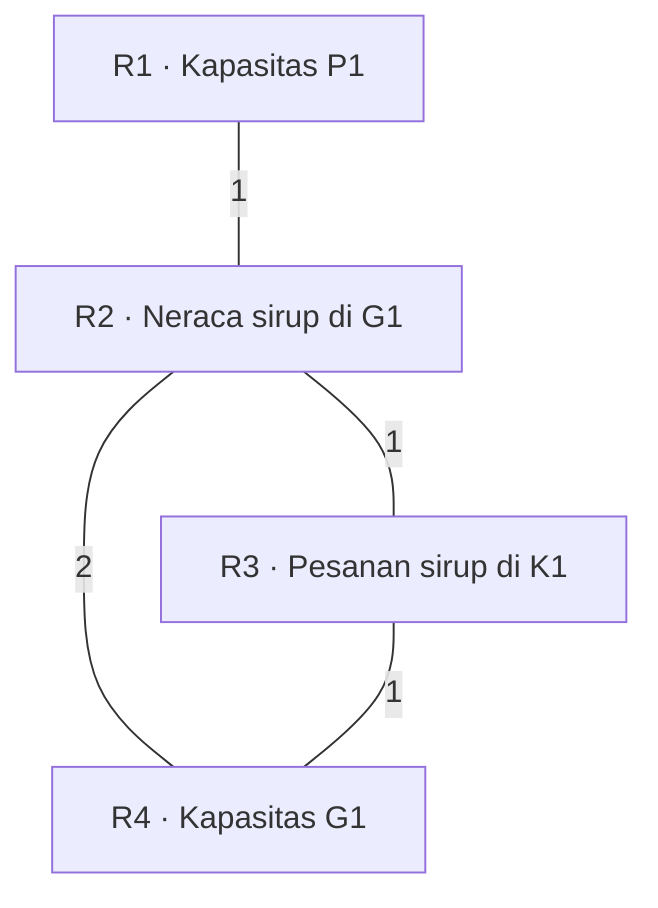

# Menghitung Weighted Constraint Coupling

*Weighted Constraint Coupling* (WCC) merangkum seberapa banyak keputusan yang dipakai bersama oleh pasangan kendala. Setiap kendala menjadi satu titik dalam graf. Bobot garis antara dua titik adalah jumlah **variabel keputusan yang sama persis** pada kedua kendala. Dua kendala yang berbagi tiga variabel mendapat bobot 3. Dua kendala tanpa variabel bersama mendapat bobot 0.

Untuk membandingkan Low, Medium, dan High, studi ini memakai **43 baris operasi dan satu penyebut bersama**. Pabrik, gudang, zona pelanggan, produk, dan aturan operasi pada profil yang sama tetap. Ketiga tingkat membedakan **rute pengiriman yang diizinkan**, sehingga variabel kiriman yang muncul pada aturan tersebut bisa bertambah.

## 1. Contoh kecil dari jaringan PT XYZ

Ambil produk B, yaitu sirup gula cair. Di Low, P1 sudah bisa mengirim sirup ke G1, dan G1 sudah bisa mengirim sirup ke K1. Di Medium, G1 juga diizinkan mengirim sirup ke K2.

| Keputusan | Notasi | Dibaca sebagai |
| --- | --- | --- |
| Kiriman masuk | $`x_{1,1,B}`$ | Ton sirup dari **pabrik P1** ke **gudang G1**. Urutan indeksnya pabrik, gudang, produk. |
| Kiriman keluar ke K1 | $`z_{1,1,B}`$ | Ton sirup dari **gudang G1** ke **zona K1**. Urutan indeksnya gudang, zona, produk. |
| Kiriman keluar ke K2 | $`z_{1,2,B}`$ | Ton sirup dari **gudang G1** ke **zona K2**. Tersedia mulai Medium. |
| Keputusan buka gudang | $`y_1`$ | Bernilai 1 jika G1 dibuka dan 0 jika G1 ditutup. |

Untuk mengenali satu variabel, cocokkan **huruf dan seluruh indeksnya**. Dua kiriman $`z_{1,1,B}`$ dan $`z_{1,2,B}`$ sama-sama sirup dari G1, tetapi tujuannya berbeda. Kiriman $`x_{1,1,B}`$ dan $`z_{1,1,B}`$ memiliki tiga indeks yang tampak sama, tetapi tahap pengirimannya berbeda.

### 1.1 Tulis kendalanya

Pilih empat baris operasi. Tabel hanya menampilkan suku yang melibatkan keputusan pada daftar sebelumnya. Model lengkap juga memasukkan kiriman lain yang relevan untuk tiap baris. R1–R4 adalah nomor untuk contoh ini.

| Baris | Aturan | Potongan kendala di Medium |
| --- | --- | --- |
| R1 | Kapasitas pabrik P1 | $`x_{1,1,B}\le 8`$ |
| R2 | Neraca sirup di G1 | $`x_{1,1,B}=z_{1,1,B}+z_{1,2,B}`$ |
| R3 | Pesanan sirup di K1 | $`z_{1,1,B}=1`$ |
| R4 | Kapasitas tonase G1 | $`z_{1,1,B}+z_{1,2,B}\le 16y_1`$ |

Baca R2 sebagai “sirup yang masuk ke G1 harus sama dengan sirup yang keluar dari G1”. Pada Low, rute sirup G1 → K2 belum tersedia, sehingga $`z_{1,2,B}`$ belum muncul pada R2 dan R4. Keempat aturan berlaku di kedua tingkat.

### 1.2 Hitung keenam pasangan baris

Mulai dari R1 dan pasangkan dengan tiga baris sesudahnya. Lalu pasangkan R2 dengan dua baris yang tersisa, dan terakhir pasangkan R3 dengan R4. Dengan cara ini, R1–R2 dihitung satu kali.

| Pasangan | Variabel yang muncul di kedua baris pada Low | Bobot Low | Variabel yang muncul di kedua baris pada Medium | Bobot Medium |
| --- | --- | ---: | --- | ---: |
| R1–R2 | $`x_{1,1,B}`$ | 1 | $`x_{1,1,B}`$ | 1 |
| R1–R3 | Tidak ada | 0 | Tidak ada | 0 |
| R1–R4 | Tidak ada | 0 | Tidak ada | 0 |
| R2–R3 | $`z_{1,1,B}`$ | 1 | $`z_{1,1,B}`$ | 1 |
| R2–R4 | $`z_{1,1,B}`$ | 1 | $`z_{1,1,B}`$ dan $`z_{1,2,B}`$ | 2 |
| R3–R4 | $`z_{1,1,B}`$ | 1 | $`z_{1,1,B}`$ | 1 |
| **Total bobot** | | **4** | | **5** |

Angka pada garis menunjukkan bobot tiap pasangan di Medium. Graf Low mempunyai garis yang sama, dengan bobot R2–R4 sebesar 1.

Tambahan rute G1 → K2 memperbesar bobot **satu garis yang sudah ada** pada potongan ini. Pada R3, zona yang diminta tetap K1. Kiriman ke K2 tidak ikut memenuhi pesanan K1, sehingga bobot R2–R3 dan R3–R4 tetap 1.

### 1.3 Pisahkan pembilang dan penyebut

Untuk contoh ini, acuan memakai empat baris yang sama dan mengizinkan ketiga rute kiriman pada tabel pertama, termasuk sirup dari G1 ke K2. Bobot tiap pasangan dihitung dari variabel yang muncul bersama. Setelah itu, kalikan **jumlah pasangan yang berbobot sama** dengan **bobot per pasangan**.

| Bobot per pasangan | Jumlah pasangan di Low | Sumbangan ke pembilang | Jumlah pasangan di acuan | Sumbangan ke penyebut |
| ---: | ---: | ---: | ---: | ---: |
| 0 | 2 | 2 × 0 = 0 | 2 | 2 × 0 = 0 |
| 1 | 4 | 4 × 1 = 4 | 3 | 3 × 1 = 3 |
| 2 | 0 | 0 × 2 = 0 | 1 | 1 × 2 = 2 |
| **Total** | **6** | **4** | **6** | **5** |

Satu pasangan yang berbobot 2 di acuan adalah **R2–R4**. Neraca sirup G1 dan kapasitas G1 sama-sama memuat dua keputusan kiriman, yaitu sirup ke K1 dan sirup ke K2. Pada Low, keduanya hanya berbagi kiriman sirup ke K1. Jadi pembilangnya **4** dari Low dan penyebutnya **5** dari acuan.

$$
\mathrm{WCC}_{\mathrm{contoh,\ Low}}
=\frac{4}{5}\times 100\%=80\%.
$$

Angka 6 pada tabel adalah jumlah **pasangan baris**. Penyebut 5 adalah **jumlah bobot keenam pasangan pada acuan**, termasuk pasangan berbobot 2. Jika Medium dibandingkan terhadap acuan contoh yang sama, hasilnya 5 ÷ 5 × 100% = 100%. Angka itu berarti bobot Medium menyamai bobot acuan pada empat baris contoh. Persentase jaringan lengkap dihitung pada Bagian 3.

### 1.4 Apa pengaruh NNZ yang berbeda?

**NNZ** (*number of nonzeros*) adalah jumlah koefisien yang bukan nol. Untuk satu baris linear, rapikan dulu persamaannya dan gabungkan suku dari variabel yang sama, lalu hitung variabel yang masih memiliki koefisien bukan nol. Konstanta seperti 8 pada R1 tidak ikut dihitung.

Jika satu baris punya 2 variabel dan baris lain punya 5, keduanya dapat berbagi **paling banyak 2**. Batas ini dihitung per pasangan dari NNZ yang lebih kecil. Untuk mengetahui bobot pasangan, periksa juga variabel mana yang sama, termasuk semua indeksnya.

| Pasangan pada acuan contoh | NNZ kedua baris | Batas atas dari NNZ | Variabel yang muncul di kedua baris | Bobot untuk penyebut |
| --- | ---: | ---: | --- | ---: |
| R1–R2 | 1 dan 3 | 1 | $`x_{1,1,B}`$ | 1 |
| R1–R4 | 1 dan 3 | 1 | Tidak ada | 0 |
| R2–R4 | 3 dan 3 | 3 | $`z_{1,1,B}`$ dan $`z_{1,2,B}`$ | 2 |

R2 memuat satu kiriman masuk dan dua kiriman keluar. R4 memuat dua kiriman keluar yang sama dan keputusan buka gudang. Maka kedua baris memiliki NNZ 3, tetapi hanya dua variabel yang sama. Pasangan R2–R4 menyumbang **2** ke penyebut.

Jika keenam pasangan diberi batas atas berdasarkan NNZ saja, jumlah batasnya 8, yaitu lima pasangan berbatas 1 ditambah satu pasangan berbatas 3. **Penyebut WCC contoh adalah 5**, yaitu jumlah variabel bersama yang dihitung per pasangan dengan daftar rute acuan. Pada jaringan lengkap, prinsip yang sama menghasilkan penyebut 435.

## 2. Perluas ke 43 baris operasi

### 2.1 Tetapkan baris dan daftar rute

Audit mengambil baris sebelum solver menyederhanakan model. Setiap tingkat memakai daftar baris berikut pada satu kondisi permintaan.

| Aturan operasi | Cara membentuk baris | Jumlah baris |
| --- | --- | ---: |
| Kapasitas pabrik | Satu per pabrik, P1 sampai P6 | 6 |
| Neraca barang | Satu per pasangan gudang–produk yang kompatibel | 11 |
| Pemenuhan pesanan | Satu per pasangan zona–produk, 6 zona × 3 produk | 18 |
| Kapasitas tonase gudang | Satu per calon gudang, G1 sampai G4 | 4 |
| Batas waktu kerja gudang | Satu per calon gudang, G1 sampai G4 | 4 |
| **Total** | | **43** |

Ada **903 pasangan baris** yang diperiksa, dari 43 × 42 ÷ 2. Bobot satu pasangan bisa nol, satu, atau lebih. Sebagai contoh, dua baris kapasitas dari pabrik berbeda mempunyai bobot nol karena masing-masing memakai variabel dengan indeks pabrik yang berbeda.

Satu rute berarti **satu asal, satu tujuan, dan satu produk**. Jika P1 dapat mengirim minyak dan sirup ke G1, data mencatat dua variabel, yaitu $`x_{1,1,A}`$ dan $`x_{1,1,B}`$. Tiap tambahan rute memasukkan satu variabel kiriman ke baris yang relevan. Daftar Low tercakup dalam Medium, dan daftar Medium tercakup dalam High. [Gambar jaringan dan data kasus](case/Kasus_Dasar.md#rute-low-medium-dan-high)

### 2.2 Periksa satu pasangan dengan semua indeksnya

Bandingkan **kapasitas tonase G1** dan **batas waktu kerja G1** pada Low. Kedua baris memakai keputusan membuka G1 dan semua kiriman keluar G1. Ada sepuluh variabel bersama.

| Jenis keputusan bersama | Seluruh variabel di Low | Jumlah |
| --- | --- | ---: |
| Buka G1 | $`y_1`$ | 1 |
| Kiriman minyak dari G1 | $`z_{1,1,A}`$, $`z_{1,2,A}`$, $`z_{1,3,A}`$, $`z_{1,4,A}`$, $`z_{1,5,A}`$, $`z_{1,6,A}`$ | 6 |
| Kiriman sirup dari G1 | $`z_{1,1,B}`$, $`z_{1,3,B}`$, $`z_{1,5,B}`$ | 3 |
| **Bobot pasangan** | | **10** |

Medium menambahkan kiriman sirup dari G1 ke K2, K4, dan K6. Ketiga variabel baru muncul pada kedua baris, sehingga bobot pasangan naik dari 10 menjadi 13. High tetap memiliki bobot 13 pada pasangan ini karena daftar rute keluar G1 sama dengan Medium. Koefisien dan satuan pada dua baris boleh berbeda. Suatu variabel dihitung satu kali untuk pasangan itu jika benar-benar muncul pada kedua baris.

### 2.3 Hitung pembilang tanpa menulis 903 pasangan satu per satu

Pada contoh kecil, kita bergerak **dari pasangan baris ke variabel bersama**. Pada jaringan lengkap, kita juga bisa bergerak **dari satu variabel ke semua pasangan baris yang memakainya**. Kedua arah menghitung hal yang sama. Setiap kali satu variabel dipakai oleh dua baris, ada satu tambahan bobot untuk pasangan tersebut.

| Jenis keputusan | Baris yang memakai satu variabel | Pasangan baris yang mendapat tambahan bobot | Kontribusi per variabel |
| --- | --- | --- | ---: |
| Buka gudang | Kapasitas tonase, waktu kerja | Kapasitas tonase–waktu kerja | 1 |
| Kiriman pabrik → gudang | Kapasitas pabrik, neraca gudang–produk | Kapasitas pabrik–neraca | 1 |
| Kiriman gudang → zona | Neraca gudang–produk, pesanan zona–produk, kapasitas tonase, waktu kerja | Neraca–pesanan, neraca–tonase, neraca–waktu, pesanan–tonase, pesanan–waktu, tonase–waktu | 6 |

Jika satu variabel muncul di $m$ baris, variabel itu menyumbang $m(m-1)/2$. Untuk dua baris, hasilnya 2 × 1 ÷ 2 = 1. Untuk empat baris, hasilnya 4 × 3 ÷ 2 = 6. Misalnya, pada model lengkap, kiriman sirup G1 → K1 muncul di neraca sirup G1, pesanan sirup K1, kapasitas tonase G1, dan batas waktu G1. Kiriman itu menambah satu pada masing-masing dari enam pasangan tersebut. Kiriman sirup G1 → K2 juga menambah satu pada enam pasangan, dengan baris pesanan **K2**. Jika kedua kiriman muncul pada pasangan yang sama, kontribusi keduanya dijumlahkan.

Karena ada empat keputusan buka gudang, bobot setiap tingkat dihitung dengan rumus berikut.

$$
B=4\times 1
+(\text{jumlah rute masuk})\times 1
+(\text{jumlah rute keluar})\times 6.
$$

## 3. Bangun penyebut bersama dan hitung WCC

Untuk penyebut, gunakan aturan dan baris yang sama. Ganti daftar rutenya dengan **daftar acuan** berikut.

1. **Rute masuk.** Ambil seluruh 35 rute pabrik → gudang dari High. Daftar ini mencakup semua rute masuk pada Low dan Medium.
2. **Rute keluar.** Untuk setiap pasangan gudang–produk yang dapat menerima barang pada daftar masuk acuan, izinkan kiriman ke semua enam zona.

| Gudang | Produk dalam acuan | Jumlah produk × zona | Rute keluar acuan |
| --- | --- | ---: | ---: |
| G1 | A, B | 2 × 6 | 12 |
| G2 | A, B, C | 3 × 6 | 18 |
| G3 | A, B, C | 3 × 6 | 18 |
| G4 | A, B, C | 3 × 6 | 18 |
| **Total** | **11 pasangan gudang–produk** | **11 × 6** | **66** |

Hitungan lengkap memakai prinsip contoh kecil. Pembilang dijumlahkan dari rute yang diizinkan pada tingkat yang sedang diperiksa. Penyebut dijumlahkan dari rute dalam acuan bersama. Cara cepat di bagian 2.3 mengelompokkan kontribusi **per variabel**. Empat keputusan buka gudang menyumbang 4 × 1, 35 rute masuk acuan menyumbang 35 × 1, dan 66 rute keluar acuan menyumbang 66 × 6. Angka 6 adalah jumlah pasangan kendala yang memakai satu variabel kiriman keluar.

$$
B_{\mathrm{acuan}}=4+35+6(66)=435.
$$

Untuk setiap tingkat, bagi bobot tingkat dengan bobot acuan dan ubah hasilnya menjadi persentase.

$$
\mathrm{WCC}=\frac{B_{\mathrm{tingkat}}}{B_{\mathrm{acuan}}}\times100\%.
$$

| Tingkat | Rute masuk | Rute keluar | Pembilang (bobot tingkat) | Penyebut (bobot acuan) | WCC |
| --- | ---: | ---: | ---: | ---: | ---: |
| Low | 16 | 36 | 4 + 16 + 6 × 36 = **236** | 435 | **54,25%** |
| Medium | 21 | 43 | 4 + 21 + 6 × 43 = **283** | 435 | **65,06%** |
| High | 35 | 57 | 4 + 35 + 6 × 57 = **381** | 435 | **87,59%** |

Sebagai contoh, 236 ÷ 435 × 100% menghasilkan 54,25% setelah pembulatan. High memiliki sembilan rute keluar lebih sedikit daripada acuan (66 − 57). Sembilan rute itu setara dengan 54 bobot, sehingga High mencapai 381 dari 435.

## 4. Membaca hasil untuk P1–P8

**Pada satu profil, Low → Medium → High menambah rute yang diizinkan ke dalam aturan yang sudah ada.** Ketika satu rute ditambah, kapasitas, neraca, dan pesanan yang relevan tetap berlaku. Tambahan rute memberi keputusan kiriman baru pada baris yang sudah ada. Itu bisa membentuk hubungan baru antarbaris atau memperbesar bobot hubungan yang sudah ada.

**Pada satu tingkat rute, P1–P8 memakai variabel yang sama pada masing-masing dari 43 baris yang diaudit.** Pada profil stokastik, audit memeriksa tiap skenario secara terpisah. Pada profil nonlinear, rumus batas waktu berubah dan suku kuadratnya memakai variabel kiriman yang sudah muncul pada baris itu. Batas emisi, tahap pemilihan emisi saat biaya sama, domain variabel, dan garis singgung solver berada di luar cakupan WCC operasi.

[Data rute](case/Data_Bersama.json) · [Model matematika](math_model_acuan/Model_Matematika.md) · [Audit 24 kombinasi](math_model_acuan/hasil/WCC.csv) · [Halaman utama](README.md)
