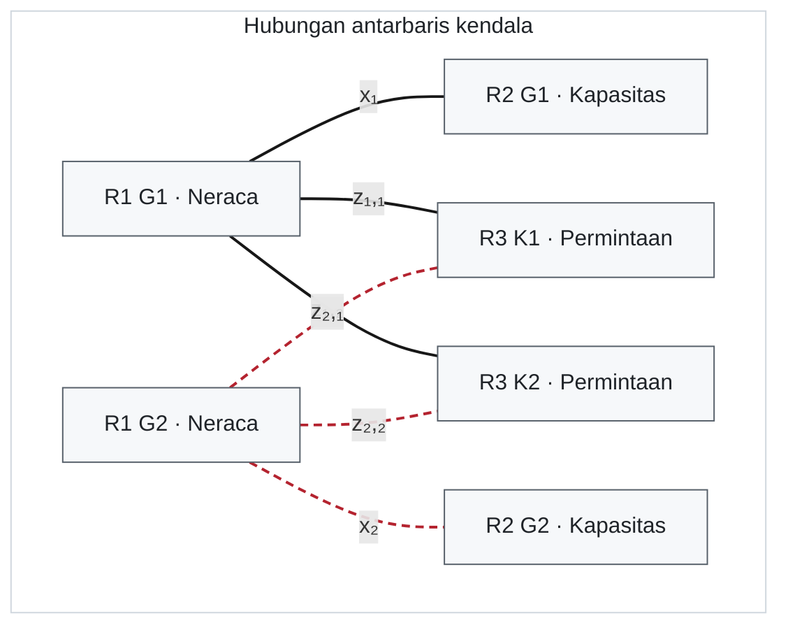

# Cara menghitung WCC di PT XYZ

## 1. Ilustrasi perhitungan WCC

### a. Apa itu WCC?

WCC (*Weighted Constraint Coupling*) mengukur seberapa banyak **variabel keputusan yang sama muncul pada dua baris kendala**. Jika kedua baris memuat satu variabel yang sama, pasangan itu mendapat bobot 1. Jika kedua baris memuat dua variabel yang sama, bobotnya 2.

### b. Rumus WCC

$$
\mathrm{WCC}
=\frac{\text{jumlah bobot semua pasangan pada versi yang dinilai}}
       {\text{jumlah bobot semua pasangan pada daftar pembanding}}
\times 100\%.
$$

Pada setiap versi, cocokkan variabel hingga ke indeksnya. Hitung setiap pasangan baris satu kali, lalu jumlahkan bobotnya. Daftar pembanding menunjukkan kombinasi rute yang boleh dipakai sebagai patokan dan ditetapkan sekali untuk semua versi yang dibandingkan.

### c. Bagaimana menghitung WCC?

**1. Tulis tiga jenis kendala.** Ada satu pabrik P1, dua gudang G1 dan G2, dua pelanggan K1 dan K2, serta satu produk. Variabel $`x_g`$ menyatakan kiriman dari P1 ke gudang $`g`$. Variabel $`z_{g,j}`$ menyatakan kiriman dari gudang $`g`$ ke pelanggan $`j`$.

| Simpul | Kendala | Persamaan |
| --- | --- | --- |
| R1 | Keseimbangan aliran di setiap gudang | $`x_g=\sum_j z_{g,j}`$ |
| R2 | Kapasitas setiap gudang | $`x_g\le V_g`$ |
| R3 | Permintaan setiap pelanggan | $`\sum_g z_{g,j}=d_j`$ |

$`V_g`$ adalah kapasitas gudang $`g`$, dan $`d_j`$ adalah permintaan pelanggan $`j`$. R2 membatasi arus masuk. Karena R1 menyamakan arus masuk dan arus keluar, batas kapasitas itu juga dapat ditulis $`\sum_j z_{g,j}\le V_g`$. Ilustrasi ini memakai bentuk arus masuk agar hubungan $`x_g`$ terlihat langsung. Gunakan bentuk kendala yang sama saat menghitung bobot versi Low dan pembanding.

Pada notasi model PT XYZ, $`\sum_{g,p}x_{igp}\le U_i`$ adalah **kapasitas pabrik** $`i`$. Penjumlahannya mencakup semua gudang dan produk yang dikirim oleh pabrik tersebut.

**2. Petakan hubungan antarbaris.** G1 dan G2 masing-masing memiliki satu baris neraca dan satu baris kapasitas. K1 dan K2 masing-masing memiliki satu baris permintaan. Jadi, ilustrasi ini memiliki enam simpul, satu untuk setiap baris kendala.

**Garis hitam penuh** menunjukkan pasangan yang berbagi variabel pada Low dan pada pembanding. **Garis merah putus-putus** menunjukkan pasangan yang berbagi variabel hanya pada pembanding. Label di atas garis menunjukkan variabel yang sama pada kedua baris.

Sebagai contoh, garis $`z_{1,2}`$ menghubungkan **neraca G1** dan **permintaan K2**. Kedua baris memuat keputusan kiriman G1 → K2. Keputusan itu tetap dihitung dalam WCC Low meskipun solver akhirnya menetapkan tonasenya nol. Pasangan baris yang tidak berbagi variabel pada Low maupun pembanding memiliki bobot nol dan tidak digambar.

**3. Hitung bobot untuk pasangan neraca–kapasitas (R1–R2).** Pada Low, pabrik P1 hanya dapat mengirim ke G1. Pembanding juga mengizinkan kiriman P1 → G2.

| Rute masuk | Variabel bersama | Pasangan baris | Bobot Low | Bobot pembanding |
| --- | --- | --- | ---: | ---: |
| P1 → G1 | $`x_1`$ | Neraca G1 dan kapasitas G1 | 1 | 1 |
| P1 → G2 | $`x_2`$ | Neraca G2 dan kapasitas G2 | 0 | 1 |
| **Total R1–R2** | | | **1** | **2** |

Pada kelompok pasangan ini, satu variabel bersama muncul di Low dan dua pada pembanding. Maka kelompok R1–R2 menyumbang **1 ke pembilang** dan **2 ke penyebut**.

**4. Hitung bobot untuk pasangan neraca–permintaan (R1–R3).** Pada Low, G1 melayani K1 dan K2 dan diasumsikan memiliki kapasitas yang cukup untuk kedua pesanan. Pada pembanding, kedua gudang memiliki rute ke K1 dan K2. Cocokkan setiap kiriman dengan baris neraca gudang asal dan baris permintaan pelanggan tujuan.

| Rute keluar | Variabel bersama | Pasangan baris | Bobot Low | Bobot pembanding |
| --- | --- | --- | ---: | ---: |
| G1 → K1 | $`z_{1,1}`$ | Neraca G1 dan permintaan K1 | 1 | 1 |
| G1 → K2 | $`z_{1,2}`$ | Neraca G1 dan permintaan K2 | 1 | 1 |
| G2 → K1 | $`z_{2,1}`$ | Neraca G2 dan permintaan K1 | 0 | 1 |
| G2 → K2 | $`z_{2,2}`$ | Neraca G2 dan permintaan K2 | 0 | 1 |
| **Total R1–R3** | | | **2** | **4** |

**5. Jumlahkan bobot, lalu bagi.** Kelompok kapasitas–permintaan (R2–R3) berbobot nol karena kapasitas pada ilustrasi ini memakai kiriman masuk, sedangkan permintaan memakai kiriman keluar. Pasangan baris dalam kelompok kendala yang sama juga berbobot nol karena masing-masing memakai indeks yang berbeda.

| Kelompok pasangan kendala | Bobot Low | Bobot pembanding |
| --- | ---: | ---: |
| R1–R2 · Neraca dan kapasitas | 1 | 2 |
| R1–R3 · Neraca dan permintaan | 2 | 4 |
| R2–R3 · Kapasitas dan permintaan | 0 | 0 |
| **Total** | **3 (pembilang)** | **6 (penyebut)** |

WCC seluruh ilustrasi adalah **3 ÷ 6 × 100% = 50%**. Pada graf, pembilang berasal dari tiga garis hitam. Penyebut berasal dari ketiga garis hitam ditambah tiga garis merah. Setiap garis di ilustrasi ini berbobot satu.

## 2. Perhitungan WCC pada kasus PT XYZ

Tabel ini menjumlahkan bobot dari **903 pasangan** di antara 43 baris operasi. Pada setiap tingkat, hitung rute dan keputusan yang muncul pada baris tersebut, termasuk keputusan yang bisa bernilai nol pada solusi optimal.

Setiap rute masuk muncul pada dua baris, jadi bobotnya **1**. Setiap rute keluar muncul pada empat baris, jadi bobotnya **6** karena ada enam cara memasangkan empat baris. Setiap keputusan buka gudang muncul pada batas tonase dan batas waktu gudang itu, jadi bobotnya **1**.

| Daftar rute | Rute masuk × 1 | Rute keluar × 6 | Keputusan buka × 1 | Total bobot | WCC |
| --- | ---: | ---: | ---: | ---: | ---: |
| Low | 16 | 216 | 4 | **236** | **54,25%** |
| Medium | 21 | 258 | 4 | **283** | **65,06%** |
| High | 35 | 342 | 4 | **381** | **87,59%** |
| Pembanding | 35 | 396 | 4 | **435** | |

### Rute apa saja yang masuk ke pembilang dan penyebut?

Satu rute dihitung untuk **satu produk**. Misalnya, P1 → G1 untuk minyak dan P1 → G1 untuk sirup adalah dua keputusan berbeda. Keduanya diperiksa menurut daftar rute pada tingkat yang dihitung.

- **Pembilang.** Ambil rute berindeks yang memang diizinkan pada Low, Medium, atau High. Hitung bobot dari baris kendala yang memuat setiap variabel kiriman. Empat keputusan buka gudang menyumbang empat poin pada setiap tingkat.
- **Penyebut.** Gunakan satu pembanding untuk ketiga tingkat. Untuk pabrik → gudang, gunakan tepat 35 rute berindeks pada High. Untuk gudang → zona, gunakan 11 pasangan gudang–produk yang menerima kiriman pada High, lalu hubungkan setiap pasangan itu ke keenam zona. Hasilnya 66 rute keluar.

Tiga contoh berikut menunjukkan cara membaca aturan itu dengan produk dan lokasi yang sama seperti di data kasus.

| Rute dan produk | Diizinkan pada Low | Masuk pembanding | Sumbangan dari variabel rute |
| --- | --- | --- | --- |
| P1 → G1, minyak (A) | Ya | Ya | 1 pada pembilang Low dan 1 pada penyebut. |
| P1 → G1, susu dingin (C) | Tidak | Tidak | 0 pada kedua total. G1 hanya menangani minyak dan sirup. |
| G2 → K2, sirup (B) | Tidak | Ya | 0 pada pembilang Low dan 6 pada penyebut. G2 menangani sirup, jadi pembanding memasukkan rute ke K2. |

Pada baris terakhir, G2 → K2 untuk sirup juga tidak tersedia pada High. Ini salah satu dari sembilan rute keluar tambahan dalam pembanding. Dengan penyebut yang sama, WCC High adalah **381 ÷ 435 × 100% = 87,59%**. Selisih Low ke Medium adalah **10,80 poin persentase** dan Medium ke High **22,53 poin persentase**, dihitung sebelum pembulatan. [Daftar rute berindeks](case/Rute_Pengiriman.md)

**Cakupan WCC.** Sebelas dari 43 baris adalah neraca gudang. Masing-masing menyamakan kiriman masuk dan keluar untuk satu produk di satu gudang. Audit menghitung 43 baris operasi sebelum penyederhanaan solver dan memeriksa setiap skenario stokastik secara terpisah. Pada tingkat rute yang sama, P1–P8 memiliki variabel yang sama pada setiap baris yang diukur. Grafik waktu dan iterasi pada halaman hasil mencakup penyelesaian seluruh profil, termasuk skenario tambahan dan perhitungan Pareto.

[Lihat persamaan R1–R43, contoh R8–R36, dan hitungan lengkap](math_model_acuan/Persamaan_WCC.md) · [Rincian 903 pasangan](math_model_acuan/hasil/Audit_WCC_Pasangan.csv) · [Model matematika](math_model_acuan/Model_Matematika.md) · [Gambar jaringan PT XYZ](case/Kasus_Dasar.md) · [Data rute](case/Rute_Pengiriman.md) · [Halaman utama](README.md)
