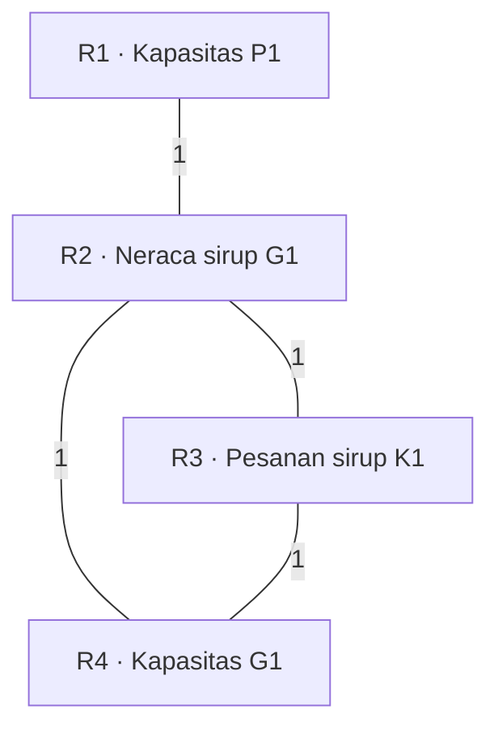

# Menghitung Weighted Constraint Coupling

Dua kendala terhubung jika keduanya memuat **variabel keputusan yang sama persis**, termasuk semua indeksnya. Bobot hubungan adalah jumlah variabel bersama. Kalau keduanya berbagi dua variabel, bobotnya 2. Kalau tidak ada yang sama, bobotnya 0.

## 1. Contoh kecil dari Low

### Kenali baris kendala

| R | Kendala |
| --- | --- |
| R1 | Kapasitas pabrik P1 |
| R2 | Neraca sirup di gudang G1 |
| R3 | Pesanan sirup di zona K1 |
| R4 | Kapasitas tonase gudang G1 |

Di contoh ini, tulis hanya suku dari rute sirup P1 → G1 → K1 dan keputusan buka G1. Nomor R di contoh kecil berlaku khusus untuk contoh ini.

```math
\begin{aligned}
\mathrm{R1}\quad &x_{1,1,B}\le 8,\\
\mathrm{R2}\quad &x_{1,1,B}=z_{1,1,B},\\
\mathrm{R3}\quad &z_{1,1,B}=1,\\
\mathrm{R4}\quad &z_{1,1,B}\le 16y_1.
\end{aligned}
```

B adalah sirup. $`x_{1,1,B}`$ berarti kiriman dari **pabrik P1 ke gudang G1**. $`z_{1,1,B}`$ berarti kiriman dari **gudang G1 ke zona K1**. Hurufnya berbeda, sehingga kedua variabel itu mewakili keputusan yang berbeda meski ketiga indeksnya sama. $`y_1`$ berarti keputusan membuka G1.

### Cocokkan variabel setiap pasangan

| Pasangan | Variabel yang sama persis | Bobot |
| --- | --- | ---: |
| R1–R2 | $`x_{1,1,B}`$ | 1 |
| R1–R3 | Tidak ada | 0 |
| R1–R4 | Tidak ada | 0 |
| R2–R3 | $`z_{1,1,B}`$ | 1 |
| R2–R4 | $`z_{1,1,B}`$ | 1 |
| R3–R4 | $`z_{1,1,B}`$ | 1 |
| **Jumlah bobot** | | **4** |

Coba baca **R1–R2**. R1 memuat $`x_{1,1,B}`$. R2 juga memuat $`x_{1,1,B}`$, jadi pasangan itu berbobot 1. R1–R3 berbobot 0 karena R3 hanya memuat $`z_{1,1,B}`$. Untuk setiap pasangan, cek variabel di kedua ruas. Konstanta dan angka koefisien tidak dihitung sebagai variabel.



## 2. Kendala dan hubungan pada model lengkap Low

### Daftar kendala R1–R43

Di model lengkap, nomor berikut mengikuti urutan 43 baris operasi sebelum penyederhanaan solver. Produk A adalah minyak goreng, B adalah sirup, dan C adalah susu. Buka kelompok yang ingin diperiksa untuk melihat setiap persamaan beserta indeksnya.

| Baris | Kendala |
| --- | --- |
| R1–R6 | Kapasitas P1–P6 |
| R7–R17 | Neraca per gudang dan produk. G1 menangani A dan B, G2–G4 masing-masing menangani A, B, dan C. |
| R18–R35 | Pesanan K1–K6, masing-masing untuk A, B, dan C |
| R36–R39 | Kapasitas tonase G1–G4 |
| R40–R43 | Batas waktu kerja G1–G4 dalam bentuk linear P1 |

<details>
<summary>R1–R6 · Kapasitas pabrik</summary>

**R1 · Kapasitas pabrik P1**

```math
\begin{aligned}
\mathrm{R1}\quad &x_{1,1,A}+x_{1,1,B}+x_{1,2,A} \le 8
\end{aligned}
```

**R2 · Kapasitas pabrik P2**

```math
\begin{aligned}
\mathrm{R2}\quad &x_{2,1,A}+x_{2,1,B}+x_{2,4,B} \le 8
\end{aligned}
```

**R3 · Kapasitas pabrik P3**

```math
\begin{aligned}
\mathrm{R3}\quad &x_{3,1,B}+x_{3,3,B}+x_{3,3,C}+x_{3,4,B} \le 8
\end{aligned}
```

**R4 · Kapasitas pabrik P4**

```math
\begin{aligned}
\mathrm{R4}\quad &x_{4,2,C}+x_{4,3,C} \le 8
\end{aligned}
```

**R5 · Kapasitas pabrik P5**

```math
\begin{aligned}
\mathrm{R5}\quad &x_{5,2,A}+x_{5,4,A} \le 8
\end{aligned}
```

**R6 · Kapasitas pabrik P6**

```math
\begin{aligned}
\mathrm{R6}\quad &x_{6,2,C}+x_{6,3,C} \le 8
\end{aligned}
```

</details>

<details>
<summary>R7–R17 · Neraca gudang–produk</summary>

**R7 · Neraca minyak di G1**

```math
\begin{aligned}
\mathrm{R7}\quad &x_{1,1,A}+x_{2,1,A}\\
&\quad = z_{1,1,A}+z_{1,2,A}+z_{1,3,A}+z_{1,4,A}\\
&\qquad {}+z_{1,5,A}+z_{1,6,A}
\end{aligned}
```

**R8 · Neraca sirup di G1**

```math
\begin{aligned}
\mathrm{R8}\quad &x_{1,1,B}+x_{2,1,B}+x_{3,1,B}\\
&\quad = z_{1,1,B}+z_{1,3,B}+z_{1,5,B}
\end{aligned}
```

**R9 · Neraca minyak di G2**

```math
\begin{aligned}
\mathrm{R9}\quad &x_{1,2,A}+x_{5,2,A}\\
&\quad = z_{2,1,A}+z_{2,3,A}+z_{2,4,A}+z_{2,5,A}\\
&\qquad {}+z_{2,6,A}
\end{aligned}
```

**R10 · Neraca sirup di G2**

```math
\begin{aligned}
\mathrm{R10}\quad &0\\
&\quad = 0
\end{aligned}
```

**R11 · Neraca susu di G2**

```math
\begin{aligned}
\mathrm{R11}\quad &x_{4,2,C}+x_{6,2,C}\\
&\quad = z_{2,1,C}+z_{2,2,C}+z_{2,3,C}+z_{2,4,C}\\
&\qquad {}+z_{2,5,C}+z_{2,6,C}
\end{aligned}
```

**R12 · Neraca minyak di G3**

```math
\begin{aligned}
\mathrm{R12}\quad &0\\
&\quad = 0
\end{aligned}
```

**R13 · Neraca sirup di G3**

```math
\begin{aligned}
\mathrm{R13}\quad &x_{3,3,B}\\
&\quad = z_{3,1,B}+z_{3,2,B}+z_{3,3,B}+z_{3,4,B}\\
&\qquad {}+z_{3,5,B}+z_{3,6,B}
\end{aligned}
```

**R14 · Neraca susu di G3**

```math
\begin{aligned}
\mathrm{R14}\quad &x_{3,3,C}+x_{4,3,C}+x_{6,3,C}\\
&\quad = z_{3,1,C}+z_{3,2,C}+z_{3,3,C}+z_{3,4,C}\\
&\qquad {}+z_{3,5,C}+z_{3,6,C}
\end{aligned}
```

**R15 · Neraca minyak di G4**

```math
\begin{aligned}
\mathrm{R15}\quad &x_{5,4,A}\\
&\quad = z_{4,2,A}
\end{aligned}
```

**R16 · Neraca sirup di G4**

```math
\begin{aligned}
\mathrm{R16}\quad &x_{2,4,B}+x_{3,4,B}\\
&\quad = z_{4,2,B}+z_{4,4,B}+z_{4,6,B}
\end{aligned}
```

**R17 · Neraca susu di G4**

```math
\begin{aligned}
\mathrm{R17}\quad &0\\
&\quad = 0
\end{aligned}
```

</details>

<details>
<summary>R18–R35 · Pesanan zona–produk</summary>

**R18 · Pesanan minyak di K1**

```math
\begin{aligned}
\mathrm{R18}\quad &z_{1,1,A}+z_{2,1,A} = 3
\end{aligned}
```

**R19 · Pesanan sirup di K1**

```math
\begin{aligned}
\mathrm{R19}\quad &z_{1,1,B}+z_{3,1,B} = 1
\end{aligned}
```

**R20 · Pesanan susu di K1**

```math
\begin{aligned}
\mathrm{R20}\quad &z_{2,1,C}+z_{3,1,C} = 1
\end{aligned}
```

**R21 · Pesanan minyak di K2**

```math
\begin{aligned}
\mathrm{R21}\quad &z_{1,2,A}+z_{4,2,A} = 3
\end{aligned}
```

**R22 · Pesanan sirup di K2**

```math
\begin{aligned}
\mathrm{R22}\quad &z_{3,2,B}+z_{4,2,B} = 1
\end{aligned}
```

**R23 · Pesanan susu di K2**

```math
\begin{aligned}
\mathrm{R23}\quad &z_{2,2,C}+z_{3,2,C} = 1
\end{aligned}
```

**R24 · Pesanan minyak di K3**

```math
\begin{aligned}
\mathrm{R24}\quad &z_{1,3,A}+z_{2,3,A} = 1
\end{aligned}
```

**R25 · Pesanan sirup di K3**

```math
\begin{aligned}
\mathrm{R25}\quad &z_{1,3,B}+z_{3,3,B} = 3
\end{aligned}
```

**R26 · Pesanan susu di K3**

```math
\begin{aligned}
\mathrm{R26}\quad &z_{2,3,C}+z_{3,3,C} = 1
\end{aligned}
```

**R27 · Pesanan minyak di K4**

```math
\begin{aligned}
\mathrm{R27}\quad &z_{1,4,A}+z_{2,4,A} = 1
\end{aligned}
```

**R28 · Pesanan sirup di K4**

```math
\begin{aligned}
\mathrm{R28}\quad &z_{3,4,B}+z_{4,4,B} = 3
\end{aligned}
```

**R29 · Pesanan susu di K4**

```math
\begin{aligned}
\mathrm{R29}\quad &z_{2,4,C}+z_{3,4,C} = 1
\end{aligned}
```

**R30 · Pesanan minyak di K5**

```math
\begin{aligned}
\mathrm{R30}\quad &z_{1,5,A}+z_{2,5,A} = 1
\end{aligned}
```

**R31 · Pesanan sirup di K5**

```math
\begin{aligned}
\mathrm{R31}\quad &z_{1,5,B}+z_{3,5,B} = 1
\end{aligned}
```

**R32 · Pesanan susu di K5**

```math
\begin{aligned}
\mathrm{R32}\quad &z_{2,5,C}+z_{3,5,C} = 3
\end{aligned}
```

**R33 · Pesanan minyak di K6**

```math
\begin{aligned}
\mathrm{R33}\quad &z_{1,6,A}+z_{2,6,A} = 1
\end{aligned}
```

**R34 · Pesanan sirup di K6**

```math
\begin{aligned}
\mathrm{R34}\quad &z_{3,6,B}+z_{4,6,B} = 1
\end{aligned}
```

**R35 · Pesanan susu di K6**

```math
\begin{aligned}
\mathrm{R35}\quad &z_{2,6,C}+z_{3,6,C} = 3
\end{aligned}
```

</details>

<details>
<summary>R36–R39 · Kapasitas tonase gudang</summary>

**R36 · Kapasitas tonase G1**

```math
\begin{aligned}
\mathrm{R36}\quad &z_{1,1,A}+z_{1,1,B}+z_{1,2,A}+z_{1,3,A}\\
&{}+z_{1,3,B}+z_{1,4,A}+z_{1,5,A}+z_{1,5,B}\\
&{}+z_{1,6,A}\\
&\quad \le 16y_1
\end{aligned}
```

**R37 · Kapasitas tonase G2**

```math
\begin{aligned}
\mathrm{R37}\quad &z_{2,1,A}+z_{2,1,C}+z_{2,2,C}+z_{2,3,A}\\
&{}+z_{2,3,C}+z_{2,4,A}+z_{2,4,C}+z_{2,5,A}\\
&{}+z_{2,5,C}+z_{2,6,A}+z_{2,6,C}\\
&\quad \le 20y_2
\end{aligned}
```

**R38 · Kapasitas tonase G3**

```math
\begin{aligned}
\mathrm{R38}\quad &z_{3,1,B}+z_{3,1,C}+z_{3,2,B}+z_{3,2,C}\\
&{}+z_{3,3,B}+z_{3,3,C}+z_{3,4,B}+z_{3,4,C}\\
&{}+z_{3,5,B}+z_{3,5,C}+z_{3,6,B}+z_{3,6,C}\\
&\quad \le 18y_3
\end{aligned}
```

**R39 · Kapasitas tonase G4**

```math
\begin{aligned}
\mathrm{R39}\quad &z_{4,2,A}+z_{4,2,B}+z_{4,4,B}+z_{4,6,B} \le 14y_4
\end{aligned}
```

</details>

<details>
<summary>R40–R43 · Batas waktu kerja gudang</summary>

**R40 · Batas waktu kerja G1**

```math
\begin{aligned}
\mathrm{R40}\quad &z_{1,1,A}+z_{1,1,B}+z_{1,2,A}+z_{1,3,A}\\
&{}+z_{1,3,B}+z_{1,4,A}+z_{1,5,A}+z_{1,5,B}\\
&{}+z_{1,6,A}\\
&\quad \le 19{,}2y_1
\end{aligned}
```

**R41 · Batas waktu kerja G2**

```math
\begin{aligned}
\mathrm{R41}\quad &z_{2,1,A}+z_{2,1,C}+z_{2,2,C}+z_{2,3,A}\\
&{}+z_{2,3,C}+z_{2,4,A}+z_{2,4,C}+z_{2,5,A}\\
&{}+z_{2,5,C}+z_{2,6,A}+z_{2,6,C}\\
&\quad \le 24y_2
\end{aligned}
```

**R42 · Batas waktu kerja G3**

```math
\begin{aligned}
\mathrm{R42}\quad &z_{3,1,B}+z_{3,1,C}+z_{3,2,B}+z_{3,2,C}\\
&{}+z_{3,3,B}+z_{3,3,C}+z_{3,4,B}+z_{3,4,C}\\
&{}+z_{3,5,B}+z_{3,5,C}+z_{3,6,B}+z_{3,6,C}\\
&\quad \le 21{,}6y_3
\end{aligned}
```

**R43 · Batas waktu kerja G4**

```math
\begin{aligned}
\mathrm{R43}\quad &z_{4,2,A}+z_{4,2,B}+z_{4,4,B}+z_{4,6,B} \le 16{,}8y_4
\end{aligned}
```

</details>

### Telusuri hubungan dari persamaan Low

| Pasangan | Kendala yang dibandingkan | Variabel bersama di Low | Bobot Low |
| --- | --- | --- | ---: |
| R1–R8 | Kapasitas P1 dan neraca sirup G1 | $`x_{1,1,B}`$ | 1 |
| R1–R19 | Kapasitas P1 dan pesanan sirup K1 | Tidak ada | 0 |
| R8–R19 | Neraca sirup G1 dan pesanan sirup K1 | $`z_{1,1,B}`$ | 1 |
| R8–R36 | Neraca sirup dan tonase G1 | $`z_{1,1,B}`$, $`z_{1,3,B}`$, $`z_{1,5,B}`$ | 3 |
| R8–R40 | Neraca sirup dan waktu kerja G1 | $`z_{1,1,B}`$, $`z_{1,3,B}`$, $`z_{1,5,B}`$ | 3 |
| R19–R36 | Pesanan sirup K1 dan tonase G1 | $`z_{1,1,B}`$ | 1 |
| R19–R40 | Pesanan sirup K1 dan waktu kerja G1 | $`z_{1,1,B}`$ | 1 |
| R36–R40 | Tonase dan waktu kerja G1 | $`z_{1,j,A}`$ untuk K1–K6, $`z_{1,j,B}`$ untuk K1, K3, K5, $`y_1`$ | 10 |

Contohnya, R36 dan R40 memuat daftar kiriman keluar G1 yang sama. Dari persamaan keduanya, cocokkan enam variabel kiriman minyak dan tiga variabel kiriman sirup. Cocokkan pula $`y_1`$ pada kedua ruas kanan. Koefisien $`y_1`$ berbeda, yaitu 16 dan 19,2, tetapi identitas variabelnya sama. Bobot pasangan ini adalah **6 + 3 + 1 = 10**.

**NNZ** adalah jumlah koefisien bukan nol pada satu baris linear. Contohnya, R8 pada Low punya 6 variabel dan R36 punya 10. Kedua baris bisa berbagi paling banyak 6 menurut jumlah variabelnya. Indeks yang sama persis hanya tiga, yaitu $`z_{1,1,B}`$, $`z_{1,3,B}`$, dan $`z_{1,5,B}`$, sehingga bobot R8–R36 adalah **3**.

Empat puluh tiga baris menghasilkan **43 × 42 ÷ 2 = 903 pasangan**. Jumlahkan bobot setiap pasangan satu kali, termasuk pasangan berbobot nol. Total bobot Low adalah **236**. Tabel pada Bagian 3 merangkum penjumlahannya, dan CSV mencantumkan indeks lengkap untuk setiap pasangan. [Rincian 903 pasangan](math_model_acuan/hasil/Audit_WCC_Pasangan.csv)

## 3. Cara membaca persentase WCC

### Apa itu acuan bersama?

Total **236** adalah bobot Low. Supaya bisa menyatakan bobot itu dalam persen, penelitian menetapkan **satu daftar rute pembanding** untuk semua tingkat. Daftar pembanding inilah yang disebut acuan. Acuan memakai 43 aturan yang sama dan mencakup semua rute yang ada di Low, Medium, dan High.

- **Rute masuk acuan** mengikuti daftar High, yaitu **35 rute**.
- **Rute keluar acuan** mencakup setiap zona untuk setiap pasangan gudang–produk yang punya rute masuk. Ada 11 pasangan gudang–produk dan 6 zona, sehingga ada **66 rute keluar**.

Misalnya, pada Low gudang G1 mengirim sirup ke K1, K3, dan K5. Dalam daftar acuan tersedia juga kiriman sirup G1 ke K2, K4, dan K6. Ketiga variabel tambahan, $`z_{1,2,B}`$, $`z_{1,4,B}`$, dan $`z_{1,6,B}`$, muncul pada **R36 dan R40**, sehingga bobot pasangan pada acuan adalah **10 + 3 = 13**. Artinya, pasangan itu menyumbang **10** saat menghitung Low dan **13** saat menghitung acuan.

<details>
<summary>Lihat seluruh persamaan R1–R43 dengan rute acuan</summary>

<details>
<summary>R1–R6 · Kapasitas pabrik</summary>

**R1 · Kapasitas pabrik P1**

```math
\begin{aligned}
\mathrm{R1}\quad &x_{1,1,A}+x_{1,1,B}+x_{1,2,A}+x_{1,2,B}\\
&{}+x_{1,3,B}+x_{1,4,A}+x_{1,4,B}\\
&\quad \le 8
\end{aligned}
```

**R2 · Kapasitas pabrik P2**

```math
\begin{aligned}
\mathrm{R2}\quad &x_{2,1,A}+x_{2,1,B}+x_{2,2,B}+x_{2,3,B}\\
&{}+x_{2,4,B}\\
&\quad \le 8
\end{aligned}
```

**R3 · Kapasitas pabrik P3**

```math
\begin{aligned}
\mathrm{R3}\quad &x_{3,1,A}+x_{3,1,B}+x_{3,2,A}+x_{3,2,B}\\
&{}+x_{3,3,A}+x_{3,3,B}+x_{3,3,C}+x_{3,4,A}\\
&{}+x_{3,4,B}\\
&\quad \le 8
\end{aligned}
```

**R4 · Kapasitas pabrik P4**

```math
\begin{aligned}
\mathrm{R4}\quad &x_{4,1,B}+x_{4,2,B}+x_{4,2,C}+x_{4,3,B}\\
&{}+x_{4,3,C}+x_{4,4,B}+x_{4,4,C}\\
&\quad \le 8
\end{aligned}
```

**R5 · Kapasitas pabrik P5**

```math
\begin{aligned}
\mathrm{R5}\quad &x_{5,1,A}+x_{5,2,A}+x_{5,3,A}+x_{5,4,A} \le 8
\end{aligned}
```

**R6 · Kapasitas pabrik P6**

```math
\begin{aligned}
\mathrm{R6}\quad &x_{6,2,C}+x_{6,3,C}+x_{6,4,C} \le 8
\end{aligned}
```

</details>

<details>
<summary>R7–R17 · Neraca gudang–produk</summary>

**R7 · Neraca minyak di G1**

```math
\begin{aligned}
\mathrm{R7}\quad &x_{1,1,A}+x_{2,1,A}+x_{3,1,A}+x_{5,1,A}\\
&\quad = z_{1,1,A}+z_{1,2,A}+z_{1,3,A}+z_{1,4,A}\\
&\qquad {}+z_{1,5,A}+z_{1,6,A}
\end{aligned}
```

**R8 · Neraca sirup di G1**

```math
\begin{aligned}
\mathrm{R8}\quad &x_{1,1,B}+x_{2,1,B}+x_{3,1,B}+x_{4,1,B}\\
&\quad = z_{1,1,B}+z_{1,2,B}+z_{1,3,B}+z_{1,4,B}\\
&\qquad {}+z_{1,5,B}+z_{1,6,B}
\end{aligned}
```

**R9 · Neraca minyak di G2**

```math
\begin{aligned}
\mathrm{R9}\quad &x_{1,2,A}+x_{3,2,A}+x_{5,2,A}\\
&\quad = z_{2,1,A}+z_{2,2,A}+z_{2,3,A}+z_{2,4,A}\\
&\qquad {}+z_{2,5,A}+z_{2,6,A}
\end{aligned}
```

**R10 · Neraca sirup di G2**

```math
\begin{aligned}
\mathrm{R10}\quad &x_{1,2,B}+x_{2,2,B}+x_{3,2,B}+x_{4,2,B}\\
&\quad = z_{2,1,B}+z_{2,2,B}+z_{2,3,B}+z_{2,4,B}\\
&\qquad {}+z_{2,5,B}+z_{2,6,B}
\end{aligned}
```

**R11 · Neraca susu di G2**

```math
\begin{aligned}
\mathrm{R11}\quad &x_{4,2,C}+x_{6,2,C}\\
&\quad = z_{2,1,C}+z_{2,2,C}+z_{2,3,C}+z_{2,4,C}\\
&\qquad {}+z_{2,5,C}+z_{2,6,C}
\end{aligned}
```

**R12 · Neraca minyak di G3**

```math
\begin{aligned}
\mathrm{R12}\quad &x_{3,3,A}+x_{5,3,A}\\
&\quad = z_{3,1,A}+z_{3,2,A}+z_{3,3,A}+z_{3,4,A}\\
&\qquad {}+z_{3,5,A}+z_{3,6,A}
\end{aligned}
```

**R13 · Neraca sirup di G3**

```math
\begin{aligned}
\mathrm{R13}\quad &x_{1,3,B}+x_{2,3,B}+x_{3,3,B}+x_{4,3,B}\\
&\quad = z_{3,1,B}+z_{3,2,B}+z_{3,3,B}+z_{3,4,B}\\
&\qquad {}+z_{3,5,B}+z_{3,6,B}
\end{aligned}
```

**R14 · Neraca susu di G3**

```math
\begin{aligned}
\mathrm{R14}\quad &x_{3,3,C}+x_{4,3,C}+x_{6,3,C}\\
&\quad = z_{3,1,C}+z_{3,2,C}+z_{3,3,C}+z_{3,4,C}\\
&\qquad {}+z_{3,5,C}+z_{3,6,C}
\end{aligned}
```

**R15 · Neraca minyak di G4**

```math
\begin{aligned}
\mathrm{R15}\quad &x_{1,4,A}+x_{3,4,A}+x_{5,4,A}\\
&\quad = z_{4,1,A}+z_{4,2,A}+z_{4,3,A}+z_{4,4,A}\\
&\qquad {}+z_{4,5,A}+z_{4,6,A}
\end{aligned}
```

**R16 · Neraca sirup di G4**

```math
\begin{aligned}
\mathrm{R16}\quad &x_{1,4,B}+x_{2,4,B}+x_{3,4,B}+x_{4,4,B}\\
&\quad = z_{4,1,B}+z_{4,2,B}+z_{4,3,B}+z_{4,4,B}\\
&\qquad {}+z_{4,5,B}+z_{4,6,B}
\end{aligned}
```

**R17 · Neraca susu di G4**

```math
\begin{aligned}
\mathrm{R17}\quad &x_{4,4,C}+x_{6,4,C}\\
&\quad = z_{4,1,C}+z_{4,2,C}+z_{4,3,C}+z_{4,4,C}\\
&\qquad {}+z_{4,5,C}+z_{4,6,C}
\end{aligned}
```

</details>

<details>
<summary>R18–R35 · Pesanan zona–produk</summary>

**R18 · Pesanan minyak di K1**

```math
\begin{aligned}
\mathrm{R18}\quad &z_{1,1,A}+z_{2,1,A}+z_{3,1,A}+z_{4,1,A} = 3
\end{aligned}
```

**R19 · Pesanan sirup di K1**

```math
\begin{aligned}
\mathrm{R19}\quad &z_{1,1,B}+z_{2,1,B}+z_{3,1,B}+z_{4,1,B} = 1
\end{aligned}
```

**R20 · Pesanan susu di K1**

```math
\begin{aligned}
\mathrm{R20}\quad &z_{2,1,C}+z_{3,1,C}+z_{4,1,C} = 1
\end{aligned}
```

**R21 · Pesanan minyak di K2**

```math
\begin{aligned}
\mathrm{R21}\quad &z_{1,2,A}+z_{2,2,A}+z_{3,2,A}+z_{4,2,A} = 3
\end{aligned}
```

**R22 · Pesanan sirup di K2**

```math
\begin{aligned}
\mathrm{R22}\quad &z_{1,2,B}+z_{2,2,B}+z_{3,2,B}+z_{4,2,B} = 1
\end{aligned}
```

**R23 · Pesanan susu di K2**

```math
\begin{aligned}
\mathrm{R23}\quad &z_{2,2,C}+z_{3,2,C}+z_{4,2,C} = 1
\end{aligned}
```

**R24 · Pesanan minyak di K3**

```math
\begin{aligned}
\mathrm{R24}\quad &z_{1,3,A}+z_{2,3,A}+z_{3,3,A}+z_{4,3,A} = 1
\end{aligned}
```

**R25 · Pesanan sirup di K3**

```math
\begin{aligned}
\mathrm{R25}\quad &z_{1,3,B}+z_{2,3,B}+z_{3,3,B}+z_{4,3,B} = 3
\end{aligned}
```

**R26 · Pesanan susu di K3**

```math
\begin{aligned}
\mathrm{R26}\quad &z_{2,3,C}+z_{3,3,C}+z_{4,3,C} = 1
\end{aligned}
```

**R27 · Pesanan minyak di K4**

```math
\begin{aligned}
\mathrm{R27}\quad &z_{1,4,A}+z_{2,4,A}+z_{3,4,A}+z_{4,4,A} = 1
\end{aligned}
```

**R28 · Pesanan sirup di K4**

```math
\begin{aligned}
\mathrm{R28}\quad &z_{1,4,B}+z_{2,4,B}+z_{3,4,B}+z_{4,4,B} = 3
\end{aligned}
```

**R29 · Pesanan susu di K4**

```math
\begin{aligned}
\mathrm{R29}\quad &z_{2,4,C}+z_{3,4,C}+z_{4,4,C} = 1
\end{aligned}
```

**R30 · Pesanan minyak di K5**

```math
\begin{aligned}
\mathrm{R30}\quad &z_{1,5,A}+z_{2,5,A}+z_{3,5,A}+z_{4,5,A} = 1
\end{aligned}
```

**R31 · Pesanan sirup di K5**

```math
\begin{aligned}
\mathrm{R31}\quad &z_{1,5,B}+z_{2,5,B}+z_{3,5,B}+z_{4,5,B} = 1
\end{aligned}
```

**R32 · Pesanan susu di K5**

```math
\begin{aligned}
\mathrm{R32}\quad &z_{2,5,C}+z_{3,5,C}+z_{4,5,C} = 3
\end{aligned}
```

**R33 · Pesanan minyak di K6**

```math
\begin{aligned}
\mathrm{R33}\quad &z_{1,6,A}+z_{2,6,A}+z_{3,6,A}+z_{4,6,A} = 1
\end{aligned}
```

**R34 · Pesanan sirup di K6**

```math
\begin{aligned}
\mathrm{R34}\quad &z_{1,6,B}+z_{2,6,B}+z_{3,6,B}+z_{4,6,B} = 1
\end{aligned}
```

**R35 · Pesanan susu di K6**

```math
\begin{aligned}
\mathrm{R35}\quad &z_{2,6,C}+z_{3,6,C}+z_{4,6,C} = 3
\end{aligned}
```

</details>

<details>
<summary>R36–R39 · Kapasitas tonase gudang</summary>

**R36 · Kapasitas tonase G1**

```math
\begin{aligned}
\mathrm{R36}\quad &z_{1,1,A}+z_{1,2,A}+z_{1,3,A}+z_{1,4,A}\\
&{}+z_{1,5,A}+z_{1,6,A}+z_{1,1,B}+z_{1,2,B}\\
&{}+z_{1,3,B}+z_{1,4,B}+z_{1,5,B}+z_{1,6,B}\\
&\quad \le 16y_1
\end{aligned}
```

**R37 · Kapasitas tonase G2**

```math
\begin{aligned}
\mathrm{R37}\quad &z_{2,1,A}+z_{2,2,A}+z_{2,3,A}+z_{2,4,A}\\
&{}+z_{2,5,A}+z_{2,6,A}+z_{2,1,B}+z_{2,2,B}\\
&{}+z_{2,3,B}+z_{2,4,B}+z_{2,5,B}+z_{2,6,B}\\
&{}+z_{2,1,C}+z_{2,2,C}+z_{2,3,C}+z_{2,4,C}\\
&{}+z_{2,5,C}+z_{2,6,C}\\
&\quad \le 20y_2
\end{aligned}
```

**R38 · Kapasitas tonase G3**

```math
\begin{aligned}
\mathrm{R38}\quad &z_{3,1,A}+z_{3,2,A}+z_{3,3,A}+z_{3,4,A}\\
&{}+z_{3,5,A}+z_{3,6,A}+z_{3,1,B}+z_{3,2,B}\\
&{}+z_{3,3,B}+z_{3,4,B}+z_{3,5,B}+z_{3,6,B}\\
&{}+z_{3,1,C}+z_{3,2,C}+z_{3,3,C}+z_{3,4,C}\\
&{}+z_{3,5,C}+z_{3,6,C}\\
&\quad \le 18y_3
\end{aligned}
```

**R39 · Kapasitas tonase G4**

```math
\begin{aligned}
\mathrm{R39}\quad &z_{4,1,A}+z_{4,2,A}+z_{4,3,A}+z_{4,4,A}\\
&{}+z_{4,5,A}+z_{4,6,A}+z_{4,1,B}+z_{4,2,B}\\
&{}+z_{4,3,B}+z_{4,4,B}+z_{4,5,B}+z_{4,6,B}\\
&{}+z_{4,1,C}+z_{4,2,C}+z_{4,3,C}+z_{4,4,C}\\
&{}+z_{4,5,C}+z_{4,6,C}\\
&\quad \le 14y_4
\end{aligned}
```

</details>

<details>
<summary>R40–R43 · Batas waktu kerja gudang</summary>

**R40 · Batas waktu kerja G1**

```math
\begin{aligned}
\mathrm{R40}\quad &z_{1,1,A}+z_{1,2,A}+z_{1,3,A}+z_{1,4,A}\\
&{}+z_{1,5,A}+z_{1,6,A}+z_{1,1,B}+z_{1,2,B}\\
&{}+z_{1,3,B}+z_{1,4,B}+z_{1,5,B}+z_{1,6,B}\\
&\quad \le 19{,}2y_1
\end{aligned}
```

**R41 · Batas waktu kerja G2**

```math
\begin{aligned}
\mathrm{R41}\quad &z_{2,1,A}+z_{2,2,A}+z_{2,3,A}+z_{2,4,A}\\
&{}+z_{2,5,A}+z_{2,6,A}+z_{2,1,B}+z_{2,2,B}\\
&{}+z_{2,3,B}+z_{2,4,B}+z_{2,5,B}+z_{2,6,B}\\
&{}+z_{2,1,C}+z_{2,2,C}+z_{2,3,C}+z_{2,4,C}\\
&{}+z_{2,5,C}+z_{2,6,C}\\
&\quad \le 24y_2
\end{aligned}
```

**R42 · Batas waktu kerja G3**

```math
\begin{aligned}
\mathrm{R42}\quad &z_{3,1,A}+z_{3,2,A}+z_{3,3,A}+z_{3,4,A}\\
&{}+z_{3,5,A}+z_{3,6,A}+z_{3,1,B}+z_{3,2,B}\\
&{}+z_{3,3,B}+z_{3,4,B}+z_{3,5,B}+z_{3,6,B}\\
&{}+z_{3,1,C}+z_{3,2,C}+z_{3,3,C}+z_{3,4,C}\\
&{}+z_{3,5,C}+z_{3,6,C}\\
&\quad \le 21{,}6y_3
\end{aligned}
```

**R43 · Batas waktu kerja G4**

```math
\begin{aligned}
\mathrm{R43}\quad &z_{4,1,A}+z_{4,2,A}+z_{4,3,A}+z_{4,4,A}\\
&{}+z_{4,5,A}+z_{4,6,A}+z_{4,1,B}+z_{4,2,B}\\
&{}+z_{4,3,B}+z_{4,4,B}+z_{4,5,B}+z_{4,6,B}\\
&{}+z_{4,1,C}+z_{4,2,C}+z_{4,3,C}+z_{4,4,C}\\
&{}+z_{4,5,C}+z_{4,6,C}\\
&\quad \le 16{,}8y_4
\end{aligned}
```

</details>

</details>

### Jumlahkan bobot, lalu bagi

| Kelompok pasangan | Jumlah pasangan | Bobot Low | Bobot acuan |
| --- | ---: | ---: | ---: |
| Kapasitas pabrik × neraca | 66 | 16 | 35 |
| Neraca × pesanan | 198 | 36 | 66 |
| Neraca × tonase | 44 | 36 | 66 |
| Neraca × waktu | 44 | 36 | 66 |
| Pesanan × tonase | 72 | 36 | 66 |
| Pesanan × waktu | 72 | 36 | 66 |
| Tonase × waktu | 16 | 40 | 70 |
| Kelompok lain | 391 | 0 | 0 |
| **Total** | **903** | **236** | **435** |

Setiap rute masuk menyumbang satu ke pasangan kapasitas pabrik–neraca. Setiap rute keluar menyumbang satu pada tiap kelompok dari neraca–pesanan sampai tonase–waktu. Pada kelompok tonase–waktu, empat keputusan buka gudang juga menyumbang empat. Itu sebabnya, misalnya, bobot kelompok tonase–waktu pada Low adalah 36 + 4 = 40.

```math
\mathrm{WCC}_{\mathrm{Low}}
=\frac{\text{total bobot Low}}{\text{total bobot acuan}}\times 100\%
=\frac{236}{435}\times 100\%
\approx 54{,}25\%.
```

## 4. Ringkasan hasil

| Tingkat | Rute masuk | Rute keluar | Total bobot tingkat | Total bobot acuan | WCC |
| --- | ---: | ---: | ---: | ---: | ---: |
| Low | 16 | 36 | 236 | 435 | **54,25%** |
| Medium | 21 | 43 | 283 | 435 | **65,06%** |
| High | 35 | 57 | 381 | 435 | **87,59%** |

Ketiga tingkat menggunakan 43 aturan operasi yang sama. Variabel kiriman bertambah ketika daftar rute bertambah. Pada satu tingkat, WCC operasi sama untuk P1–P8. Audit memeriksa skenario stokastik satu per satu. Batas emisi, domain variabel, pemilihan emisi saat biaya sama, dan garis singgung solver berada di luar 43 baris yang dihitung.

[Model matematika](math_model_acuan/Model_Matematika.md) · [Data rute](case/Data_Bersama.json) · [Audit 24 kombinasi](math_model_acuan/hasil/WCC.csv) · [Halaman utama](README.md)
