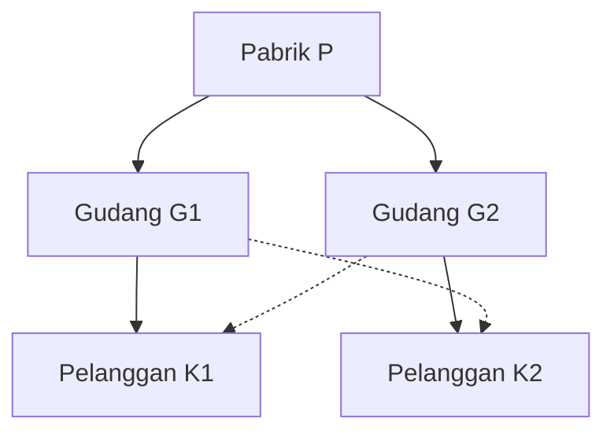

# Cara menghitung WCC di PT XYZ

## 1. Ilustrasi perhitungan WCC

### a. Apa itu WCC?

WCC (*Weighted Constraint Coupling*) mengukur **seberapa banyak aturan berbagi variabel keputusan**. Misalnya, jumlah sirup yang dikirim dari gudang G1 ke pelanggan K1 ditulis sebagai $`z_{1,1}`$. Jika variabel yang sama muncul pada dua aturan, pasangan aturan itu mendapat **1 poin** dari variabel tersebut. Setiap variabel lain yang juga muncul pada kedua aturan menambah 1 poin.

### b. Rumus WCC

Dalam kasus ini, hitung poin dari semua pasangan aturan. Lakukan sekali untuk **daftar rute yang sedang dinilai** dan sekali untuk **daftar rute pembanding**.

$$
\mathrm{WCC}
=\frac{\text{total poin pada daftar rute yang dinilai}}
       {\text{total poin pada daftar rute pembanding}}
\times 100\%.
$$

Poin tiap pasangan aturan adalah jumlah variabel yang sama persis pada kedua persamaan. Pasangan R1–R2 dihitung satu kali. Jika tidak ada variabel yang sama, pasangan itu mendapat 0 poin. Daftar rute pembanding ditetapkan satu kali dan menjadi pembagi yang sama untuk semua versi jaringan.

### c. Bagaimana menghitung WCC?

**Langkah 1. Lihat rute yang tersedia.** Ilustrasi ini memakai satu pabrik P, dua gudang G1 dan G2, dua pelanggan K1 dan K2, serta satu produk, yaitu sirup. Pabrik bisa mengirim ke kedua gudang. Pada versi yang dinilai, G1 melayani K1 dan G2 melayani K2. Daftar pembanding mengizinkan masing-masing gudang melayani kedua pelanggan.

Garis utuh tersedia pada versi yang dinilai. Daftar pembanding memakai garis utuh dan garis putus-putus.

**Langkah 2. Tulis tiga jenis kendala.** Variabel $`x_g`$ adalah jumlah sirup yang dikirim pabrik P ke gudang $`g`$. Variabel $`z_{g,j}`$ adalah jumlah sirup yang dikirim dari gudang $`g`$ ke pelanggan $`j`$. Kapasitas G1 dan G2 berturut-turut 8 dan 6 ton. Pesanan K1 dan K2 berturut-turut 4 dan 3 ton.

| Jenis kendala | Artinya | Baris persamaan |
| --- | --- | --- |
| Keseimbangan aliran (*flow balance*) | Sirup masuk sama dengan sirup keluar di setiap gudang. | R1 untuk G1, R2 untuk G2 |
| Kapasitas gudang | Total sirup yang keluar tidak boleh melebihi kapasitas gudang. | R3 untuk G1, R4 untuk G2 |
| Permintaan (*demand*) | Total sirup yang diterima pelanggan sama dengan pesanannya. | R5 untuk K1, R6 untuk K2 |

Rumus $`\sum_{g,p}x_{igp}\le U_i`$ membatasi kiriman yang **keluar dari pabrik** $`i`$ ke berbagai gudang dan untuk berbagai produk. Pada ilustrasi ini, yang dibatasi pada R3 dan R4 adalah kiriman yang **keluar dari gudang** ke pelanggan, sehingga variabelnya $`z`$.

**Versi yang dinilai** memakai dua rute keluar gudang.

$$
\begin{aligned}
\mathrm{R1}\quad & x_1 = z_{1,1} &
\mathrm{R2}\quad & x_2 = z_{2,2} \\
\mathrm{R3}\quad & z_{1,1} \le 8 &
\mathrm{R4}\quad & z_{2,2} \le 6 \\
\mathrm{R5}\quad & z_{1,1} = 4 &
\mathrm{R6}\quad & z_{2,2} = 3
\end{aligned}
$$

**Daftar pembanding** memakai empat rute keluar gudang. Tambahannya adalah G1 → K2 dan G2 → K1.

$$
\begin{aligned}
\mathrm{R1}\quad & x_1 = z_{1,1} + z_{1,2} &
\mathrm{R2}\quad & x_2 = z_{2,1} + z_{2,2} \\
\mathrm{R3}\quad & z_{1,1} + z_{1,2} \le 8 &
\mathrm{R4}\quad & z_{2,1} + z_{2,2} \le 6 \\
\mathrm{R5}\quad & z_{1,1} + z_{2,1} = 4 &
\mathrm{R6}\quad & z_{1,2} + z_{2,2} = 3
\end{aligned}
$$

**Langkah 3. Hitung poin dari variabel yang sama.** Kiriman G1 → K1, yaitu $`z_{1,1}`$, muncul di R1, R3, dan R5. Jadi variabel itu muncul bersama pada tiga pasangan, yaitu **R1–R3, R1–R5, dan R3–R5**. Masing-masing mendapat 1 poin.

| Kiriman | Variabel | Pasangan aturan yang berbagi variabel | Poin versi yang dinilai | Poin pembanding |
| --- | --- | --- | ---: | ---: |
| G1 → K1 | $`z_{1,1}`$ | R1–R3, R1–R5, R3–R5 | 3 | 3 |
| G2 → K2 | $`z_{2,2}`$ | R2–R4, R2–R6, R4–R6 | 3 | 3 |
| **G1 → K2** | $`z_{1,2}`$ | R1–R3, R1–R6, R3–R6 | 0 | 3 |
| **G2 → K1** | $`z_{2,1}`$ | R2–R4, R2–R5, R4–R5 | 0 | 3 |
| **Total poin** | | | **6** | **12** |

Lihat pasangan **R1–R3**. Versi yang dinilai hanya berbagi $`z_{1,1}`$, jadi bobot pasangan itu 1. Pada daftar pembanding, pasangan yang sama berbagi $`z_{1,1}`$ dan $`z_{1,2}`$, jadi bobotnya 2. Variabel masuk $`x_1`$ dan $`x_2`$ masing-masing hanya muncul di satu aturan, sehingga sumbangannya 0.

**Langkah 4. Bagi poin yang didapat dengan poin pembanding.** Versi yang dinilai mendapat **6 poin** dan daftar pembanding memberi **12 poin**. Jadi, WCC ilustrasi ini adalah **6 ÷ 12 × 100% = 50%**.

## 2. Perhitungan WCC pada kasus PT XYZ

Pada jaringan PT XYZ, kita mulai dari kiriman sirup G1 → K1. **Rute yang sama tertulis di dua aturan.**

| Aturan | Apa yang diperiksa? |
| --- | --- |
| **R8 · Aturan sirup** | Jumlah sirup yang masuk ke G1 harus sama dengan jumlah sirup yang dikirim keluar dari G1. |
| **R36 · Aturan gudang** | Semua barang yang dikirim keluar dari G1, termasuk sirup, ikut memakai batas 16 ton. |

Sirup **G1 → K1** muncul di kedua aturan. Jadi, saat membandingkan dua aturan ini, rute G1 → K1 mendapat **1 poin**. Kiriman sirup ke tujuan lain diperiksa dengan cara yang sama.

### 2.1 Hitung poin untuk dua aturan

PT XYZ punya enam zona tujuan, K1 sampai K6. **Low** membolehkan gudang G1 mengirim sirup ke tiga zona. **Medium** menambah tiga zona. Untuk membandingkan keduanya, penelitian memakai **daftar pembanding** yang berisi keenam zona.

| Tujuan kiriman sirup dari G1 | Low | Medium | Daftar pembanding |
| --- | ---: | ---: | ---: |
| K1 | 1 | 1 | 1 |
| **K2** | 0 | **1** | 1 |
| K3 | 1 | 1 | 1 |
| **K4** | 0 | **1** | 1 |
| K5 | 1 | 1 | 1 |
| **K6** | 0 | **1** | 1 |
| **Jumlah poin** | **3** | **6** | **6** |

**1** berarti rute itu tertulis di kedua aturan. **0** berarti rute itu belum tersedia di tingkat tersebut. Lihat baris **K2**. Pada Low, G1 belum boleh mengirim sirup ke K2, jadi poinnya 0. Pada Medium, rute itu ditambahkan dan tertulis di kedua aturan, jadi poinnya 1. Tiga tujuan yang ditebalkan memberi **3 poin tambahan**.

Untuk **dua aturan ini**, Low mendapat **3 dari 6 poin atau 50%**, dan Medium mendapat **6 dari 6 poin atau 100%**. Bagi poin yang didapat dengan poin pembanding. Untuk Low, hitung **3 ÷ 6**. Untuk Medium, hitung **6 ÷ 6**. Angka pembaginya sama.

### 2.2 Susun daftar pembanding

Dalam contoh tadi, daftar pembanding memuat K1 sampai K6 karena **G1 dapat menerima sirup** dan rancangan pembanding mengizinkan sirup dari G1 dikirim ke semua zona. Untuk jaringan lengkap, daftar pembanding disusun sekali dengan cara berikut.

1. **Dari pabrik ke gudang**, ambil 35 rute masuk dari High. Setiap rute mencatat pabrik, gudang tujuan, dan produknya.
2. **Dari gudang ke pelanggan**, lihat produk apa saja yang bisa diterima tiap gudang berdasarkan 35 rute tadi. Ada 11 pasangan gudang–produk. Izinkan setiap pasangan mengirim ke 6 zona. Hasilnya **11 × 6 = 66 rute keluar**.

Contohnya, rute **pabrik P4 → G1 untuk sirup** tersedia pada High, sehingga ikut dalam 35 rute masuk pembanding. Di tahap keluar, **G1 → K2 untuk sirup** sudah masuk daftar pembanding sejak awal, termasuk ketika yang sedang dihitung adalah Low. Itulah sebabnya poin yang didapat bisa bertambah dari Low ke Medium sementara poin pembandingnya tetap.

### 2.3 Hitung poin semua aturan

Jaringan lengkap punya **43 aturan**. Kita memeriksa tiap pasangan aturan satu kali. Jika satu rute tertulis di dua aturan, rute itu mendapat **1 poin**. Jika satu rute tertulis di empat aturan, rute itu bisa ditemukan pada **6 pasangan** dan mendapat **6 poin**. Cara menghitung enam pasangan itu adalah **3 + 2 + 1**. Pasangkan aturan pertama dengan tiga sisanya, aturan kedua dengan dua sisanya, lalu aturan ketiga dengan aturan keempat.

| Yang dihitung | Poin per variabel | Low | Medium | Daftar pembanding |
| --- | ---: | ---: | ---: | ---: |
| Rute pabrik → gudang | 1 | 16 × 1 | 21 × 1 | 35 × 1 |
| Rute gudang → pelanggan | 6 | 36 × 6 | 43 × 6 | 66 × 6 |
| Keputusan buka gudang | 1 | 4 × 1 | 4 × 1 | 4 × 1 |
| **Jumlah poin** | | **236** | **283** | **435** |

Contoh cara membaca tabel. Satu rute gudang → pelanggan muncul di empat aturan, yaitu aturan barang masuk dan keluar, pesanan pelanggan, batas tonase, dan batas waktu kerja. Enam pasangan aturan memakai rute itu. Karena Low punya 36 rute jenis ini, sumbangannya **36 × 6 = 216 poin**. Tambahkan 16 poin dari rute pabrik dan 4 poin dari keputusan membuka gudang. Hasilnya **236 poin**. Dengan cara yang sama, daftar pembanding mendapat **35 + 396 + 4 = 435 poin**.

### 2.4 Hasil WCC seluruh jaringan

**WCC** (*Weighted Constraint Coupling*) adalah poin yang didapat dibagi poin pembanding, lalu dinyatakan dalam persen. Untuk seluruh jaringan, daftar pembanding selalu memberi **435 poin**.

| Tingkat | Poin yang didapat | Poin pembanding | WCC |
| --- | ---: | ---: | ---: |
| Low | 236 | 435 | **54,25%** |
| Medium | 283 | 435 | **65,06%** |
| High | 381 | 435 | **87,59%** |

Dari Low ke Medium, ada **5 rute pabrik baru** yang masing-masing memberi 1 poin dan **7 rute gudang baru** yang masing-masing memberi 6 poin. Jadi, seluruh jaringan bertambah **5 + 42 = 47 poin**. Tiga poin dari contoh sirup G1 sudah termasuk dalam 47 poin itu.

### Contoh persamaan R8 pada Low

Gudang G1 boleh mengirim sirup ke K1, K3, dan K5. Persamaan R8 menyatakan **total sirup yang masuk = total sirup yang keluar**.

$$
\begin{aligned}
\mathrm{R8}\quad &x_{1,1,B}+x_{2,1,B}+x_{3,1,B}\\
&\quad = z_{1,1,B}+z_{1,3,B}+z_{1,5,B}
\end{aligned}
$$

## Lampiran teknis

[Lihat persamaan R1–R43, indeks rute, dan hitungan lengkap](math_model_acuan/Persamaan_WCC.md).

[Gambar jaringan PT XYZ](case/Kasus_Dasar.md) · [Rincian 903 pasangan](math_model_acuan/hasil/Audit_WCC_Pasangan.csv) · [Model matematika](math_model_acuan/Model_Matematika.md) · [Data rute](case/Data_Bersama.json) · [Audit 24 kombinasi](math_model_acuan/hasil/WCC.csv) · [Halaman utama](README.md)
