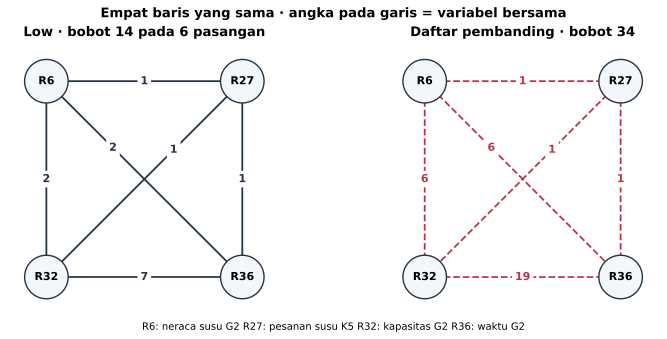

# Menghitung Weighted Constraint Coupling

## 1. Apa yang dihitung?

*Weighted Constraint Coupling* (WCC) menghitung **variabel keputusan yang dipakai bersama oleh pasangan baris kendala**. Satu variabel bersama memberi bobot satu. Jika dua baris memakai tiga variabel yang sama, bobot pasangannya tiga. Cocokkan huruf **dan seluruh indeks**: $z_{2,5,C}$ berbeda dari $z_{2,6,C}$, dan $x_{2,5,C}$ berbeda dari $z_{2,5,C}$.

Setiap baris kendala menjadi satu titik pada graf. Garis menghubungkan dua baris yang berbagi variabel; angka pada garis menunjukkan jumlah variabel bersama. Periksa setiap pasangan satu kali.

```math
w_{rs}=|S_r\cap S_s|,\qquad
B=\sum_{r<s}w_{rs},\qquad
\mathrm{WCC}=\frac{B}{B_{\mathrm{ref}}}\times100\%.
```

| Simbol | Arti dan cara mendapatkannya |
|---|---|
| $S_r$ | Himpunan variabel berbeda yang muncul pada baris $r$. |
| $w_{rs}$ | Bobot pasangan: hitung variabel yang terdapat di kedua himpunan. |
| $B$ | **Pembilang**: jumlahkan bobot seluruh pasangan pada tingkat yang dinilai. |
| $B_{\mathrm{ref}}$ | **Penyebut bersama**: jumlahkan bobot pasangan pada satu daftar rute pembanding yang ditetapkan untuk semua tingkat. |

**Dari mana daftar pembanding berasal?** Kasus ini memiliki empat gudang, enam zona, dan tiga produk. Semua gudang mampu menangani semua produk. Daftar pembanding mengizinkan setiap gudang mengirim setiap produk ke setiap zona: $4\times6\times3=72$ rute keluar. Rute masuk mengikuti daftar High. Low, Medium, dan High hanya menggunakan sebagian dari daftar tersebut. Fasilitas tambahan tidak dibuat untuk menghitung penyebut.

Penyebut ini adalah bobot maksimum **dalam struktur rute pembanding tersebut**. Normalisasi ini ditetapkan untuk penelitian ini; persentasenya perlu dibaca bersama daftar rute dan cakupan kendala yang digunakan.

**NNZ dan kemungkinan hubungan.** NNZ adalah jumlah entri bukan nol. Pada matriks insidensi variabel–kendala, NNZ satu baris sama dengan banyaknya variabel berbeda yang muncul pada baris itu. Konstanta tidak dihitung. Dua baris dengan NNZ 3 dan 7 dapat berbagi paling banyak 3 variabel. Akan tetapi, batas 3 belum menyatakan bahwa ketiganya bisa cocok: asal, tujuan, produk, dan jenis keputusan juga harus sesuai. Penyebut dihitung dari **variabel yang benar-benar dapat muncul bersama dalam struktur pembanding**, bukan dengan mengalikan semua pasangan dengan satu angka NNZ.

## 2. Contoh kecil dari empat baris model sebenarnya

Ambil empat baris dari profil P1 Low. Nomor baris mengikuti model lengkap, sehingga contoh dapat ditelusuri pada [persamaan R1–R38](math_model_acuan/Persamaan_WCC.md).

| Baris | Aturan | Data yang dipakai |
|---|---|---|
| R6 | Neraca susu C di G2 | Susu masuk harus sama dengan susu keluar. |
| R27 | Pesanan susu C di K5 | Pesanan K5 sebesar 2,73 ton. |
| R32 | Kapasitas tonase G2 | Maksimal 20 ton jika G2 dibuka. |
| R36 | Waktu kerja G2 | Maksimal 22,40 jam jika G2 dibuka. |

### 2.1 Tulis persamaan dan seluruh indeksnya

Pada Low, G2 menerima susu dari P4 dan mengirimkannya ke K5 serta K6:

```math
\mathrm{R6}:\quad x_{4,2,C}=z_{2,5,C}+z_{2,6,C}.
```

Pesanan susu K5 dilayani melalui G1 dan G2:

```math
\mathrm{R27}:\quad z_{1,5,C}+z_{2,5,C}=2{,}73.
```

Kapasitas tonase G2 menjumlahkan semua produk yang keluar:

```math
\begin{aligned}
\mathrm{R32}:\quad &z_{2,1,A}+z_{2,2,A}+z_{2,3,B}+z_{2,4,B}\\
&+z_{2,5,C}+z_{2,6,C}\le20y_2.
\end{aligned}
```

Pada P1, setiap ton membutuhkan satu jam. Baris waktu G2 memakai kiriman yang sama:

```math
\begin{aligned}
\mathrm{R36}:\quad &z_{2,1,A}+z_{2,2,A}+z_{2,3,B}+z_{2,4,B}\\
&+z_{2,5,C}+z_{2,6,C}\le22{,}40y_2.
\end{aligned}
```

$x_{4,2,C}$ berarti ton susu dari **P4 ke G2**. $z_{2,5,C}$ berarti ton susu dari **G2 ke K5**. $y_2$ adalah keputusan membuka G2. Angka 20 dan 22,40 merupakan parameter; keduanya tidak menambah bobot.

| Baris | Variabel yang muncul pada Low | NNZ insidensi |
|---|---|---:|
| R6 | $x_{4,2,C},z_{2,5,C},z_{2,6,C}$ | 3 |
| R27 | $z_{1,5,C},z_{2,5,C}$ | 2 |
| R32 | $z_{2,1,A},z_{2,2,A},z_{2,3,B},z_{2,4,B},z_{2,5,C},z_{2,6,C},y_2$ | 7 |
| R36 | Sama dengan daftar R32 | 7 |

### 2.2 Hitung pembilang: periksa keenam pasangan

Empat baris mempunyai $4(4-1)/2=6$ pasangan. Mulai dari R6 dengan tiga baris sesudahnya, lalu R27 dengan dua baris sesudahnya, dan terakhir R32–R36.

| Pasangan | Variabel bersama pada Low | Bobot Low |
|---|---|---:|
| R6–R27 | $z_{2,5,C}$ | 1 |
| R6–R32 | $z_{2,5,C},z_{2,6,C}$ | 2 |
| R6–R36 | $z_{2,5,C},z_{2,6,C}$ | 2 |
| R27–R32 | $z_{2,5,C}$ | 1 |
| R27–R36 | $z_{2,5,C}$ | 1 |
| R32–R36 | Keenam kiriman $z$ pada R32 dan $y_2$ | 7 |
| **Jumlah pada empat baris** | $1+2+2+1+1+7$ | **14** |

Contoh R6–R32: keduanya memuat kiriman susu ke K5 dan K6. Variabel masuk $x_{4,2,C}$ tidak ada pada R32. Kiriman minyak dan sirup serta $y_2$ tidak ada pada R6. Karena itu, bobotnya **2**, walaupun NNZ yang lebih kecil adalah 3.

### 2.3 Hitung penyebut pada empat baris yang sama

Daftar pembanding membolehkan susu dari G2 dikirim ke seluruh K1–K6. Gudang lain juga dapat melayani susu K5. Keempat aturan tetap berlaku; daftar kiriman yang boleh muncul diperluas.

| Baris | Persamaan dengan daftar rute pembanding | NNZ insidensi |
|---|---|---:|
| R6 | $x_{4,2,C}=\sum_{j=1}^{6}z_{2,j,C}$ | 7 |
| R27 | $\sum_{g=1}^{4}z_{g,5,C}=2{,}73$ | 4 |
| R32 | $\sum_{p\in\{A,B,C\}}\sum_{j=1}^{6}z_{2,j,p}\le20y_2$ | 19 |
| R36 | $\sum_{p\in\{A,B,C\}}\sum_{j=1}^{6}z_{2,j,p}\le22{,}40y_2$ | 19 |

Penjumlahan pada R6 berarti $z_{2,1,C}+z_{2,2,C}+z_{2,3,C}+z_{2,4,C}+z_{2,5,C}+z_{2,6,C}$. Penjumlahan pada R32 mencakup enam kiriman A, enam kiriman B, dan enam kiriman C, sehingga terdapat 18 kiriman ditambah $y_2$.

| Pasangan | Variabel yang dapat muncul bersama pada pembanding | Bobot pembanding |
|---|---|---:|
| R6–R27 | $z_{2,5,C}$ | 1 |
| R6–R32 | $z_{2,1,C},z_{2,2,C},z_{2,3,C},z_{2,4,C},z_{2,5,C},z_{2,6,C}$ | 6 |
| R6–R36 | Enam kiriman C yang sama | 6 |
| R27–R32 | $z_{2,5,C}$ | 1 |
| R27–R36 | $z_{2,5,C}$ | 1 |
| R32–R36 | Seluruh 18 kiriman keluar G2 dan $y_2$ | 19 |
| **Jumlah pada empat baris** | $1+6+6+1+1+19$ | **34** |

R6–R27 tetap berbobot satu: R6 hanya membahas G2 dan R27 hanya membahas K5. Variabel yang memenuhi kedua identitas itu hanya $z_{2,5,C}$. NNZ 7 dan 4 tidak membuat empat kiriman bisa digunakan bersama oleh pasangan ini.



Garis hitam memperlihatkan bobot aktual Low; garis merah putus-putus memperlihatkan bobot yang dimungkinkan oleh daftar pembanding. Persilangan garis di tengah gambar bukan simpul tambahan. [Buka versi PNG](math_model_acuan/diagram/WCC_Empat_Baris.png).

Untuk **potongan empat baris ini**, persentasenya $14/34\times100\%=41{,}18\%$. Angka tersebut hanya menerangkan empat baris yang dipilih. WCC seluruh model menjumlahkan semua 703 pasangan, termasuk pasangan dengan baris di luar gambar.

### 2.4 Mengapa pembilang naik ketika rute ditambahkan?

Telusuri satu pasangan yang sama, **R6–R32**, dari Low ke Medium dan High. Ada enam tujuan yang diperbolehkan pada pembanding.

| Variabel susu dari G2 | Low | Medium | High | Pembanding |
|---|---:|---:|---:|---:|
| $z_{2,1,C}$ | 0 | **1** | 1 | 1 |
| $z_{2,2,C}$ | 0 | **1** | 1 | 1 |
| $z_{2,3,C}$ | 0 | **1** | 1 | 1 |
| $z_{2,4,C}$ | 0 | 0 | **1** | 1 |
| $z_{2,5,C}$ | 1 | 1 | 1 | 1 |
| $z_{2,6,C}$ | 1 | 1 | 1 | 1 |
| **Bobot pasangan** | **2** | **5** | **6** | **6** |

Angka 1 berarti variabel kiriman itu muncul pada kedua baris. Medium menambah tiga kiriman susu; bobot pasangan naik dari 2 menjadi 5. High menambah satu lagi; bobot menjadi 6. Penyebut pasangan tetap 6. R6 tetap merupakan aturan neraca, dan R32 tetap merupakan aturan kapasitas; yang berubah adalah rute yang boleh digunakan.

## 3. Perhitungan untuk seluruh model PT XYZ

### 3.1 Tetapkan baris yang diukur

| Keluarga kendala | Nomor baris | Jumlah |
|---|---|---:|
| Neraca gudang–produk | R1–R12 | $4\times3=12$ |
| Pesanan zona–produk | R13–R30 | $6\times3=18$ |
| Kapasitas gudang | R31–R34 | 4 |
| Waktu kerja gudang | R35–R38 | 4 |
| **Total** | **R1–R38** | **38** |

Jumlah pasangan adalah $38(38-1)/2=703$. Baris yang sama dipakai pada Low, Medium, dan High. Semua fasilitas dan produk tetap; daftar rute berubah. Karena variabel hanya disediakan untuk rute yang diizinkan, jumlah variabel kiriman juga berubah.

### 3.2 Jumlahkan kontribusi setiap variabel

Bobot seluruh pasangan dapat dihitung dengan cara lain yang memberi hasil sama. Jika satu variabel muncul pada $m$ baris, variabel tersebut menyumbang $m(m-1)/2$ pasangan.

| Jenis keputusan | Baris yang memakainya | Pasangan yang dibentuk | Bobot per variabel |
|---|---|---|---:|
| Kiriman masuk $x_{igp}$ | Satu neraca gudang–produk | Tidak ada pasangan | 0 |
| Kiriman keluar $z_{gjp}$ | Neraca, pesanan, kapasitas, waktu | Neraca–pesanan; neraca–kapasitas; neraca–waktu; pesanan–kapasitas; pesanan–waktu; kapasitas–waktu | 6 |
| Buka gudang $y_g$ | Kapasitas dan waktu gudang itu | Kapasitas–waktu | 1 |

Kiriman masuk tidak muncul pada batas pasokan pabrik karena kasus ini tidak membatasi pasokan pabrik. Karena hanya muncul pada satu baris yang diukur, kontribusinya nol. Kiriman itu tetap menjadi variabel model serta menimbulkan biaya dan emisi angkutan.

Contoh $z_{2,5,C}$ muncul di R6, R27, R32, dan R36. Keempatnya membentuk enam pasangan pada tabel contoh. Satu variabel menyumbang satu pada masing-masing pasangan, sehingga total kontribusinya enam.

Empat keputusan buka menyumbang 4. Jika terdapat $n_{\mathrm{out}}$ rute keluar, total bobot adalah:

```math
B=6n_{\mathrm{out}}+4,
\qquad B_{\mathrm{ref}}=6(72)+4=436.
```

### 3.3 Pembilang, penyebut, dan hasil

| Tingkat | Rute masuk | Rute keluar | Hitungan pembilang | Total bobot | Penyebut tetap | WCC |
|---|---:|---:|---|---:|---:|---:|
| Low | 16 | 36 | $6(36)+4$ | 220 | 436 | **50,458716%** |
| Medium | 17 | 42 | $6(42)+4$ | 256 | 436 | **58,715596%** |
| High | 22 | 60 | $6(60)+4$ | 364 | 436 | **83,486239%** |
| Pembanding | 22 | 72 | $6(72)+4$ | 436 | 436 | 100% |

Sebagai contoh, Low dihitung dengan $220/436\times100\%$. Medium menambah enam rute keluar, sehingga bobot bertambah $6\times6=36$, dari 220 menjadi 256. High menambah 18 rute keluar dari Medium, sehingga bobot bertambah $18\times6=108$, dari 256 menjadi 364. Selisih persentasenya **8,256881 poin** dan **24,770642 poin**, dihitung sebelum pembulatan.

Penambahan satu rute masuk pada Medium tidak menambah bobot pada cakupan ini karena kiriman masuk hanya muncul pada satu baris. Dengan demikian, WCC ini terutama berubah bersama jumlah rute keluar; angka WCC perlu dibaca bersama susunan jaringan dan banyak variabel.

### 3.4 Pemeriksaan seluruh pasangan

Tabel berikut mengelompokkan 703 pasangan yang sudah diperiksa satu per satu. Angka pada kolom bobot merupakan **jumlah variabel bersama**, bukan jumlah garis.

| Kelompok pasangan | Jumlah pasangan | Bobot Low | Bobot Medium | Bobot High | Bobot pembanding |
|---|---:|---:|---:|---:|---:|
| Neraca × neraca | 66 | 0 | 0 | 0 | 0 |
| Neraca × permintaan | 216 | 36 | 42 | 60 | 72 |
| Neraca × kapasitas | 48 | 36 | 42 | 60 | 72 |
| Neraca × waktu | 48 | 36 | 42 | 60 | 72 |
| Permintaan × permintaan | 153 | 0 | 0 | 0 | 0 |
| Permintaan × kapasitas | 72 | 36 | 42 | 60 | 72 |
| Permintaan × waktu | 72 | 36 | 42 | 60 | 72 |
| Kapasitas × kapasitas | 6 | 0 | 0 | 0 | 0 |
| Kapasitas × waktu | 16 | 40 | 46 | 64 | 76 |
| Waktu × waktu | 6 | 0 | 0 | 0 | 0 |
| **Total** | **703** | **220** | **256** | **364** | **436** |


Pasangan berbobot nol tetap diperiksa. Misalnya, dua baris neraca untuk gudang atau produk berbeda tidak memakai kiriman yang sama. Pada pembanding pun bobotnya nol. Pasangan tersebut menyumbang nol pada pembilang dan penyebut. Penyebut 436 adalah jumlah bobot yang diperbolehkan struktur; jumlah pasangan 703 bukan penyebut persentase ini.

Audit memakai dua metode: irisan himpunan variabel untuk seluruh pasangan, serta penjumlahan kontribusi kemunculan setiap variabel. Keduanya menghasilkan bobot yang sama.

## 4. Kesamaan WCC pada P1–P8

Pada satu tingkat rute, P1–P8 memakai identitas variabel yang sama pada **38 baris operasi per skenario**. Profil stokastik memiliki 27 salinan skenario dalam model lengkap, dengan keputusan buka bersama. Audit struktur di sini memeriksa setiap salinan secara terpisah.

Pada profil nonlinear, singkatan tonase $q_{gp}$ terlebih dahulu diganti dengan jumlah kiriman $z_{gjp}$. Suku kuadrat memakai variabel yang sudah ada pada baris waktu; satu variabel dihitung sekali dalam daftar variabel baris itu. Nilai kiriman nol pada solusi optimal tidak menghapus variabel dari audit.

Fungsi tujuan, domain, batas emisi, pemecah seri, hubungan lintas skenario, serta variabel bantu dan baris tambahan solver berada di luar 38 baris yang diukur. Karena itu, kesamaan WCC ini berlaku pada blok operasi acuan yang dinyatakan, sedangkan waktu dan iterasi mengukur penyelesaian seluruh formulasi dan prosedur profil.

[Kasus untuk pemodel](case/Kasus_Dasar.md) · [Model matematika](math_model_acuan/Model_Matematika.md) · [Persamaan lengkap R1–R38](math_model_acuan/Persamaan_WCC.md) · [Seluruh 703 pasangan](math_model_acuan/hasil/audit/WCC_Pasangan.csv) · [Hasil verifikasi](math_model_acuan/Hasil_Verifikasi.md) · [Halaman utama](README.md)
