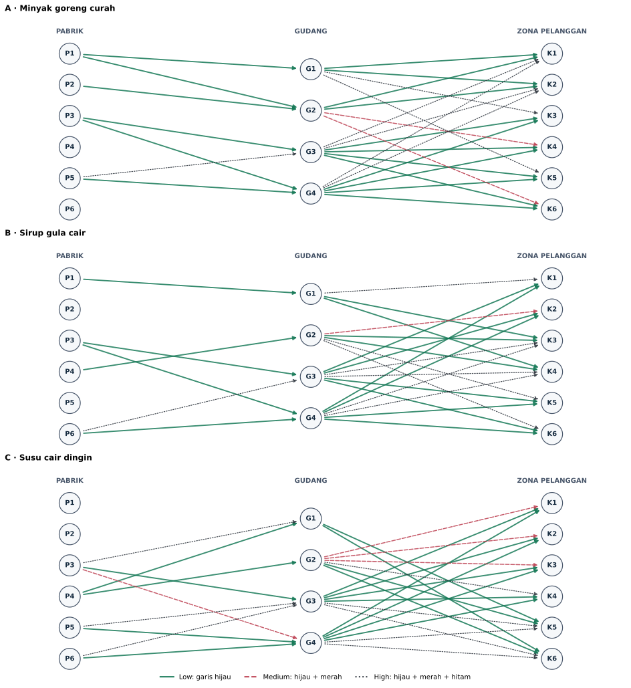

# Lampiran Model Matematika Tesis

Benchmark pemodelan jaringan distribusi PT XYZ Bahan Pangan, perusahaan fiktif yang mengirim minyak goreng curah, sirup gula cair, dan susu cair dingin. Perusahaan memilih gudang yang dibuka dan menentukan jumlah kiriman dari pabrik ke zona pelanggan melalui gudang.

| Tingkat rute | Pabrik → gudang | Gudang → zona | WCC operasi |
| --- | ---: | ---: | ---: |
| Low | 16 | 36 | 54,25% |
| Medium | 21 | 43 | 65,06% |
| High | 35 | 57 | 87,59% |

Enam pabrik, empat calon gudang, dan enam zona pelanggan dipakai pada ketiga tingkat. Setiap panah dihitung untuk satu produk. Delapan profil P1–P8 mengombinasikan permintaan pasti atau stokastik, penanganan linear atau nonlinear, serta satu atau dua tujuan.

[Kasus dan profil](case/Kasus_Dasar.md) · [Model matematika](math_model_acuan/Model_Matematika.md) · [Hasil validasi](math_model_acuan/Hasil_Verifikasi.md) · [Cara menghitung WCC](Lampiran_WCC.md)

