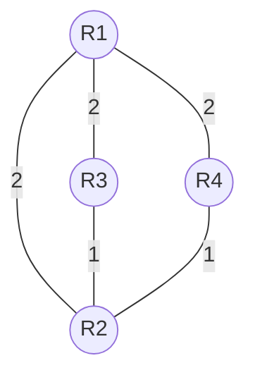

# Menghitung Constraint Coupling hingga Tingkat Indeks

*Constraint coupling* (CC) mengukur berapa banyak pasangan baris kendala yang memakai variabel keputusan yang sama. *Weighted constraint coupling* (WCC) juga menghitung **berapa variabel yang dipakai bersama**. Jika dua baris sama-sama memakai dua variabel, grafnya memiliki **satu garis dengan angka 2**.

Penghitungan dilakukan setelah indeks dijabarkan. Satu rumus yang berlaku untuk pelanggan 1 dan 2 menghasilkan dua baris kendala. Pada saat yang sama, pengiriman produk A ke pelanggan 1 dan pengiriman produk A ke pelanggan 2 adalah dua keputusan yang berbeda.

## 1. Kasus dan kendala

Gudang 1 mengirim produk A dan B ke dua pelanggan. Kedua produk dihitung dalam satuan paket. Gudang dapat menangani paling banyak **20 paket**. Produk A memerlukan penanganan dingin, dengan kapasitas **12 paket A** yang termasuk dalam kapasitas total gudang. Pelanggan 1 harus menerima sedikitnya **7 paket**, dan pelanggan 2 sedikitnya **6 paket**. Dalam contoh ini, kedua pelanggan dapat menerima kombinasi A dan B.

### Variabel keputusan

Notasi $x_{g,j,p}$ berarti jumlah paket produk $p$ yang dikirim dari gudang $g$ ke pelanggan $j$. Urutan indeksnya adalah **gudang, pelanggan, produk**. Karena hanya ada satu gudang, indeks pertama selalu 1.

| Variabel | Keputusan yang dicatat |
| --- | --- |
| $x_{1,1,A}$ | Paket A dari Gudang 1 ke Pelanggan 1 |
| $x_{1,1,B}$ | Paket B dari Gudang 1 ke Pelanggan 1 |
| $x_{1,2,A}$ | Paket A dari Gudang 1 ke Pelanggan 2 |
| $x_{1,2,B}$ | Paket B dari Gudang 1 ke Pelanggan 2 |

Sebagai contoh, $x_{1,1,A}=4$ dan $x_{1,2,A}=2$ berarti Gudang 1 mengirim empat paket A ke Pelanggan 1 dan dua paket A ke Pelanggan 2. Perbedaan pada indeks pelanggan membuat keduanya menjadi variabel yang berbeda, walaupun keduanya memakai huruf $x$ dan produk A yang sama.

### Empat baris kendala

**R1. Kapasitas total gudang**

```math
x_{1,1,A}+x_{1,1,B}+x_{1,2,A}+x_{1,2,B} \le 20
```

Keempat pengiriman memakai kapasitas gudang. Jika pengiriman pada urutan di atas adalah 4, 3, 2, dan 4 paket, kapasitas yang terpakai adalah $4+3+2+4=13$ paket.

**R2. Kapasitas penanganan dingin untuk produk A**

```math
x_{1,1,A}+x_{1,2,A} \le 12
```

Kendala ini menjumlahkan pengiriman produk A ke kedua pelanggan. Pada pengiriman yang sama, kapasitas dingin yang terpakai adalah $4+2=6$ paket A.

**R3 dan R4. Jumlah minimum paket untuk setiap pelanggan**

Kedua baris berasal dari satu rumus. Indeks $j$ menunjukkan pelanggan, $p$ menunjukkan produk, dan $d_j$ adalah jumlah paket minimum untuk pelanggan $j$.

```math
\sum_{p\in\{A,B\}} x_{1,j,p} \ge d_j, \qquad j\in\{1,2\}
```

Masukkan $j=1$ dan $d_1=7$ untuk memperoleh **R3**.

```math
x_{1,1,A}+x_{1,1,B} \ge 7
```

Pelanggan 1 menerima $4+3=7$ paket pada contoh pengiriman tadi.

Masukkan $j=2$ dan $d_2=6$ untuk memperoleh **R4**.

```math
x_{1,2,A}+x_{1,2,B} \ge 6
```

Pelanggan 2 menerima $2+4=6$ paket. Semua variabel pengiriman bernilai nonnegatif. Graf tutorial ini memakai empat baris kendala fungsional R1–R4. Nonnegativitas dicatat sebagai domain variabel.

## 2. Bandingkan keenam pasangan baris satu per satu

Pertama, tandai variabel yang muncul pada setiap baris. Tanda ✓ berarti variabel dengan **nama dan seluruh indeks tersebut** muncul pada baris itu.

| Baris | $x_{1,1,A}$ | $x_{1,1,B}$ | $x_{1,2,A}$ | $x_{1,2,B}$ |
| --- | :---: | :---: | :---: | :---: |
| R1 · Kapasitas total | ✓ | ✓ | ✓ | ✓ |
| R2 · Kapasitas dingin | ✓ | | ✓ | |
| R3 · Minimum Pelanggan 1 | ✓ | ✓ | | |
| R4 · Minimum Pelanggan 2 | | | ✓ | ✓ |

Selanjutnya, ambil dua baris dan hitung kolom yang memiliki ✓ di **kedua** baris. Contohnya, R1 dan R2 sama-sama memiliki ✓ pada kolom $x_{1,1,A}$ dan $x_{1,2,A}$. Jadi bobot pasangan R1–R2 adalah $1+1=2$.

| Pasangan | Variabel yang sama persis di kedua baris | Bobot garis |
| --- | --- | ---: |
| R1–R2 | $x_{1,1,A}$ dan $x_{1,2,A}$ | 2 |
| R1–R3 | $x_{1,1,A}$ dan $x_{1,1,B}$ | 2 |
| R1–R4 | $x_{1,2,A}$ dan $x_{1,2,B}$ | 2 |
| R2–R3 | $x_{1,1,A}$ | 1 |
| R2–R4 | $x_{1,2,A}$ | 1 |
| R3–R4 | Tidak ada. Indeks pelanggan pada R3 adalah 1 dan pada R4 adalah 2. | 0 |

Perhatikan R3–R4. Kedua baris menyebut produk A dan B. Namun, $x_{1,1,A}$ masuk ke R3, sedangkan $x_{1,2,A}$ masuk ke R4. Untuk produk B, perbedaan indeks pelanggannya juga sama. Karena tidak ada kolom yang ditandai pada kedua baris, bobotnya **0**.

## 3. Gambar graf kendala

Setiap lingkaran mewakili satu baris kendala. Garis muncul jika dua baris memakai sedikitnya satu variabel yang sama. Angka pada garis menunjukkan jumlah variabel yang digunakan bersama. R3 dan R4 tidak memiliki garis langsung.



## 4. Hitung CC dan WCC

### CC biasa menghitung banyaknya garis

Empat baris menghasilkan **enam** pasangan yang mungkin. R1 bisa dipasangkan dengan tiga baris setelahnya, R2 dengan dua, dan R3 dengan satu. Pasangan R1–R2 dihitung sekali karena urutan kedua baris tidak mengubah pasangannya.

```math
\text{Pasangan yang mungkin}=3+2+1=6
```

Lima pasangan mempunyai garis, yaitu lima pasangan dengan bobot positif pada tabel. Masing-masing menyumbang satu ke pembilang.

```math
\mathrm{CC}=\frac{5}{6}\times 100\%\approx 83{,}33\%
```

Secara umum, untuk $m$ baris kendala, jumlah pasangan yang mungkin adalah $m(m-1)/2$. Pembilang CC adalah jumlah pasangan yang memiliki sekurang-kurangnya satu variabel bersama.

### WCC menjumlahkan angka pada garis

Gunakan $S_r$ untuk menyatakan himpunan variabel yang muncul pada baris $r$. Bobot $w_{rs}$ adalah jumlah variabel yang muncul pada kedua baris $r$ dan $s$. Notasi $S_r\cap S_s$ berarti mengambil variabel yang ada di kedua himpunan.

```math
w_{rs}=|S_r\cap S_s|, \qquad
B=\sum_{r<s} w_{rs}
```

Di contoh ini, $B$ adalah **total bobot graf**. Jumlahkan bobot semua pasangan sesuai urutan tabel.

```math
B=2+2+2+1+1+0=8
```

Angka 8 berarti ada delapan kemunculan variabel bersama jika semua pasangan diperiksa. Satu variabel dapat menyumbang ke beberapa pasangan. Misalnya, $x_{1,1,A}$ muncul di R1, R2, dan R3, sehingga menyumbang satu ke R1–R2, satu ke R1–R3, dan satu ke R2–R3.

Membagi 8 dengan 6 memberikan $1{,}33$ variabel bersama **per pasangan yang mungkin**, termasuk pasangan dengan bobot nol. Hasil bagi itu adalah rata-rata. Untuk menyatakan WCC dalam persen relatif terhadap suatu jaringan, gunakan total bobot dari jaringan acuan sebagai penyebut.

```math
\mathrm{WCC}_{\mathrm{ref}}
=\frac{B}{B_{\mathrm{ref}}}\times 100\%
```

Di sini, **jaringan acuan** mengizinkan A dan B dikirim ke kedua pelanggan. Enam pasangan sudah dihitung satu per satu dan total bobotnya adalah $B_{\mathrm{ref}}=8$. Model acuan mendapat $8/8\times100\%=100\%$ terhadap dirinya sendiri. Angka 100% berarti total bobotnya mencapai total bobot acuan. Graf tersebut tetap memiliki lima dari enam garis yang mungkin.

### Satu kombinasi indeks dihapus

Sekarang anggap Pelanggan 2 hanya bisa menerima produk A. Pengiriman B ke pelanggan tersebut tidak tersedia, sehingga variabel $x_{1,2,B}$ dikeluarkan dari model. R1 tinggal menjumlahkan tiga variabel dan R4 menjadi $x_{1,2,A}\ge6$.

Semula R1 dan R4 berbagi dua variabel, yaitu $x_{1,2,A}$ dan $x_{1,2,B}$. Setelah perubahan, pasangan itu masih berbagi $x_{1,2,A}$. Garisnya tetap ada dan bobotnya turun dari 2 menjadi 1. Lima pasangan lain memiliki bobot yang sama seperti sebelumnya.

| Ukuran | Acuan · A dan B dapat dikirim ke kedua pelanggan | Pelanggan 2 hanya menerima A |
| --- | ---: | ---: |
| Pasangan yang memiliki garis | 5 | 5 |
| Total bobot $B$ | $2+2+2+1+1+0=8$ | $2+2+1+1+1+0=7$ |
| CC biasa | $5/6=83{,}33\%$ | $5/6=83{,}33\%$ |
| WCC terhadap acuan | $8/8=100\%$ | $7/8=87{,}50\%$ |

Kedua versi memakai penyebut WCC yang sama, yaitu **8**. Maka WCC menunjukkan penurunan sebesar **12,50 poin persentase**, walaupun CC biasa tetap sama. Jika acuan dibangun dengan mengaktifkan semua kombinasi yang diperbolehkan dan versi yang dibandingkan hanya menghapus kemunculan variabel dari baris yang sama, WCC berada pada rentang 0–100%. Penyebut harus positif dan ditetapkan sebelum membandingkan versi.

## 5. Terapkan pada model lain

1. Tentukan baris kendala fungsional yang dihitung pada formulasi acuan sebelum *presolve*. Fungsi tujuan dan deklarasi domain berada di luar graf kendala ini.
2. Jabarkan setiap rumus berindeks. Misalnya, satu rumus untuk dua pelanggan menghasilkan dua baris.
3. Catat variabel yang muncul pada setiap baris dengan nama dan **seluruh indeksnya**. Pada kendala linear, gabungkan suku dengan variabel yang sama dan abaikan koefisien yang menjadi nol. Variabel yang muncul beberapa kali dalam satu baris tetap dicatat satu kali.
4. Periksa setiap pasangan baris berbeda satu kali. Bobotnya sama dengan jumlah variabel berindeks lengkap yang muncul pada kedua baris.
5. Untuk CC, bagi jumlah pasangan berbobot positif dengan jumlah pasangan yang mungkin. Untuk WCC relatif, bagi total bobot dengan bobot jaringan acuan yang sudah ditetapkan.

Jika dua model memiliki WCC yang sama, keduanya memiliki total bobot yang sama selama memakai penyebut yang sama. Untuk memastikan **graf dan variabel penghubungnya juga sama**, cocokkan daftar variabel bersama pada **setiap pasangan baris**, seperti pada tabel di bagian 2.
