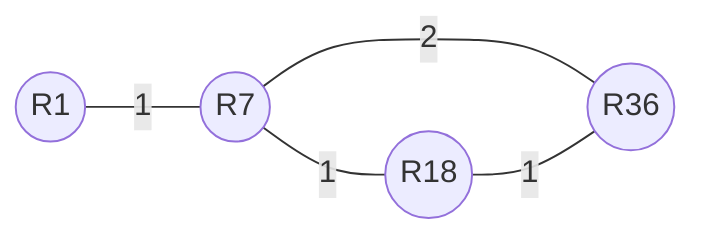

# Lampiran — Weighted Constraint Coupling (WCC)

WCC menghitung berapa banyak variabel keputusan yang dipakai bersama oleh kendala. Pada Profil 1, seluruh tingkat dinilai pada **satu skala acuan**. Pembagi diperoleh dengan menjumlahkan batas bobot yang benar-benar diizinkan untuk setiap pasangan baris. [Model matematika Profil 1](Profil_1_Model_Matematika.md)

## 1. Cara membaca bobot pasangan

Ambil tiga persamaan ini.

```math
\begin{aligned}
\text{R1}\quad &x_1+x_2=5,\\
\text{R2}\quad &x_2+x_3=4,\\
\text{R3}\quad &x_1+x_3=7.
\end{aligned}
```

| Pasangan | Variabel yang muncul di kedua baris | Bobot |
| --- | --- | ---: |
| R1–R2 | $x_2$ | 1 |
| R1–R3 | $x_1$ | 1 |
| R2–R3 | $x_3$ | 1 |

Bobot aktual totalnya $1+1+1=3$. Dengan tiga baris, ada tiga pasangan. Secara umum, $m$ baris menghasilkan $m(m-1)/2$ pasangan. Setiap baris bisa dipasangkan dengan $m-1$ baris lain, lalu hasilnya dibagi dua karena pasangan R1–R2 dan R2–R1 dihitung satu kali. Pasangan dengan irisan kosong tetap terdaftar dengan bobot nol.

Untuk kendala linear, gabungkan dahulu semua suku dengan variabel berindeks sama. Ambil variabel dengan koefisien akhir selain nol. Suku $2x_1$ menyumbang satu kemunculan $x_1$, sama seperti suku $x_1$. Pada model berindeks, $z_{1,1,A}$ dan $z_{2,1,A}$ adalah dua keputusan berbeda karena gudangnya berbeda.

## 2. Cara menetapkan penyebut bersama

### 2.1 Contoh empat kendala dengan NNZ berbeda

NNZ (*number of nonzeros*) adalah jumlah koefisien selain nol setelah suku sejenis digabungkan. Pada satu baris kendala linear, ini sama dengan jumlah variabel yang muncul pada baris.

```math
\begin{aligned}
\text{R1}\quad &x_1+x_2=2,\\
\text{R2}\quad &2x_1+x_2+x_3=4,\\
\text{R3}\quad &x_1+x_4+x_5+x_6=4,\\
\text{R4}\quad &x_3+x_4+x_5+x_6+x_7=5.
\end{aligned}
```

Misalkan desain contoh ini menetapkan batas NNZ acuan R1–R4 sebesar **2, 3, 4, dan 5**. Jika yang diketahui hanya batas NNZ, dua baris paling banyak bisa berbagi sebanyak ukuran daftar yang lebih pendek. R1–R2, misalnya, paling banyak berbagi 2 variabel karena R1 hanya memuat 2. Batas tersebut dihitung untuk setiap pasangan.

| Pasangan | Batas NNZ kedua baris | Batas bobot dari NNZ | Variabel bersama aktual | Bobot aktual |
| --- | ---: | ---: | --- | ---: |
| R1–R2 | 2 dan 3 | 2 | $x_1,x_2$ | 2 |
| R1–R3 | 2 dan 4 | 2 | $x_1$ | 1 |
| R1–R4 | 2 dan 5 | 2 | — | 0 |
| R2–R3 | 3 dan 4 | 3 | $x_1$ | 1 |
| R2–R4 | 3 dan 5 | 3 | $x_3$ | 1 |
| R3–R4 | 4 dan 5 | 4 | $x_4,x_5,x_6$ | 3 |
| **Total** | | **16** | | **8** |

Penyebutnya $2+2+2+3+3+4=16$. WCC contoh ini adalah $8/16\times100\%=50\%$. Batas 2, 3, atau 4 mengikuti kemampuan masing-masing pasangan. Jika keempat batas NNZ itu menjadi bagian dari satu desain tingkat Low, Medium, dan High, ketiganya menggunakan penyebut 16. Isi kendala aktual pada masing-masing tingkat menentukan pembilangnya.

### 2.2 Perketat batas dengan daftar variabel yang diizinkan

Dalam kasus nyata, aturan jaringan bisa lebih informatif daripada NNZ. Kapasitas P1 dan kapasitas P4, misalnya, hanya memakai variabel pengiriman dari pabriknya masing-masing. Indeks pabrik berbeda, sehingga batas pasangan itu memang **0**, berapa pun NNZ kedua baris.

Untuk setiap posisi baris $r$, tetapkan $U_r^{\mathrm{ref}}$, yaitu daftar variabel yang diizinkan muncul oleh desain acuan. Bila desain juga mempunyai batas NNZ independen, sebut $d_r^{\mathrm{ref}}$ sebagai batasnya. Maka batas satu pasangan dapat dihitung sebagai berikut.

```math
b_{rs}^{\mathrm{ref}}=
\min\!\left(
d_r^{\mathrm{ref}},
d_s^{\mathrm{ref}},
\lvert U_r^{\mathrm{ref}}\cap U_s^{\mathrm{ref}}\rvert
\right).
```

Pada Profil 1, jalur yang diizinkan menentukan seluruh daftar variabel per baris. Nilai $d_r^{\mathrm{ref}}$ sama dengan ukuran daftar $U_r^{\mathrm{ref}}$, sehingga kita cukup menghitung irisannya. Bekukan daftar acuan dan pemetaan ID sebelum penilaian. Untuk setiap tingkat $\ell$, $S_r^{(\ell)}$ adalah daftar variabel dari kendala yang benar-benar ditulis pada tingkat itu.

```math
\begin{aligned}
w_{rs}^{(\ell)} &= \lvert S_r^{(\ell)}\cap S_s^{(\ell)}\rvert,\\
B_\ell &= \sum_{(r,s)\in P} w_{rs}^{(\ell)},\\
D_{\mathrm{ref}} &= \sum_{(r,s)\in P} b_{rs}^{\mathrm{ref}},\\
\mathrm{WCC}_\ell &= 100\%\times\frac{B_\ell}{D_{\mathrm{ref}}}.
\end{aligned}
```

Di sini $P$ adalah daftar pasangan posisi baris yang sama untuk semua tingkat. Pembaginya positif selama sedikitnya satu pasangan bisa berbagi variabel.

## 3. Studi kasus Profil 1 — seluruh kendala asli

### 3.1 Pemetaan ID dan penjabaran R1–R39

Profil 1 terdiri atas **enam pabrik, empat calon gudang, enam pelanggan, tiga produk, dan satu periode**. Subbab ini menurunkan semua baris dari empat keluarga kendala pada [model utama](Profil_1_Model_Matematika.md#3-fungsi-tujuan-dan-seluruh-keluarga-kendala).

| ID | Keluarga | Jumlah posisi acuan |
| --- | --- | ---: |
| R1–R6 | Kapasitas setiap pabrik | 6 |
| R7–R17 | Neraca setiap pasangan gudang–produk yang diizinkan pada acuan | 11 |
| R18–R35 | Pemenuhan permintaan setiap pasangan pelanggan–produk | 18 |
| R36–R39 | Kapasitas dan keputusan buka setiap gudang | 4 |
| **Total** | | **39** |

Pasangan G1–C berada di luar acuan karena ketiga jaringan menempatkan C di gudang lain. Baris yang menjadi $0=0$ pada suatu tingkat dipertahankan sebagai posisi pembanding dan diberi NNZ nol. Contohnya, R19 adalah permintaan B di K1. Pada Low, K1 hanya meminta A, sehingga R19 bernilai $0=0$. Pada Medium, K1 mulai meminta B dan R19 mempunyai variabel pengiriman.

**Low** di bawah menampilkan semua posisi, termasuk posisi kosong. Buka tabel Medium dan High untuk melihat persamaan skalar dengan ID yang sama. Nilai $d_{j,p}^{M}$ dan $d_{j,p}^{H}$ menunjukkan pembagian permintaan per produk yang masih berupa parameter.

| ID | Kendala | Bentuk skalar | NNZ |
| --- | --- | --- | ---: |
| R1 | Kapasitas P1 | $x_{1,1,A}+x_{1,2,A}+x_{1,4,A}\le 8$ | 3 |
| R2 | Kapasitas P2 | $x_{2,1,B}+x_{2,3,B}+x_{2,4,B}\le 8$ | 3 |
| R3 | Kapasitas P3 | $x_{3,1,B}+x_{3,3,B}+x_{3,4,B}\le 8$ | 3 |
| R4 | Kapasitas P4 | $x_{4,2,C}+x_{4,3,C}\le 8$ | 2 |
| R5 | Kapasitas P5 | $x_{5,1,A}+x_{5,2,A}+x_{5,4,A}\le 8$ | 3 |
| R6 | Kapasitas P6 | $x_{6,2,C}+x_{6,3,C}\le 8$ | 2 |
| R7 | Neraca G1–A | $x_{1,1,A}+x_{5,1,A}=z_{1,1,A}+z_{1,2,A}$ | 4 |
| R8 | Neraca G1–B | $x_{2,1,B}+x_{3,1,B}=z_{1,3,B}+z_{1,4,B}$ | 4 |
| R9 | Neraca G2–A | $x_{1,2,A}+x_{5,2,A}=z_{2,1,A}+z_{2,2,A}$ | 4 |
| R10 | Neraca G2–B | $0=0$ | 0 |
| R11 | Neraca G2–C | $x_{4,2,C}+x_{6,2,C}=z_{2,5,C}+z_{2,6,C}$ | 4 |
| R12 | Neraca G3–A | $0=0$ | 0 |
| R13 | Neraca G3–B | $x_{2,3,B}+x_{3,3,B}=z_{3,3,B}+z_{3,4,B}$ | 4 |
| R14 | Neraca G3–C | $x_{4,3,C}+x_{6,3,C}=z_{3,5,C}+z_{3,6,C}$ | 4 |
| R15 | Neraca G4–A | $x_{1,4,A}+x_{5,4,A}=z_{4,1,A}+z_{4,2,A}$ | 4 |
| R16 | Neraca G4–B | $x_{2,4,B}+x_{3,4,B}=z_{4,3,B}+z_{4,4,B}$ | 4 |
| R17 | Neraca G4–C | $0=0$ | 0 |
| R18 | Permintaan K1–A | $z_{1,1,A}+z_{2,1,A}+z_{4,1,A}=5$ | 3 |
| R19 | Permintaan K1–B | $0=0$ | 0 |
| R20 | Permintaan K1–C | $0=0$ | 0 |
| R21 | Permintaan K2–A | $z_{1,2,A}+z_{2,2,A}+z_{4,2,A}=5$ | 3 |
| R22 | Permintaan K2–B | $0=0$ | 0 |
| R23 | Permintaan K2–C | $0=0$ | 0 |
| R24 | Permintaan K3–A | $0=0$ | 0 |
| R25 | Permintaan K3–B | $z_{1,3,B}+z_{3,3,B}+z_{4,3,B}=5$ | 3 |
| R26 | Permintaan K3–C | $0=0$ | 0 |
| R27 | Permintaan K4–A | $0=0$ | 0 |
| R28 | Permintaan K4–B | $z_{1,4,B}+z_{3,4,B}+z_{4,4,B}=5$ | 3 |
| R29 | Permintaan K4–C | $0=0$ | 0 |
| R30 | Permintaan K5–A | $0=0$ | 0 |
| R31 | Permintaan K5–B | $0=0$ | 0 |
| R32 | Permintaan K5–C | $z_{2,5,C}+z_{3,5,C}=5$ | 2 |
| R33 | Permintaan K6–A | $0=0$ | 0 |
| R34 | Permintaan K6–B | $0=0$ | 0 |
| R35 | Permintaan K6–C | $z_{2,6,C}+z_{3,6,C}=5$ | 2 |
| R36 | Kapasitas G1 | $z_{1,1,A}+z_{1,2,A}+z_{1,3,B}+z_{1,4,B}\le 16y_{1}$ | 5 |
| R37 | Kapasitas G2 | $z_{2,1,A}+z_{2,2,A}+z_{2,5,C}+z_{2,6,C}\le 20y_{2}$ | 5 |
| R38 | Kapasitas G3 | $z_{3,3,B}+z_{3,4,B}+z_{3,5,C}+z_{3,6,C}\le 18y_{3}$ | 5 |
| R39 | Kapasitas G4 | $z_{4,1,A}+z_{4,2,A}+z_{4,3,B}+z_{4,4,B}\le 14y_{4}$ | 5 |

<details>
<summary>Medium — buka tabel R1–R39</summary>

| ID | Kendala | Bentuk skalar | NNZ |
| --- | --- | --- | ---: |
| R1 | Kapasitas P1 | $x_{1,1,A}+x_{1,1,B}+x_{1,2,A}+x_{1,2,B}+x_{1,3,B}+x_{1,4,A}+x_{1,4,B}\le 8$ | 7 |
| R2 | Kapasitas P2 | $x_{2,1,B}+x_{2,2,B}+x_{2,3,B}+x_{2,4,B}\le 8$ | 4 |
| R3 | Kapasitas P3 | $x_{3,1,B}+x_{3,2,B}+x_{3,3,B}+x_{3,4,B}\le 8$ | 4 |
| R4 | Kapasitas P4 | $x_{4,2,C}+x_{4,3,C}\le 8$ | 2 |
| R5 | Kapasitas P5 | $x_{5,1,A}+x_{5,2,A}+x_{5,4,A}\le 8$ | 3 |
| R6 | Kapasitas P6 | $x_{6,2,C}+x_{6,3,C}\le 8$ | 2 |
| R7 | Neraca G1–A | $x_{1,1,A}+x_{5,1,A}=z_{1,1,A}+z_{1,2,A}+z_{1,5,A}+z_{1,6,A}$ | 6 |
| R8 | Neraca G1–B | $x_{1,1,B}+x_{2,1,B}+x_{3,1,B}=z_{1,1,B}+z_{1,2,B}+z_{1,3,B}+z_{1,4,B}$ | 7 |
| R9 | Neraca G2–A | $x_{1,2,A}+x_{5,2,A}=z_{2,1,A}+z_{2,2,A}+z_{2,5,A}+z_{2,6,A}$ | 6 |
| R10 | Neraca G2–B | $x_{1,2,B}+x_{2,2,B}+x_{3,2,B}=z_{2,1,B}+z_{2,2,B}+z_{2,3,B}+z_{2,4,B}$ | 7 |
| R11 | Neraca G2–C | $x_{4,2,C}+x_{6,2,C}=z_{2,3,C}+z_{2,4,C}+z_{2,5,C}+z_{2,6,C}$ | 6 |
| R12 | Neraca G3–A | $0=0$ | 0 |
| R13 | Neraca G3–B | $x_{1,3,B}+x_{2,3,B}+x_{3,3,B}=z_{3,1,B}+z_{3,2,B}+z_{3,3,B}+z_{3,4,B}$ | 7 |
| R14 | Neraca G3–C | $x_{4,3,C}+x_{6,3,C}=z_{3,3,C}+z_{3,4,C}+z_{3,5,C}+z_{3,6,C}$ | 6 |
| R15 | Neraca G4–A | $x_{1,4,A}+x_{5,4,A}=z_{4,1,A}+z_{4,2,A}+z_{4,5,A}+z_{4,6,A}$ | 6 |
| R16 | Neraca G4–B | $x_{1,4,B}+x_{2,4,B}+x_{3,4,B}=z_{4,1,B}+z_{4,2,B}+z_{4,3,B}+z_{4,4,B}$ | 7 |
| R17 | Neraca G4–C | $0=0$ | 0 |
| R18 | Permintaan K1–A | $z_{1,1,A}+z_{2,1,A}+z_{4,1,A}=d^{M}_{1,A}$ | 3 |
| R19 | Permintaan K1–B | $z_{1,1,B}+z_{2,1,B}+z_{3,1,B}+z_{4,1,B}=d^{M}_{1,B}$ | 4 |
| R20 | Permintaan K1–C | $0=0$ | 0 |
| R21 | Permintaan K2–A | $z_{1,2,A}+z_{2,2,A}+z_{4,2,A}=d^{M}_{2,A}$ | 3 |
| R22 | Permintaan K2–B | $z_{1,2,B}+z_{2,2,B}+z_{3,2,B}+z_{4,2,B}=d^{M}_{2,B}$ | 4 |
| R23 | Permintaan K2–C | $0=0$ | 0 |
| R24 | Permintaan K3–A | $0=0$ | 0 |
| R25 | Permintaan K3–B | $z_{1,3,B}+z_{2,3,B}+z_{3,3,B}+z_{4,3,B}=d^{M}_{3,B}$ | 4 |
| R26 | Permintaan K3–C | $z_{2,3,C}+z_{3,3,C}=d^{M}_{3,C}$ | 2 |
| R27 | Permintaan K4–A | $0=0$ | 0 |
| R28 | Permintaan K4–B | $z_{1,4,B}+z_{2,4,B}+z_{3,4,B}+z_{4,4,B}=d^{M}_{4,B}$ | 4 |
| R29 | Permintaan K4–C | $z_{2,4,C}+z_{3,4,C}=d^{M}_{4,C}$ | 2 |
| R30 | Permintaan K5–A | $z_{1,5,A}+z_{2,5,A}+z_{4,5,A}=d^{M}_{5,A}$ | 3 |
| R31 | Permintaan K5–B | $0=0$ | 0 |
| R32 | Permintaan K5–C | $z_{2,5,C}+z_{3,5,C}=d^{M}_{5,C}$ | 2 |
| R33 | Permintaan K6–A | $z_{1,6,A}+z_{2,6,A}+z_{4,6,A}=d^{M}_{6,A}$ | 3 |
| R34 | Permintaan K6–B | $0=0$ | 0 |
| R35 | Permintaan K6–C | $z_{2,6,C}+z_{3,6,C}=d^{M}_{6,C}$ | 2 |
| R36 | Kapasitas G1 | $z_{1,1,A}+z_{1,1,B}+z_{1,2,A}+z_{1,2,B}+z_{1,3,B}+z_{1,4,B}+z_{1,5,A}+z_{1,6,A}\le 16y_{1}$ | 9 |
| R37 | Kapasitas G2 | $z_{2,1,A}+z_{2,1,B}+z_{2,2,A}+z_{2,2,B}+z_{2,3,B}+z_{2,3,C}+z_{2,4,B}+z_{2,4,C}+z_{2,5,A}+z_{2,5,C}+z_{2,6,A}+z_{2,6,C}\le 20y_{2}$ | 13 |
| R38 | Kapasitas G3 | $z_{3,1,B}+z_{3,2,B}+z_{3,3,B}+z_{3,3,C}+z_{3,4,B}+z_{3,4,C}+z_{3,5,C}+z_{3,6,C}\le 18y_{3}$ | 9 |
| R39 | Kapasitas G4 | $z_{4,1,A}+z_{4,1,B}+z_{4,2,A}+z_{4,2,B}+z_{4,3,B}+z_{4,4,B}+z_{4,5,A}+z_{4,6,A}\le 14y_{4}$ | 9 |

</details>

<details>
<summary>High — buka tabel R1–R39</summary>

| ID | Kendala | Bentuk skalar | NNZ |
| --- | --- | --- | ---: |
| R1 | Kapasitas P1 | $x_{1,1,A}+x_{1,1,B}+x_{1,2,A}+x_{1,2,B}+x_{1,3,A}+x_{1,3,B}+x_{1,4,A}+x_{1,4,B}\le 8$ | 8 |
| R2 | Kapasitas P2 | $x_{2,1,B}+x_{2,2,B}+x_{2,3,B}+x_{2,4,B}\le 8$ | 4 |
| R3 | Kapasitas P3 | $x_{3,1,A}+x_{3,1,B}+x_{3,2,A}+x_{3,2,B}+x_{3,3,A}+x_{3,3,B}+x_{3,4,A}+x_{3,4,B}\le 8$ | 8 |
| R4 | Kapasitas P4 | $x_{4,1,B}+x_{4,2,B}+x_{4,2,C}+x_{4,3,B}+x_{4,3,C}+x_{4,4,B}+x_{4,4,C}\le 8$ | 7 |
| R5 | Kapasitas P5 | $x_{5,1,A}+x_{5,2,A}+x_{5,3,A}+x_{5,4,A}\le 8$ | 4 |
| R6 | Kapasitas P6 | $x_{6,2,C}+x_{6,3,C}+x_{6,4,C}\le 8$ | 3 |
| R7 | Neraca G1–A | $x_{1,1,A}+x_{3,1,A}+x_{5,1,A}=z_{1,1,A}+z_{1,2,A}+z_{1,3,A}+z_{1,4,A}+z_{1,5,A}+z_{1,6,A}$ | 9 |
| R8 | Neraca G1–B | $x_{1,1,B}+x_{2,1,B}+x_{3,1,B}+x_{4,1,B}=z_{1,1,B}+z_{1,2,B}+z_{1,3,B}+z_{1,4,B}+z_{1,5,B}+z_{1,6,B}$ | 10 |
| R9 | Neraca G2–A | $x_{1,2,A}+x_{3,2,A}+x_{5,2,A}=z_{2,1,A}+z_{2,2,A}+z_{2,3,A}+z_{2,4,A}+z_{2,5,A}+z_{2,6,A}$ | 9 |
| R10 | Neraca G2–B | $x_{1,2,B}+x_{2,2,B}+x_{3,2,B}+x_{4,2,B}=z_{2,1,B}+z_{2,2,B}+z_{2,3,B}+z_{2,4,B}+z_{2,5,B}+z_{2,6,B}$ | 10 |
| R11 | Neraca G2–C | $x_{4,2,C}+x_{6,2,C}=z_{2,1,C}+z_{2,2,C}+z_{2,3,C}+z_{2,4,C}+z_{2,5,C}+z_{2,6,C}$ | 8 |
| R12 | Neraca G3–A | $x_{1,3,A}+x_{3,3,A}+x_{5,3,A}=z_{3,1,A}+z_{3,2,A}+z_{3,3,A}+z_{3,4,A}+z_{3,5,A}+z_{3,6,A}$ | 9 |
| R13 | Neraca G3–B | $x_{1,3,B}+x_{2,3,B}+x_{3,3,B}+x_{4,3,B}=z_{3,1,B}+z_{3,2,B}+z_{3,3,B}+z_{3,4,B}+z_{3,5,B}+z_{3,6,B}$ | 10 |
| R14 | Neraca G3–C | $x_{4,3,C}+x_{6,3,C}=z_{3,1,C}+z_{3,2,C}+z_{3,3,C}+z_{3,4,C}+z_{3,5,C}+z_{3,6,C}$ | 8 |
| R15 | Neraca G4–A | $x_{1,4,A}+x_{3,4,A}+x_{5,4,A}=z_{4,1,A}+z_{4,2,A}+z_{4,3,A}+z_{4,4,A}+z_{4,5,A}+z_{4,6,A}$ | 9 |
| R16 | Neraca G4–B | $x_{1,4,B}+x_{2,4,B}+x_{3,4,B}+x_{4,4,B}=z_{4,1,B}+z_{4,2,B}+z_{4,3,B}+z_{4,4,B}+z_{4,5,B}+z_{4,6,B}$ | 10 |
| R17 | Neraca G4–C | $x_{4,4,C}+x_{6,4,C}=z_{4,1,C}+z_{4,2,C}+z_{4,3,C}+z_{4,4,C}+z_{4,5,C}+z_{4,6,C}$ | 8 |
| R18 | Permintaan K1–A | $z_{1,1,A}+z_{2,1,A}+z_{3,1,A}+z_{4,1,A}=d^{H}_{1,A}$ | 4 |
| R19 | Permintaan K1–B | $z_{1,1,B}+z_{2,1,B}+z_{3,1,B}+z_{4,1,B}=d^{H}_{1,B}$ | 4 |
| R20 | Permintaan K1–C | $z_{2,1,C}+z_{3,1,C}+z_{4,1,C}=d^{H}_{1,C}$ | 3 |
| R21 | Permintaan K2–A | $z_{1,2,A}+z_{2,2,A}+z_{3,2,A}+z_{4,2,A}=d^{H}_{2,A}$ | 4 |
| R22 | Permintaan K2–B | $z_{1,2,B}+z_{2,2,B}+z_{3,2,B}+z_{4,2,B}=d^{H}_{2,B}$ | 4 |
| R23 | Permintaan K2–C | $z_{2,2,C}+z_{3,2,C}+z_{4,2,C}=d^{H}_{2,C}$ | 3 |
| R24 | Permintaan K3–A | $z_{1,3,A}+z_{2,3,A}+z_{3,3,A}+z_{4,3,A}=d^{H}_{3,A}$ | 4 |
| R25 | Permintaan K3–B | $z_{1,3,B}+z_{2,3,B}+z_{3,3,B}+z_{4,3,B}=d^{H}_{3,B}$ | 4 |
| R26 | Permintaan K3–C | $z_{2,3,C}+z_{3,3,C}+z_{4,3,C}=d^{H}_{3,C}$ | 3 |
| R27 | Permintaan K4–A | $z_{1,4,A}+z_{2,4,A}+z_{3,4,A}+z_{4,4,A}=d^{H}_{4,A}$ | 4 |
| R28 | Permintaan K4–B | $z_{1,4,B}+z_{2,4,B}+z_{3,4,B}+z_{4,4,B}=d^{H}_{4,B}$ | 4 |
| R29 | Permintaan K4–C | $z_{2,4,C}+z_{3,4,C}+z_{4,4,C}=d^{H}_{4,C}$ | 3 |
| R30 | Permintaan K5–A | $z_{1,5,A}+z_{2,5,A}+z_{3,5,A}+z_{4,5,A}=d^{H}_{5,A}$ | 4 |
| R31 | Permintaan K5–B | $z_{1,5,B}+z_{2,5,B}+z_{3,5,B}+z_{4,5,B}=d^{H}_{5,B}$ | 4 |
| R32 | Permintaan K5–C | $z_{2,5,C}+z_{3,5,C}+z_{4,5,C}=d^{H}_{5,C}$ | 3 |
| R33 | Permintaan K6–A | $z_{1,6,A}+z_{2,6,A}+z_{3,6,A}+z_{4,6,A}=d^{H}_{6,A}$ | 4 |
| R34 | Permintaan K6–B | $z_{1,6,B}+z_{2,6,B}+z_{3,6,B}+z_{4,6,B}=d^{H}_{6,B}$ | 4 |
| R35 | Permintaan K6–C | $z_{2,6,C}+z_{3,6,C}+z_{4,6,C}=d^{H}_{6,C}$ | 3 |
| R36 | Kapasitas G1 | $z_{1,1,A}+z_{1,1,B}+z_{1,2,A}+z_{1,2,B}+z_{1,3,A}+z_{1,3,B}+z_{1,4,A}+z_{1,4,B}+z_{1,5,A}+z_{1,5,B}+z_{1,6,A}+z_{1,6,B}\le 16y_{1}$ | 13 |
| R37 | Kapasitas G2 | $z_{2,1,A}+z_{2,1,B}+z_{2,1,C}+z_{2,2,A}+z_{2,2,B}+z_{2,2,C}+z_{2,3,A}+z_{2,3,B}+z_{2,3,C}+z_{2,4,A}+z_{2,4,B}+z_{2,4,C}+z_{2,5,A}+z_{2,5,B}+z_{2,5,C}+z_{2,6,A}+z_{2,6,B}+z_{2,6,C}\le 20y_{2}$ | 19 |
| R38 | Kapasitas G3 | $z_{3,1,A}+z_{3,1,B}+z_{3,1,C}+z_{3,2,A}+z_{3,2,B}+z_{3,2,C}+z_{3,3,A}+z_{3,3,B}+z_{3,3,C}+z_{3,4,A}+z_{3,4,B}+z_{3,4,C}+z_{3,5,A}+z_{3,5,B}+z_{3,5,C}+z_{3,6,A}+z_{3,6,B}+z_{3,6,C}\le 18y_{3}$ | 19 |
| R39 | Kapasitas G4 | $z_{4,1,A}+z_{4,1,B}+z_{4,1,C}+z_{4,2,A}+z_{4,2,B}+z_{4,2,C}+z_{4,3,A}+z_{4,3,B}+z_{4,3,C}+z_{4,4,A}+z_{4,4,B}+z_{4,4,C}+z_{4,5,A}+z_{4,5,B}+z_{4,5,C}+z_{4,6,A}+z_{4,6,B}+z_{4,6,C}\le 14y_{4}$ | 19 |

</details>

### 3.2 Telusuri pasangan dari persamaan

Ambil **R1–R4** pada Low. R1 berisi tiga variabel kiriman A dari P1 ke G1, G2, dan G4. R4 berisi dua variabel kiriman C dari P4 ke G2 dan G3. Walaupun keduanya mengirim ke G2, tipe arus dan seluruh indeks harus cocok. Bobot aktualnya **0** dan batas acuannya juga **0**, karena variabel dengan indeks pabrik 1 dan 4 tetap berbeda di setiap tingkat.

Sekarang ambil **R1–R7** pada Low. R7 adalah neraca A di G1. Dari persamaan R1 dan R7, satu variabel yang sama adalah $x_{1,1,A}$, yaitu kiriman A dari P1 ke G1. Bobotnya **1**. Untuk pasangan **R7–R36**, kedua baris berbagi $z_{1,1,A}$ dan $z_{1,2,A}$, sehingga bobotnya **2** pada Low. Pada High, G1 dapat memasok A ke enam pelanggan. Keenam arus keluar A itu muncul pada R7 dan R36, sehingga batas acuannya **6** dan bobot High juga **6**.

| Pasangan | Makna baris yang dibandingkan | Bobot L | Bobot M | Bobot H | Batas acuan |
| --- | --- | ---: | ---: | ---: | ---: |
| R1–R4 | Kapasitas P1 dan Kapasitas P4 | 0 | 0 | 0 | 0 |
| R1–R7 | Kapasitas P1 dan Neraca G1–A | 1 | 1 | 1 | 1 |
| R4–R8 | Kapasitas P4 dan Neraca G1–B | 0 | 0 | 1 | 1 |
| R7–R18 | Neraca G1–A dan Permintaan K1–A | 1 | 1 | 1 | 1 |
| R7–R36 | Neraca G1–A dan Kapasitas G1 | 2 | 4 | 6 | 6 |
| R18–R36 | Permintaan K1–A dan Kapasitas G1 | 1 | 1 | 1 | 1 |
| R17–R39 | Neraca G4–C dan Kapasitas G4 | 0 | 0 | 6 | 6 |

Subgraf berikut menampilkan keterkaitan Low pada empat baris aktual di sekitar G1. Setiap lingkaran adalah satu baris, dan angka pada garis adalah banyaknya variabel bersama.



### 3.3 Hitung pembilang dan penyebut dari 741 pasangan

Jumlah posisi baris 39 menghasilkan $39\times38/2=741$ pasangan. Tabel ini menjumlahkan seluruh bobot menurut keluarga, termasuk kelompok dengan batas nol. Setiap pasangan muncul pada satu kelompok saja. Baris individual dan daftar variabel yang membentuk bobotnya tersedia dalam [audit lengkap 741 pasangan](Audit_WCC_Profil_1_Pasangan.csv).

| Kelompok pasangan | Jumlah pasangan | Bobot L | Bobot M | Bobot H | Total batas acuan |
| --- | ---: | ---: | ---: | ---: | ---: |
| Kapasitas pabrik × Kapasitas pabrik | 15 | 0 | 0 | 0 | 0 |
| Kapasitas pabrik × Neraca gudang–produk | 66 | 16 | 22 | 34 | 34 |
| Kapasitas pabrik × Permintaan pelanggan–produk | 108 | 0 | 0 | 0 | 0 |
| Kapasitas pabrik × Kapasitas gudang | 24 | 0 | 0 | 0 | 0 |
| Neraca gudang–produk × Neraca gudang–produk | 55 | 0 | 0 | 0 | 0 |
| Neraca gudang–produk × Permintaan pelanggan–produk | 198 | 16 | 36 | 66 | 66 |
| Neraca gudang–produk × Kapasitas gudang | 44 | 16 | 36 | 66 | 66 |
| Permintaan pelanggan–produk × Permintaan pelanggan–produk | 153 | 0 | 0 | 0 | 0 |
| Permintaan pelanggan–produk × Kapasitas gudang | 72 | 16 | 36 | 66 | 66 |
| Kapasitas gudang × Kapasitas gudang | 6 | 0 | 0 | 0 | 0 |
| **Total** | **741** | **64** | **130** | **232** | **232** |

**Asal penyebut 232.** Pada cakupan rute acuan, ada 166 pasangan dengan batas 1 dan 11 pasangan dengan batas 6. Sebanyak 564 pasangan lain memiliki batas 0. Jadi $166\times1+11\times6=232$. Jumlah ini dapat diperiksa lewat kemunculan variabel:

- **34 arus masuk** masing-masing muncul di kapasitas pabrik dan neraca gudang–produk. Setiap variabel menyumbang 1 pasangan, sehingga totalnya 34.
- **66 arus keluar** masing-masing muncul di neraca gudang–produk, permintaan pelanggan, dan kapasitas gudang. Setiap variabel menyumbang 3 pasangan, sehingga totalnya 198.
- **4 keputusan buka gudang** masing-masing hanya muncul di satu baris kendala kapasitas. Masing-masing menyumbang 0 pasangan.

Hasilnya **$34+198=232$**. Dengan pemeriksaan serupa, pada Low bobotnya $16+3\times16=64$, dan pada Medium bobotnya $22+3\times36=130$.

| Tingkat | Jalur masuk | Jalur keluar | Variabel | Baris dengan variabel | NNZ | Pasangan berbobot positif | Total bobot aktual | WCC |
| --- | ---: | ---: | ---: | ---: | ---: | ---: | ---: | ---: |
| L | 16 | 16 | 36 | 24 | 84 | 56 | 64 | 27,59% |
| M | 22 | 36 | 62 | 31 | 156 | 103 | 130 | 56,03% |
| H | 34 | 66 | 104 | 39 | 270 | 177 | 232 | 100,00% |

High memakai semua rute yang diizinkan dalam cakupan acuan, sehingga mencapai $232/232=100\%$ pada skala ini. Low ke Medium naik **28,45 poin persentase** dan Medium ke High naik **43,97 poin persentase**, dihitung sebelum pembulatan. Pada struktur ini, tambahan arus masuk menyumbang 1 bobot dan tambahan arus keluar menyumbang 3 bobot. Jumlah rute, variabel, dan baris dengan variabel aktif berbeda antartingkat. WCC mendeskripsikan perubahan struktur tersebut, sementara performa formulasi LLM dinilai melalui eksperimen tersendiri.

## Referensi

- Gasse et al. (2019) merepresentasikan MILP sebagai graf bipartit variabel–kendala. [NeurIPS 2019](https://papers.neurips.cc/paper_files/paper/2019/hash/d14c2267d848abeb81fd590f371d39bd-Abstract.html)
- Cann, Weaver, dan Williams (2020), Persamaan (2), menjelaskan proyeksi dengan bobot berdasarkan jumlah tetangga bersama. Pada lampiran ini, tetangga bersama adalah variabel yang muncul di dua baris kendala. Penjumlahan batas acuan per pasangan merupakan definisi operasional normalisasi WCC dalam studi ini. [Network Science](https://doi.org/10.1017/nws.2020.11)
