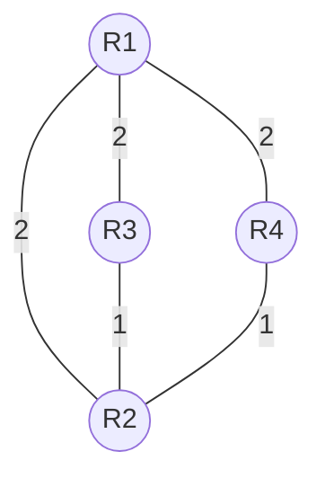

# Tutorial Weighted Constraint Coupling (WCC)

Weighted Constraint Coupling (WCC) mengukur keterkaitan antarbaris kendala berdasarkan **jumlah variabel keputusan yang dipakai bersama**. Misalnya, aturan kapasitas gudang dan aturan minimum kiriman sama-sama membatasi pengiriman A dan B ke Pelanggan 1. Kedua keputusan itu menghubungkan sepasang kendala, sehingga garisnya berbobot **2**. Pasangan lain yang hanya berbagi pengiriman A mendapat bobot **1**. Bobot ini membuat perbedaan kedua pasangan terlihat pada graf.

Untuk menghitungnya, jabarkan dulu indeks pada setiap kendala. Satu rumus yang berlaku untuk dua pelanggan menghasilkan dua baris, dan setiap keputusan pengiriman dikenali lewat nama variabel beserta seluruh indeksnya.

## Contoh cepat dengan tiga kendala

Hitung WCC langsung dari model berikut.

```math
\begin{aligned}
\text{R1}\quad & x_1+x_2=5 \\
\text{R2}\quad & x_2+x_3=4 \\
\text{R3}\quad & x_1+x_3=7
\end{aligned}
```

**1. Daftar semua pasangan baris.** R1 bisa berpasangan dengan R2 dan R3. Setelah itu, tersisa R2–R3. Jadi ada **3 pasangan yang mungkin**.

| Pasangan | Variabel yang muncul di kedua baris | Bobot |
| --- | --- | ---: |
| R1–R2 | $x_2$ | 1 |
| R1–R3 | $x_1$ | 1 |
| R2–R3 | $x_3$ | 1 |

**2. Jumlahkan bobotnya.** Ketiga pasangan masing-masing berbobot 1. Jadi total bobotnya **$1+1+1=3$**.

**3. Tentukan batas bobot per pasangan.** Setiap baris memuat dua variabel. Sepasang baris bisa berbagi paling banyak **2 variabel**, yaitu jika kedua baris memakai daftar variabel yang persis sama. Dalam tiga persamaan di atas, setiap pasangan berbagi satu variabel. Jadi **1 adalah bobot aktual** tiap pasangan dan **2 adalah batas skala** tiap pasangan.

**4. Bagi dengan jumlah pasangan dikali batas bobot.** Penyebutnya **$3 \times 2=6$**. Maka WCC-nya sebagai berikut.

```math
\mathrm{WCC} = \frac{3}{3\times 2}\times 100\% = 50\%
```

Cara membacanya: rata-rata ada **$3/3=1$ variabel bersama per pasangan**. Satu variabel dari batas dua variabel berarti **50%**.

## 1. Kasus pengiriman dan kendalanya

Gudang 1 mengirim produk A dan B ke dua pelanggan. Kedua produk dihitung dalam satuan paket. Gudang dapat menangani paling banyak **20 paket**. Produk A memerlukan penanganan dingin, dengan kapasitas **12 paket A** yang termasuk dalam kapasitas total gudang. Pelanggan 1 harus menerima sedikitnya **7 paket**, dan pelanggan 2 sedikitnya **6 paket**. Dalam contoh ini, kedua pelanggan dapat menerima kombinasi A dan B.

### Variabel keputusan

Notasi $x_{g,j,p}$ berarti jumlah paket produk $p$ yang dikirim dari gudang $g$ ke pelanggan $j$. Urutan indeksnya adalah **gudang, pelanggan, produk**. Karena hanya ada satu gudang, indeks pertama selalu 1.

| Variabel | Keputusan yang dicatat |
| --- | --- |
| $x_{1,1,A}$ | Paket A dari Gudang 1 ke Pelanggan 1 |
| $x_{1,1,B}$ | Paket B dari Gudang 1 ke Pelanggan 1 |
| $x_{1,2,A}$ | Paket A dari Gudang 1 ke Pelanggan 2 |
| $x_{1,2,B}$ | Paket B dari Gudang 1 ke Pelanggan 2 |

Sebagai contoh, $x_{1,1,A}=4$ dan $x_{1,2,A}=2$ berarti Gudang 1 mengirim empat paket A ke Pelanggan 1 dan dua paket A ke Pelanggan 2. Perbedaan pada indeks pelanggan membuat keduanya menjadi variabel yang berbeda, walaupun keduanya memakai huruf $x$ dan produk A yang sama.

### Empat baris kendala

**R1. Kapasitas total gudang**

```math
x_{1,1,A}+x_{1,1,B}+x_{1,2,A}+x_{1,2,B} \le 20
```

Keempat pengiriman memakai kapasitas gudang. Jika pengiriman pada urutan di atas adalah 4, 3, 2, dan 4 paket, kapasitas yang terpakai adalah $4+3+2+4=13$ paket.

**R2. Kapasitas penanganan dingin untuk produk A**

```math
x_{1,1,A}+x_{1,2,A} \le 12
```

Kendala ini menjumlahkan pengiriman produk A ke kedua pelanggan. Pada pengiriman yang sama, kapasitas dingin yang terpakai adalah $4+2=6$ paket A.

**R3 dan R4. Jumlah minimum paket untuk setiap pelanggan**

Kedua baris berasal dari satu rumus. Indeks $j$ menunjukkan pelanggan, $p$ menunjukkan produk, dan $d_j$ adalah jumlah paket minimum untuk pelanggan $j$.

```math
\sum_{p\in\{A,B\}} x_{1,j,p} \ge d_j, \qquad j\in\{1,2\}
```

Masukkan $j=1$ dan $d_1=7$ untuk memperoleh **R3**.

```math
x_{1,1,A}+x_{1,1,B} \ge 7
```

Pelanggan 1 menerima $4+3=7$ paket pada contoh pengiriman tadi.

Masukkan $j=2$ dan $d_2=6$ untuk memperoleh **R4**.

```math
x_{1,2,A}+x_{1,2,B} \ge 6
```

Pelanggan 2 menerima $2+4=6$ paket. Semua variabel pengiriman bernilai nonnegatif. Graf tutorial ini memakai empat baris kendala fungsional R1–R4. Nonnegativitas dicatat sebagai domain variabel.

## 2. Hitung jumlah pasangan yang mungkin dan bobotnya

### 2.1 Dari mana angka 6 berasal?

Ambil satu baris dan pasangkan dengan baris yang berada setelahnya. Dengan cara ini, setiap pasangan dicatat sekali.

| Mulai dari | Pasangkan dengan | Pasangan baru |
| --- | --- | ---: |
| R1 | R2, R3, R4 | 3 |
| R2 | R3, R4 | 2 |
| R3 | R4 | 1 |
| R4 | Selesai | 0 |
| **Total** | | **6** |

Secara umum, dengan $m$ baris, setiap baris dapat dipasangkan dengan $m-1$ baris lain. Perkalian $m(m-1)$ menghitung setiap pasangan dua kali, misalnya R1–R2 dan R2–R1. Karena urutannya tidak memengaruhi bobot, bagi hasilnya dengan 2. Huruf $N$ menyatakan jumlah semua pasangan yang mungkin.

```math
N = \frac{m(m-1)}{2}
= \frac{4(4-1)}{2}
= 6
```

Angka ini mencakup pasangan yang akhirnya berbobot nol. Kita menentukan $N$ dari jumlah baris sebelum memeriksa garis pada graf.

### 2.2 Hitung bobot keenam pasangan

Pertama, tandai variabel yang muncul pada setiap baris. Tanda ✓ berarti variabel dengan **nama dan seluruh indeks tersebut** muncul pada baris itu.

| Baris | $x_{1,1,A}$ | $x_{1,1,B}$ | $x_{1,2,A}$ | $x_{1,2,B}$ |
| --- | :---: | :---: | :---: | :---: |
| R1 · Kapasitas total | ✓ | ✓ | ✓ | ✓ |
| R2 · Kapasitas dingin | ✓ | | ✓ | |
| R3 · Minimum Pelanggan 1 | ✓ | ✓ | | |
| R4 · Minimum Pelanggan 2 | | | ✓ | ✓ |

Selanjutnya, ambil dua baris dan hitung kolom yang memiliki ✓ di **kedua** baris. Contohnya, R1 dan R2 sama-sama memiliki ✓ pada kolom $x_{1,1,A}$ dan $x_{1,2,A}$. Jadi bobot pasangan R1–R2 adalah $1+1=2$.

| Pasangan | Variabel yang sama persis di kedua baris | Bobot garis |
| --- | --- | ---: |
| R1–R2 | $x_{1,1,A}$ dan $x_{1,2,A}$ | 2 |
| R1–R3 | $x_{1,1,A}$ dan $x_{1,1,B}$ | 2 |
| R1–R4 | $x_{1,2,A}$ dan $x_{1,2,B}$ | 2 |
| R2–R3 | $x_{1,1,A}$ | 1 |
| R2–R4 | $x_{1,2,A}$ | 1 |
| R3–R4 | Tidak ada. Indeks pelanggan pada R3 adalah 1 dan pada R4 adalah 2. | 0 |

Perhatikan R3–R4. Kedua baris menyebut produk A dan B. Namun, $x_{1,1,A}$ masuk ke R3, sedangkan $x_{1,2,A}$ masuk ke R4. Untuk produk B, perbedaan indeks pelanggannya juga sama. Karena tidak ada kolom yang ditandai pada kedua baris, bobotnya **0**.

## 3. Gambar graf kendala

Setiap lingkaran mewakili satu baris kendala. Garis muncul jika dua baris memakai sedikitnya satu variabel yang sama. Angka pada garis menunjukkan jumlah variabel yang digunakan bersama. R3 dan R4 tidak memiliki garis langsung.



## 4. Dari mana rumus bobot berasal?

### 4.1 Hitung satu pasangan dulu

Ambil **R1 dan R2**. Baca kedua baris dan beri **1** untuk setiap variabel yang muncul di keduanya, atau **0** jika variabel itu hanya muncul di salah satu baris.

| Variabel | Ada di R1? | Ada di R2? | Sumbangan ke bobot R1–R2 |
| --- | :---: | :---: | ---: |
| $x_{1,1,A}$ | Ya | Ya | 1 |
| $x_{1,1,B}$ | Ya | Tidak | 0 |
| $x_{1,2,A}$ | Ya | Ya | 1 |
| $x_{1,2,B}$ | Ya | Tidak | 0 |
| **Total** | | | **2** |

Inilah asal angka **2** pada garis R1–R2. Nilai pengirimannya, misalnya empat paket A ke Pelanggan 1, digunakan untuk memeriksa kapasitas pada model. Untuk menghitung bobot, kemunculan variabel pengiriman tersebut menyumbang **1** ke pasangan R1–R2.

Dalam notasi matematika, $S_r$ adalah daftar variabel pada baris R yang bernomor $r$. Jadi $S_1$ berisi empat variabel pengiriman pada R1. $S_2$ berisi dua variabel pengiriman produk A pada R2. Simbol $\cap$ berarti mengambil anggota yang ada di kedua daftar.

```math
S_1 \cap S_2 = \{x_{1,1,A},\ x_{1,2,A}\}
```

Hasilnya berisi dua anggota. Jika $R_r$ dan $R_s$ adalah dua baris yang sedang dibandingkan, $w_{rs}$ adalah bobot garis penghubungnya. Tanda $\lvert\,\cdot\,\rvert$ pada rumus berikut berarti menghitung banyaknya anggota.

```math
w_{rs} = \lvert S_r \cap S_s \rvert
```

### 4.2 Jumlahkan bobot seluruh pasangan

Huruf $B$ menyatakan total bobot keenam pasangan yang sudah didaftar pada bagian 2.1.

```math
B = w_{12}+w_{13}+w_{14}+w_{23}+w_{24}+w_{34}
```

Masukkan bobot dari tabel pasangan di bagian 2 sesuai urutan. R3–R4 ikut diperiksa dengan bobot 0.

```math
B = 2 + 2 + 2 + 1 + 1 + 0 = 8
```

Angka **8** berasal dari penjumlahan lima label pada graf. Dalam contoh ini, ada empat variabel pengiriman, dan satu variabel bisa menyumbang bobot ke lebih dari satu pasangan. Misalnya, $x_{1,1,A}$ muncul di R1, R2, dan R3. Variabel ini menyumbang satu ke R1–R2, satu ke R1–R3, dan satu ke R2–R3. Kita bisa memeriksa hasil 8 dengan menghitung dari sisi variabel.

| Variabel | Baris tempat variabel muncul | Pasangan yang mendapat tambahan 1 | Sumbangan |
| --- | --- | --- | ---: |
| $x_{1,1,A}$ | R1, R2, R3 | R1–R2, R1–R3, R2–R3 | 3 |
| $x_{1,1,B}$ | R1, R3 | R1–R3 | 1 |
| $x_{1,2,A}$ | R1, R2, R4 | R1–R2, R1–R4, R2–R4 | 3 |
| $x_{1,2,B}$ | R1, R4 | R1–R4 | 1 |
| **Total** | | | **8** |

Untuk model yang lebih besar, $P$ menyatakan daftar semua pasangan baris berbeda, dengan setiap pasangan dicatat sekali. Simbol $\sum$ menyingkat penjumlahan bobot pada daftar itu.

```math
B = \sum_{(r,s) \in P} w_{rs}
```

## 5. Hitung batas bobot dan WCC dari model pengiriman

### 5.1 Bagaimana menghitung batas bobot per pasangan?

Hitung banyaknya variabel pada tiap baris. Pada tabel kemunculan variabel di bagian 2.2, R1 memiliki **4** tanda centang, sedangkan R2, R3, dan R4 masing-masing memiliki **2**.

Ambil R1–R2. R1 memiliki empat variabel dan R2 memiliki dua. Jumlah yang bisa muncul di keduanya dibatasi oleh R2, karena daftar R2 hanya punya dua tempat. Maka batas pasangan ini adalah $\min(4,2)=2$. Fungsi $\min$ mengambil angka yang lebih kecil. Terapkan aturan itu ke keenam pasangan.

| Pasangan | Banyak variabel pada masing-masing baris | Batas dari banyaknya variabel | Bobot aktual dari irisan |
| --- | --- | ---: | ---: |
| R1–R2 | 4 dan 2 | 2 | 2 |
| R1–R3 | 4 dan 2 | 2 | 2 |
| R1–R4 | 4 dan 2 | 2 | 2 |
| R2–R3 | 2 dan 2 | 2 | 1 |
| R2–R4 | 2 dan 2 | 2 | 1 |
| R3–R4 | 2 dan 2 | 2 | 0 |

Kolom batas memakai **banyaknya variabel** pada tiap baris. Kolom aktual memakai **daftar variabel yang benar-benar sama**. Misalnya, batas R3–R4 adalah 2 karena tiap baris punya dua variabel. Bobot aktualnya 0 karena R3 memakai variabel untuk Pelanggan 1 dan R4 memakai variabel untuk Pelanggan 2.

Untuk memakai satu skala yang sama pada seluruh pasangan, ambil nilai terbesar dari kolom batas. Sebut angka itu $K$. Dengan begitu, $K$ merupakan batas atas untuk bobot semua pasangan. Di model pengiriman ini, keenam batas bernilai 2, sehingga **$K=2$**. Aturan ini tetap berlaku kalau banyaknya variabel berbeda antarpasangan. Selalu ambil angka terkecil di dalam tiap pasangan, lalu ambil yang terbesar dari semua batas pasangan.

### 5.2 Mengapa penyebutnya 12?

Model ini mempunyai **6 pasangan yang mungkin**. Setiap pasangan dinilai pada skala dari 0 sampai **2**. Jadi batas skala seragam untuk total bobot adalah **$6\times 2=12$**.

Dari graf, ada tiga garis berbobot 2 dan dua garis berbobot 1. Pasangan R3–R4 menyumbang 0. Jadi pembilangnya **$(2\times 3)+(1\times 2)+0=8$**. Hasil WCC untuk empat kendala yang ditulis pada bagian 1 adalah sebagai berikut.

```math
\mathrm{WCC}
= \frac{\text{total bobot aktual}}{\text{jumlah pasangan yang mungkin}\times\text{batas seragam per pasangan}}
\times 100\%
= \frac{8}{6\times 2}\times 100\%
\approx 66{,}67\%
```

| Angka | Arti | Cara memperoleh |
| --- | --- | --- |
| **6** | Jumlah pasangan yang mungkin | Daftar pasangan dari 4 baris |
| **2** | Batas bobot seragam per pasangan | Nilai terbesar pada kolom batas |
| **8** | Total bobot aktual | Jumlah variabel bersama, dijumlahkan pada keenam pasangan |
| **12** | Penyebut untuk persentase | 6 pasangan dikali batas 2 |
| **66,67%** | WCC model pengiriman | 8 dibagi 12, lalu dikali 100% |

Hasil yang sama bisa dibaca dalam dua langkah. Rata-rata aktualnya $8/6$, sekitar **1,33 variabel bersama per pasangan**. Dibandingkan dengan batas **2 variabel per pasangan**, rata-rata itu mencapai **66,67%**. Pada skala ini, 100% berarti setiap pasangan mencapai batas seragamnya.

## 6. Contoh ketika NNZ berbeda pada setiap baris

**NNZ** (*number of nonzeros*) adalah jumlah koefisien selain nol dalam satu baris kendala. Setelah suku sejenis digabungkan, NNZ menunjukkan berapa variabel yang muncul pada baris itu. Pada contoh ini, koefisien 2 untuk $x_1$ pada R2 tetap dihitung sebagai satu kemunculan variabel.

```math
\begin{aligned}
\text{R1}\quad & x_1+x_2=2 \\
\text{R2}\quad & 2x_1+x_2+x_3=4 \\
\text{R3}\quad & x_1+x_4+x_5+x_6=4 \\
\text{R4}\quad & x_3+x_4+x_5+x_6+x_7=5
\end{aligned}
```

| Kendala | Variabel yang muncul | NNZ |
| --- | --- | ---: |
| R1 | $x_1,x_2$ | 2 |
| R2 | $x_1,x_2,x_3$ | 3 |
| R3 | $x_1,x_4,x_5,x_6$ | 4 |
| R4 | $x_3,x_4,x_5,x_6,x_7$ | 5 |

Empat baris menghasilkan **6 pasangan yang mungkin**. Pada setiap pasangan, baca dua hal:

- **Bobot aktual** adalah jumlah variabel yang benar-benar muncul di kedua baris.
- **Batas dari NNZ** adalah NNZ yang lebih kecil pada pasangan tersebut. Irisan kedua daftar paling besar sebesar ukuran daftar yang lebih pendek.

| Pasangan | NNZ kedua baris | Variabel bersama | Bobot aktual | Batas dari NNZ |
| --- | --- | --- | ---: | ---: |
| R1–R2 | 2 dan 3 | $x_1,x_2$ | 2 | 2 |
| R1–R3 | 2 dan 4 | $x_1$ | 1 | 2 |
| R1–R4 | 2 dan 5 | Tidak ada | 0 | 2 |
| R2–R3 | 3 dan 4 | $x_1$ | 1 | 3 |
| R2–R4 | 3 dan 5 | $x_3$ | 1 | 3 |
| R3–R4 | 4 dan 5 | $x_4,x_5,x_6$ | 3 | 4 |

**Lihat R3–R4.** Daftar R3 berisi empat variabel, sehingga batas dari NNZ-nya adalah $\min(4,5)=4$. Ketika dicocokkan, hanya $x_4$, $x_5$, dan $x_6$ yang muncul juga di R4. Jadi bobot aktualnya **3**. R1–R4 juga tetap dihitung sebagai satu pasangan dalam penyebut, dengan bobot aktual **0**.

Jumlahkan bobot aktual untuk mendapat $B=2+1+0+1+1+3=8$. Lalu ambil **nilai terbesar** dari kolom batas, yaitu $K=4$. Nilai ini menjadi satu batas seragam untuk enam pasangan. Dengan definisi WCC di tutorial ini, penyebutnya adalah $6\times4=24$.

```math
\mathrm{WCC} = \frac{B}{N\times K}\times 100\%
= \frac{8}{6\times4}\times100\%
\approx 33{,}33\%
```

## 7. Terapkan pada model lain

1. Tetapkan baris kendala fungsional yang dihitung pada formulasi sebelum *presolve*. Fungsi tujuan dan deklarasi domain berada di luar graf ini.
2. Jabarkan rumus berindeks menjadi baris terpisah. Catat nama dan **seluruh indeks** variabel pada setiap baris. Untuk baris linear, gabungkan suku sejenis terlebih dahulu. Catat satu kali setiap variabel dengan koefisien akhir bukan nol.
3. Periksa setiap pasangan baris sekali. Beri satu poin untuk setiap variabel berindeks lengkap yang muncul di kedua baris. Jumlahkan seluruh bobot pasangan untuk memperoleh $B$.
4. Hitung jumlah pasangan yang mungkin dengan $N=m(m-1)/2$. Pasangan yang bobotnya nol tetap masuk dalam $N$.
5. Untuk setiap pasangan, ambil jumlah variabel yang lebih kecil dari dua barisnya. Gunakan nilai terbesar dari hasil langkah itu sebagai batas seragam $K$ untuk model ini.
6. Hitung persentase WCC dengan $100\%\times B/(N\times K)$, dengan $N$ dan $K$ positif.

Kesamaan WCC dengan penyebut yang sama menunjukkan kesamaan **total bobot**. Jika yang ingin dipastikan juga mencakup kesamaan garis serta variabel yang menghubungkannya, periksa daftar variabel bersama **pada setiap pasangan baris**.

## Referensi

- Gasse et al. (2019) merepresentasikan MILP sebagai graf bipartit variabel dan kendala. Pada tutorial ini, hubungan awal menunjukkan apakah suatu variabel muncul pada suatu baris kendala. [NeurIPS 2019](https://papers.neurips.cc/paper_files/paper/2019/hash/d14c2267d848abeb81fd590f371d39bd-Abstract.html)
- Cann, Weaver, dan Williams (2020), Persamaan (2), menjelaskan proyeksi dengan bobot berupa jumlah tetangga bersama. Di sini tetangga bersama sepasang baris adalah variabel keputusan yang muncul di keduanya. Normalisasi dengan jumlah pasangan dan batas seragam $K$ adalah definisi operasional WCC yang dipakai di tutorial ini. [Network Science](https://doi.org/10.1017/nws.2020.11)
