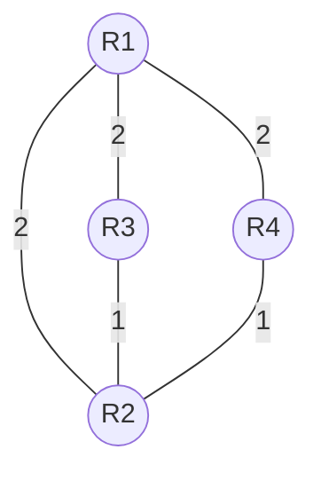

# Tutorial Weighted Constraint Coupling (WCC)

Weighted Constraint Coupling (WCC) mengukur keterkaitan antarbaris kendala berdasarkan **jumlah variabel keputusan yang dipakai bersama**. Misalnya, aturan kapasitas gudang dan aturan minimum kiriman sama-sama membatasi pengiriman A dan B ke Pelanggan 1. Kedua keputusan itu menghubungkan sepasang kendala, sehingga garisnya berbobot **2**. Pasangan lain yang hanya berbagi pengiriman A mendapat bobot **1**. Bobot ini membuat perbedaan kedua pasangan terlihat pada graf.

Untuk menghitungnya, jabarkan dulu indeks pada setiap kendala. Satu rumus yang berlaku untuk dua pelanggan menghasilkan dua baris, dan setiap keputusan pengiriman dikenali lewat nama variabel beserta seluruh indeksnya.

## 1. Kasus dan kendala

Gudang 1 mengirim produk A dan B ke dua pelanggan. Kedua produk dihitung dalam satuan paket. Gudang dapat menangani paling banyak **20 paket**. Produk A memerlukan penanganan dingin, dengan kapasitas **12 paket A** yang termasuk dalam kapasitas total gudang. Pelanggan 1 harus menerima sedikitnya **7 paket**, dan pelanggan 2 sedikitnya **6 paket**. Dalam contoh ini, kedua pelanggan dapat menerima kombinasi A dan B.

### Variabel keputusan

Notasi $x_{g,j,p}$ berarti jumlah paket produk $p$ yang dikirim dari gudang $g$ ke pelanggan $j$. Urutan indeksnya adalah **gudang, pelanggan, produk**. Karena hanya ada satu gudang, indeks pertama selalu 1.

| Variabel | Keputusan yang dicatat |
| --- | --- |
| $x_{1,1,A}$ | Paket A dari Gudang 1 ke Pelanggan 1 |
| $x_{1,1,B}$ | Paket B dari Gudang 1 ke Pelanggan 1 |
| $x_{1,2,A}$ | Paket A dari Gudang 1 ke Pelanggan 2 |
| $x_{1,2,B}$ | Paket B dari Gudang 1 ke Pelanggan 2 |

Sebagai contoh, $x_{1,1,A}=4$ dan $x_{1,2,A}=2$ berarti Gudang 1 mengirim empat paket A ke Pelanggan 1 dan dua paket A ke Pelanggan 2. Perbedaan pada indeks pelanggan membuat keduanya menjadi variabel yang berbeda, walaupun keduanya memakai huruf $x$ dan produk A yang sama.

### Empat baris kendala

**R1. Kapasitas total gudang**

```math
x_{1,1,A}+x_{1,1,B}+x_{1,2,A}+x_{1,2,B} \le 20
```

Keempat pengiriman memakai kapasitas gudang. Jika pengiriman pada urutan di atas adalah 4, 3, 2, dan 4 paket, kapasitas yang terpakai adalah $4+3+2+4=13$ paket.

**R2. Kapasitas penanganan dingin untuk produk A**

```math
x_{1,1,A}+x_{1,2,A} \le 12
```

Kendala ini menjumlahkan pengiriman produk A ke kedua pelanggan. Pada pengiriman yang sama, kapasitas dingin yang terpakai adalah $4+2=6$ paket A.

**R3 dan R4. Jumlah minimum paket untuk setiap pelanggan**

Kedua baris berasal dari satu rumus. Indeks $j$ menunjukkan pelanggan, $p$ menunjukkan produk, dan $d_j$ adalah jumlah paket minimum untuk pelanggan $j$.

```math
\sum_{p\in\{A,B\}} x_{1,j,p} \ge d_j, \qquad j\in\{1,2\}
```

Masukkan $j=1$ dan $d_1=7$ untuk memperoleh **R3**.

```math
x_{1,1,A}+x_{1,1,B} \ge 7
```

Pelanggan 1 menerima $4+3=7$ paket pada contoh pengiriman tadi.

Masukkan $j=2$ dan $d_2=6$ untuk memperoleh **R4**.

```math
x_{1,2,A}+x_{1,2,B} \ge 6
```

Pelanggan 2 menerima $2+4=6$ paket. Semua variabel pengiriman bernilai nonnegatif. Graf tutorial ini memakai empat baris kendala fungsional R1–R4. Nonnegativitas dicatat sebagai domain variabel.

## 2. Bandingkan keenam pasangan baris satu per satu

Pertama, tandai variabel yang muncul pada setiap baris. Tanda ✓ berarti variabel dengan **nama dan seluruh indeks tersebut** muncul pada baris itu.

| Baris | $x_{1,1,A}$ | $x_{1,1,B}$ | $x_{1,2,A}$ | $x_{1,2,B}$ |
| --- | :---: | :---: | :---: | :---: |
| R1 · Kapasitas total | ✓ | ✓ | ✓ | ✓ |
| R2 · Kapasitas dingin | ✓ | | ✓ | |
| R3 · Minimum Pelanggan 1 | ✓ | ✓ | | |
| R4 · Minimum Pelanggan 2 | | | ✓ | ✓ |

Selanjutnya, ambil dua baris dan hitung kolom yang memiliki ✓ di **kedua** baris. Contohnya, R1 dan R2 sama-sama memiliki ✓ pada kolom $x_{1,1,A}$ dan $x_{1,2,A}$. Jadi bobot pasangan R1–R2 adalah $1+1=2$.

| Pasangan | Variabel yang sama persis di kedua baris | Bobot garis |
| --- | --- | ---: |
| R1–R2 | $x_{1,1,A}$ dan $x_{1,2,A}$ | 2 |
| R1–R3 | $x_{1,1,A}$ dan $x_{1,1,B}$ | 2 |
| R1–R4 | $x_{1,2,A}$ dan $x_{1,2,B}$ | 2 |
| R2–R3 | $x_{1,1,A}$ | 1 |
| R2–R4 | $x_{1,2,A}$ | 1 |
| R3–R4 | Tidak ada. Indeks pelanggan pada R3 adalah 1 dan pada R4 adalah 2. | 0 |

Perhatikan R3–R4. Kedua baris menyebut produk A dan B. Namun, $x_{1,1,A}$ masuk ke R3, sedangkan $x_{1,2,A}$ masuk ke R4. Untuk produk B, perbedaan indeks pelanggannya juga sama. Karena tidak ada kolom yang ditandai pada kedua baris, bobotnya **0**.

## 3. Gambar graf kendala

Setiap lingkaran mewakili satu baris kendala. Garis muncul jika dua baris memakai sedikitnya satu variabel yang sama. Angka pada garis menunjukkan jumlah variabel yang digunakan bersama. R3 dan R4 tidak memiliki garis langsung.



## 4. Dari mana rumus bobot berasal?

### 4.1 Hitung satu pasangan dulu

Ambil **R1 dan R2**. Baca kedua baris dan beri **1** untuk setiap variabel yang muncul di keduanya, atau **0** jika variabel itu hanya muncul di salah satu baris.

| Variabel | Ada di R1? | Ada di R2? | Sumbangan ke bobot R1–R2 |
| --- | :---: | :---: | ---: |
| $x_{1,1,A}$ | Ya | Ya | 1 |
| $x_{1,1,B}$ | Ya | Tidak | 0 |
| $x_{1,2,A}$ | Ya | Ya | 1 |
| $x_{1,2,B}$ | Ya | Tidak | 0 |
| **Total** | | | **2** |

Inilah asal angka **2** pada garis R1–R2. Nilai pengirimannya, misalnya empat paket A ke Pelanggan 1, digunakan untuk memeriksa kapasitas pada model. Untuk menghitung bobot, kemunculan variabel pengiriman tersebut menyumbang **1** ke pasangan R1–R2.

Dalam notasi matematika, $S_r$ adalah daftar variabel pada baris R yang bernomor $r$. Jadi $S_1$ berisi empat variabel pengiriman pada R1. $S_2$ berisi dua variabel pengiriman produk A pada R2. Simbol $\cap$ berarti mengambil anggota yang ada di kedua daftar.

```math
S_1 \cap S_2 = \{x_{1,1,A},\ x_{1,2,A}\}
```

Hasilnya berisi dua anggota. Jika $R_r$ dan $R_s$ adalah dua baris yang sedang dibandingkan, $w_{rs}$ adalah bobot garis penghubungnya. Tanda $\lvert\,\cdot\,\rvert$ pada rumus berikut berarti menghitung banyaknya anggota.

```math
w_{rs} = \lvert S_r \cap S_s \rvert
```

### 4.2 Jumlahkan bobot seluruh pasangan

R1 membentuk tiga pasangan dengan R2, R3, dan R4. Setelah itu, R2 membentuk dua pasangan baru dengan R3 dan R4. Terakhir, tersisa R3–R4. Jadi ada **3 + 2 + 1 = 6 pasangan**, masing-masing dihitung sekali. Huruf $B$ menyatakan total bobot keenam pasangan.

```math
B = w_{12}+w_{13}+w_{14}+w_{23}+w_{24}+w_{34}
```

Masukkan bobot dari tabel pasangan di bagian 2 sesuai urutan. R3–R4 ikut diperiksa dengan bobot 0.

```math
B = 2 + 2 + 2 + 1 + 1 + 0 = 8
```

Angka **8** berasal dari penjumlahan lima label pada graf. Dalam contoh ini, ada empat variabel pengiriman, dan satu variabel bisa menyumbang bobot ke lebih dari satu pasangan. Misalnya, $x_{1,1,A}$ muncul di R1, R2, dan R3. Variabel ini menyumbang satu ke R1–R2, satu ke R1–R3, dan satu ke R2–R3. Kita bisa memeriksa hasil 8 dengan menghitung dari sisi variabel.

| Variabel | Baris tempat variabel muncul | Pasangan yang mendapat tambahan 1 | Sumbangan |
| --- | --- | --- | ---: |
| $x_{1,1,A}$ | R1, R2, R3 | R1–R2, R1–R3, R2–R3 | 3 |
| $x_{1,1,B}$ | R1, R3 | R1–R3 | 1 |
| $x_{1,2,A}$ | R1, R2, R4 | R1–R2, R1–R4, R2–R4 | 3 |
| $x_{1,2,B}$ | R1, R4 | R1–R4 | 1 |
| **Total** | | | **8** |

Untuk model yang lebih besar, $P$ menyatakan daftar semua pasangan baris berbeda, dengan setiap pasangan dicatat sekali. Simbol $\sum$ menyingkat penjumlahan bobot pada daftar itu.

```math
B = \sum_{(r,s) \in P} w_{rs}
```

## 5. Hitung versi rute terbatas dan bandingkan skornya

### 5.1 Mengapa bobot R1–R4 turun dari 2 menjadi 1?

Pada versi awal, R1 menghitung semua kiriman gudang dan R4 menghitung kiriman ke Pelanggan 2. Karena itu, kiriman A dan kiriman B ke Pelanggan 2 muncul di kedua baris.

```math
\begin{aligned}
\text{R1}\quad & x_{1,1,A}+x_{1,1,B}+x_{1,2,A}+x_{1,2,B} \le 20 \\
\text{R4}\quad & x_{1,2,A}+x_{1,2,B} \ge 6
\end{aligned}
```

Pada versi rute terbatas, Pelanggan 2 hanya menerima A. Aturan ini menghapus keputusan pengiriman $x_{1,2,B}$ dari model. Suku itu hilang dari R1 dan R4.

```math
\begin{aligned}
\text{R1}\quad & x_{1,1,A}+x_{1,1,B}+x_{1,2,A} \le 20 \\
\text{R4}\quad & x_{1,2,A} \ge 6
\end{aligned}
```

Sekarang yang muncul di kedua baris tinggal $x_{1,2,A}$. Jadi garis R1–R4 masih ada, dengan label **1**. Jika rute B tetap tersedia dan solver kebetulan memilih kiriman nol, $x_{1,2,B}$ tetap muncul di kedua kendala dan bobotnya tetap **2**. Bobot mengikuti variabel yang muncul pada formulasi, terlepas dari nilai yang dipilih solver.

| Pasangan | Bobot versi awal | Variabel bersama pada versi rute terbatas | Bobot pada versi rute terbatas |
| --- | ---: | --- | ---: |
| R1–R2 | 2 | $x_{1,1,A}$ dan $x_{1,2,A}$ | 2 |
| R1–R3 | 2 | $x_{1,1,A}$ dan $x_{1,1,B}$ | 2 |
| R1–R4 | 2 | $x_{1,2,A}$ | 1 |
| R2–R3 | 1 | $x_{1,1,A}$ | 1 |
| R2–R4 | 1 | $x_{1,2,A}$ | 1 |
| R3–R4 | 0 | Tidak ada | 0 |
| **Total** | **8** | | **7** |

### 5.2 Bobot dikali jumlah garis

Di versi rute terbatas, ada **2 garis berbobot 2** dan **3 garis berbobot 1**. Mengalikan bobot dengan jumlah garis pada setiap kelompok memberi hasil yang sama dengan menjumlahkan label satu per satu.

```math
B = (2 \times 2) + (1 \times 3) = 7
```

Jika pembaginya adalah **5 garis yang ada**, hasilnya $7/5=1{,}4$ variabel bersama per garis. Ukuran itu menjawab seberapa kuat hubungan yang terbentuk. Jika pertanyaannya mencakup semua pasangan baris, R3–R4 juga ikut dihitung dengan bobot nol. Pembaginya menjadi **6 pasangan yang mungkin**, sehingga rata-ratanya $7/6\approx1{,}17$ variabel bersama per pasangan.

### 5.3 Persentase untuk membandingkan tingkat WCC

Untuk pelaporan Low–Medium–High, gunakan semua pasangan yang mungkin dan tetapkan batas bobot per pasangan yang sama untuk seluruh versi. Sebut batas itu $K_{\mathrm{ref}}$. Pada contoh empat baris ini, bobot terbesar pada versi awal adalah **2**. Versi yang hanya menghapus rute dari formulasi awal memiliki jumlah variabel bersama yang sama atau lebih kecil pada setiap pasangan. Jadi angka 2 juga merupakan batas untuk semua versi tersebut.

```math
\mathrm{WCC} =
\frac{\text{total bobot semua pasangan}}
{\text{jumlah pasangan yang mungkin} \times K_{\mathrm{ref}}}
\times 100\%
```

Enam pasangan dikali batas 2 memberi penyebut **12**. Angka 12 adalah batas seragam untuk skala ini. Struktur kendala dapat membuat sebagian pasangan selalu berada di bawah batas tersebut.

| Versi contoh | Total bobot | Pasangan yang mungkin | Batas per pasangan | WCC |
| --- | ---: | ---: | ---: | ---: |
| Awal | 8 | 6 | 2 | $8/12 \times 100\% = 66{,}67\%$ |
| Rute terbatas | 7 | 6 | 2 | $7/12 \times 100\% = 58{,}33\%$ |

Versi rute terbatas memiliki WCC lebih rendah pada skala yang sama. Untuk menetapkan kategori Low pada model penelitian, terapkan rumus pada semua baris model tersebut dan bandingkan hasilnya dengan ambang yang ditetapkan.

Jika tujuan perhitungannya hanya mengetahui **berapa bagian bobot versi awal yang masih ada**, penyebutnya adalah total bobot versi awal, yaitu **8**. Untuk pertanyaan itu, hasilnya $7/8=87{,}5\%$. Ketiga pembagi menjawab tiga pertanyaan berbeda.

| Pembagi pada versi rute terbatas | Pertanyaan | Hasil |
| --- | --- | ---: |
| 5 garis dengan bobot positif | Berapa rata-rata jumlah variabel bersama pada garis yang ada? | 1,4 |
| $6 \times 2 = 12$ | Berapa persen total bobot terhadap batas seragam seluruh pasangan? | 58,33% |
| 8 poin bobot pada versi awal | Berapa persen total bobot versi awal yang masih ada? | 87,5% |

## 6. Terapkan pada model lain

1. Tetapkan baris kendala fungsional yang dihitung pada formulasi sebelum *presolve*. Fungsi tujuan dan deklarasi domain berada di luar graf ini.
2. Jabarkan rumus berindeks menjadi baris terpisah. Catat nama dan **seluruh indeks** variabel pada setiap baris. Untuk baris linear, gabungkan suku sejenis terlebih dahulu. Catat satu kali setiap variabel dengan koefisien akhir bukan nol.
3. Periksa setiap pasangan baris sekali. Beri satu poin untuk setiap variabel berindeks lengkap yang muncul di kedua baris. Jumlahkan seluruh bobot pasangan untuk memperoleh $B$.
4. Untuk melaporkan WCC dalam persen, bagi $B$ dengan jumlah pasangan yang mungkin dikali $K_{\mathrm{ref}}$, lalu kalikan dengan 100%. Untuk perbandingan versi dengan baris yang sama, tetapkan satu batas $K_{\mathrm{ref}}$ positif yang berlaku pada seluruh versi.

Kesamaan WCC dengan penyebut yang sama menunjukkan kesamaan **total bobot**. Jika yang ingin dipastikan juga mencakup kesamaan garis serta variabel yang menghubungkannya, periksa daftar variabel bersama **pada setiap pasangan baris**.

## Referensi

- Gasse et al. (2019) merepresentasikan MILP sebagai graf bipartit variabel dan kendala. Pada tutorial ini, hubungan awal menunjukkan apakah suatu variabel muncul pada suatu baris kendala. [NeurIPS 2019](https://papers.neurips.cc/paper_files/paper/2019/hash/d14c2267d848abeb81fd590f371d39bd-Abstract.html)
- Cann, Weaver, dan Williams (2020), Persamaan (2), menjelaskan proyeksi dengan bobot berupa jumlah tetangga bersama. Di sini tetangga bersama sepasang baris adalah variabel keputusan yang muncul di keduanya. Normalisasi WCC dengan batas seragam $K_{\mathrm{ref}}$ adalah definisi operasional yang digunakan untuk perbandingan tingkat pada tutorial ini. [Network Science](https://doi.org/10.1017/nws.2020.11)
