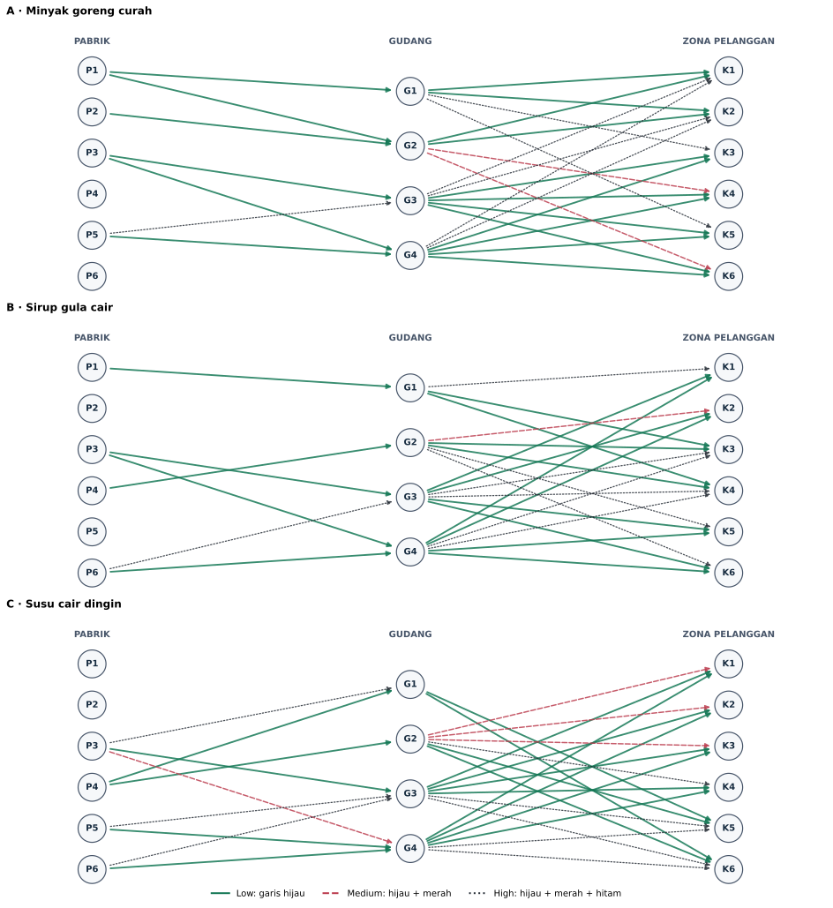

# Kasus distribusi PT XYZ Bahan Pangan

PT XYZ Bahan Pangan adalah perusahaan fiktif yang memasok **minyak goreng curah (A)**, **sirup gula cair (B)**, dan **susu cair dingin (C)**. Perusahaan memiliki enam pabrik dan empat calon gudang untuk melayani enam zona pelanggan selama satu periode. Barang melewati dua tahap pengiriman, yaitu **pabrik → gudang** dan **gudang → zona pelanggan**.

Perusahaan menentukan **gudang mana yang dibuka** dan **berapa ton setiap produk dikirim melalui tiap rute**. Sebagai contoh, zona K1 dapat menerima **1,25 ton minyak dari G1** dan **1,75 ton dari G2** untuk memenuhi pesanannya sebesar **3 ton**. Jumlah kiriman boleh pecahan.

## Rute Low, Medium, dan High

| Tingkat | Panah yang dibaca | Pabrik → gudang | Gudang → zona |
| --- | --- | ---: | ---: |
| Low | Hijau penuh | 16 | 36 |
| Medium | Hijau + merah putus-putus | 21 | 43 |
| High | Hijau + merah putus-putus + hitam bertitik | 35 | 57 |

Ikuti panah untuk **produk yang sama** pada kedua tahap. Untuk minyak goreng, misalnya, **P1 → G1 → K1** tersedia sejak Low. Rute lengkap memerlukan kedua panah pada tingkat yang dipilih serta gudang yang dibuka. Pabrik, gudang, zona, permintaan, tarif, dan kapasitas pada kasus dasar sama di ketiga tingkat.

## Aturan pengiriman

1. **Pabrik.** Setiap pabrik dapat memasok maksimal 8 ton. Ketiga produk berbagi batas tersebut.
2. **Gudang.** Gudang yang dibuka dapat menerima dan mengirim barang sampai batas tonase dan waktu penanganannya. Barang yang diterima harus dikirim kembali dalam periode yang sama, per produk. Gudang yang ditutup memiliki arus masuk dan keluar nol.
3. **Zona pelanggan.** Pesanan per produk harus dipenuhi tepat. Kiriman dapat dibagi ke beberapa gudang yang melayani produk dan zona tersebut.
4. **Tarif.** Perusahaan membayar biaya buka gudang satu kali. Biaya angkut dibayar pada kedua tahap, dan biaya penanganan dikenakan sekali per ton yang melewati gudang. Semua angka biaya memakai satuan biaya sintetis.

| Calon gudang | Kapasitas (ton) | Waktu tersedia (jam) | Biaya buka |
| --- | ---: | ---: | ---: |
| G1 | 16 | 19,20 | 25 |
| G2 | 20 | 24,00 | 31 |
| G3 | 18 | 21,60 | 28 |
| G4 | 14 | 16,80 | 17 |

Untuk minyak goreng dari **P1 lewat G1 ke K1**, tarif dasar per ton adalah 2 untuk angkut masuk, 1 untuk penanganan, dan 2 untuk angkut keluar. Jumlahnya **5 per ton**. Biaya membuka G1, jika dipilih, dihitung terpisah.

## Kapasitas fisik dan waktu penanganan

Kapasitas tonase mengukur **berapa banyak barang** yang dapat ditangani. Batas waktu mengukur **berapa jam kerja** yang tersedia. Pada data uji, untuk tiap ton kapasitas tersedia 1,2 jam. Karena itu, G3 yang berkapasitas 18 ton mempunyai waktu 21,60 jam.

- **Penanganan linear.** Setiap ton membutuhkan satu jam. Menangani 18 ton di G3 memerlukan 18 jam, sehingga memenuhi kedua batas.
- **Penanganan nonlinear.** Volume setiap produk menambah waktu secara kuadratik. Sebagai contoh, menangani 10 ton sirup dan 8 ton susu di G3 memerlukan $18+0{,}025(10^2+8^2)=22{,}10$ jam. Rencana ini memenuhi batas tonase dan melampaui waktu tersedia sebesar 0,50 jam.

## Permintaan dasar

| Zona | Minyak goreng (ton) | Sirup gula (ton) | Susu dingin (ton) |
| --- | ---: | ---: | ---: |
| K1 | 3 | 1 | 1 |
| K2 | 3 | 1 | 1 |
| K3 | 1 | 3 | 1 |
| K4 | 1 | 3 | 1 |
| K5 | 1 | 1 | 3 |
| K6 | 1 | 1 | 3 |

[Data rute, tarif, emisi, dan permintaan](Data_Bersama.json) · [Varian kasus P1–P8](Profil_P1_P8.md) · [Halaman utama](../README.md)
