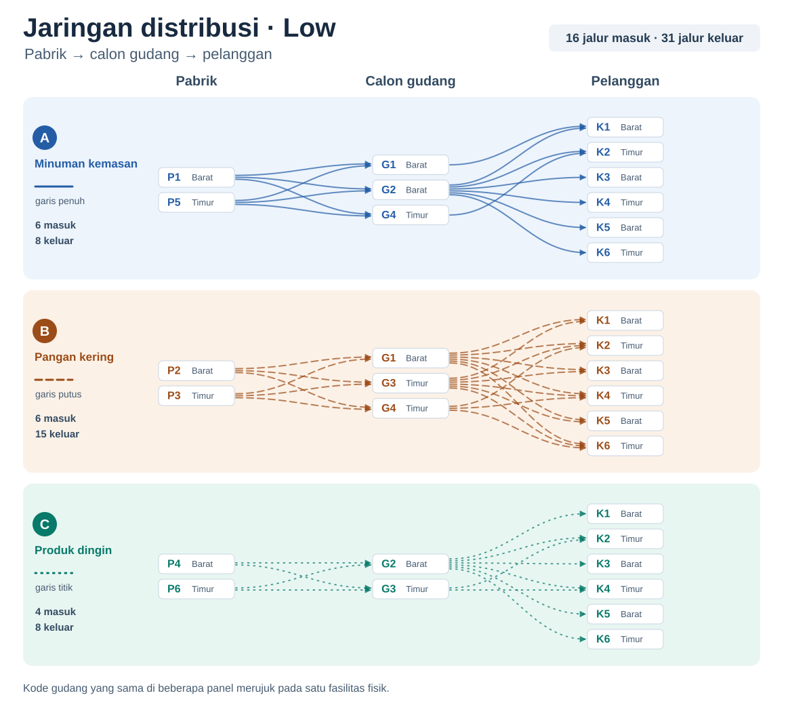
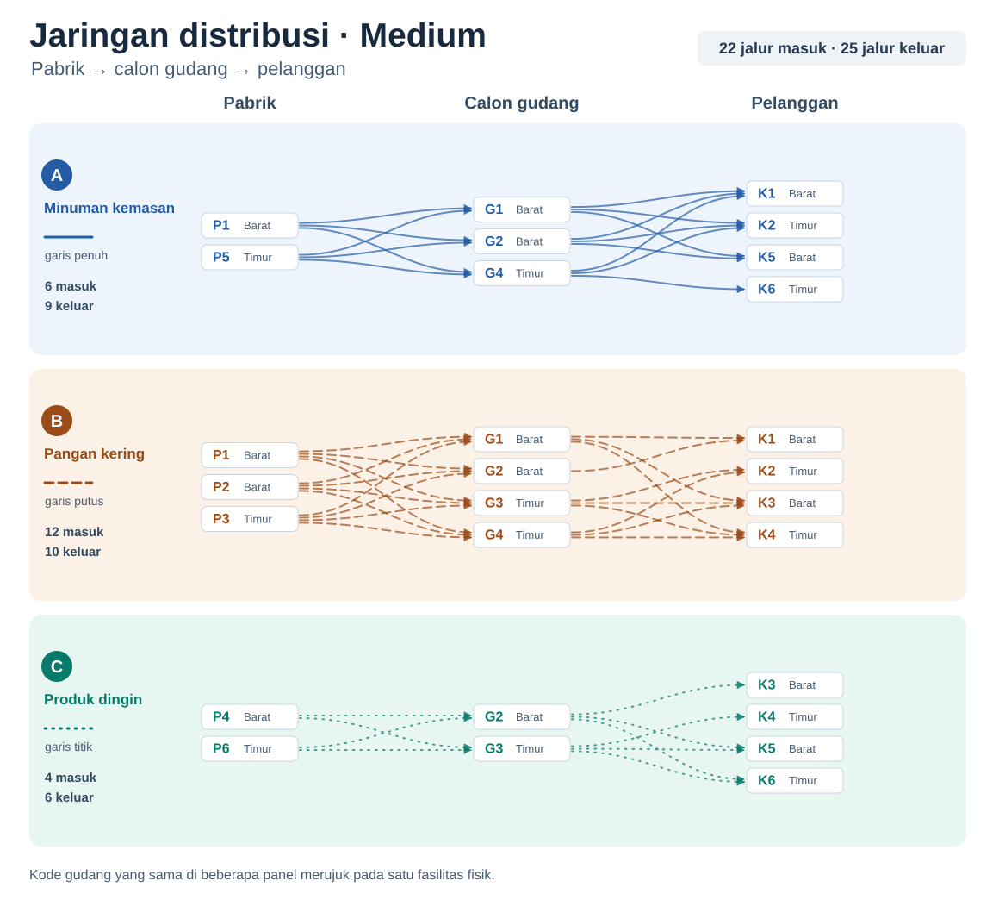
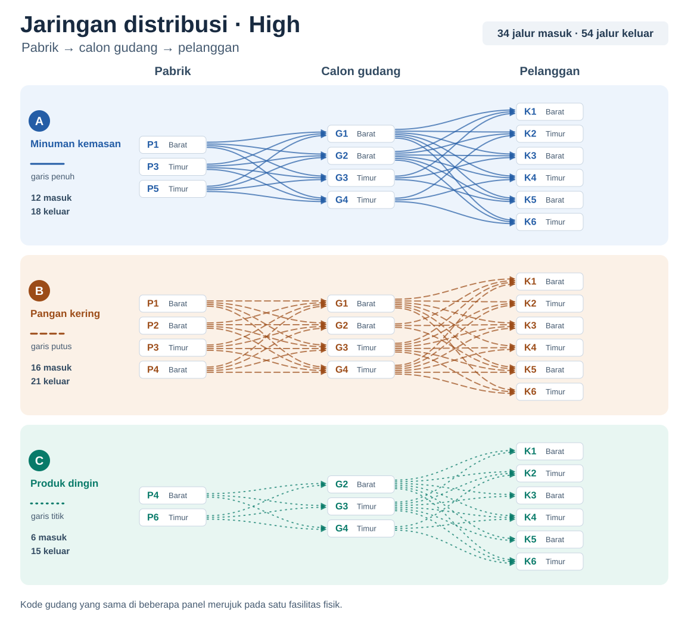

# Kasus dasar · Pemilihan gudang dan pengiriman

Sebuah perusahaan menyalurkan minuman kemasan (A), pangan kering (B), dan produk dingin (C). Dalam satu periode perencanaan, barang dikirim dari enam pabrik ke gudang yang dipilih dari empat lokasi calon, lalu dari gudang ke enam pelanggan. Setiap kiriman melewati kedua tahap itu.

Perusahaan harus menentukan **gudang mana yang dibuka** dan **berapa palet setiap produk yang dikirim pada setiap rute**. Membuka lebih banyak gudang menambah biaya tetap, tetapi bisa memberi akses ke jalur yang lebih murah atau lebih dekat dengan pelanggan. Gudang G4, misalnya, punya biaya buka terendah dan tarif distribusi ke K2 sebesar 1,79 per palet. Pada Low, akses G4 untuk produk A memang terbatas ke K2, sehingga manfaatnya bergantung pada pelanggan dan produk yang dilayani.

Kasus ini menggunakan tiga susunan rute, yaitu Low, Medium, dan High. Fasilitas, tarif, kapasitas, dan data dasar permintaan sama pada ketiganya. Setiap susunan rute dipakai untuk delapan profil yang merinci kapan permintaan diketahui, perlakuan biaya dan waktu penanganan, serta tujuan perusahaan. [Ketentuan P1–P8](Profil_P1_P8.md)

## Aturan operasi

- **Kapasitas pabrik.** Masing-masing pabrik dapat mengirim paling banyak 8 palet, dijumlahkan untuk seluruh gudang dan produk. Kiriman boleh berupa pecahan palet. Contohnya, pabrik yang telah mengirim 5,5 palet dapat mengirim hingga 2,5 palet lagi.
- **Pembukaan gudang.** Setiap lokasi dipilih untuk dibuka atau ditutup. Lokasi yang dipilih membayar biaya buka satu kali dan bisa menyalurkan barang dalam batas kapasitas fisik dan waktu penanganannya. Lokasi yang ditutup memiliki arus masuk dan keluar sebesar nol.
- **Keseimbangan gudang.** Untuk setiap gudang dan produk, semua barang yang masuk disalurkan di periode yang sama. Jika G2 menerima enam palet A, G2 menyalurkan tepat enam palet A. Barang masuk seluruhnya berasal dari pabrik dalam jaringan.
- **Pemenuhan pesanan.** Jumlah palet yang diterima setiap pelanggan untuk setiap produk harus tepat sebesar pesanannya. Pesanan bisa dibagi ke beberapa gudang. Contohnya, K1 dapat menerima satu palet A dari G1 dan dua palet A dari G2 untuk memenuhi tiga palet A.
- **Tarif.** Biaya angkut dikenakan pada kedua tahap. Setiap palet dikenai biaya penanganan sekali di gudang yang menyalurkannya. Semua tarif dan biaya tetap memakai satuan biaya yang sama.

Sebagai contoh, pada Low satu palet A dapat bergerak dari pabrik P1 ke G2 lalu ke K1. Biaya angkutnya 3 pada tahap pertama dan 1 pada tahap kedua. Biaya penanganan dasar di G2 adalah 2, sehingga biaya dasar rute itu 6 per palet. Biaya buka G2 dihitung satu kali untuk seluruh arusnya. Profil nonlinear juga mengenakan biaya tambahan berdasarkan volume produk yang ditangani gudang.

| Gudang | Kapasitas (palet) | Biaya buka |
| --- | ---: | ---: |
| G1 | 16 | 25 |
| G2 | 20 | 31 |
| G3 | 18 | 28 |
| G4 | 14 | 17 |

## Jalur masuk dan keluar

Low menyediakan 16 rute masuk dan 31 rute keluar. Medium menyediakan 22 rute masuk dan 40 rute keluar, termasuk layanan A dari G1 ke K2–K6 dan layanan C dari G3 ke K1, K3, K5, dan K6. High menyediakan 34 rute masuk dan 54 rute keluar, termasuk penyaluran C melalui G4 ke K2, K4, dan K6. Rute yang sudah tersedia ikut dibawa ke tingkat berikutnya. Satu rute dihitung untuk satu produk.

**Pola garis**

- A · Minuman kemasan · garis penuh
- B · Pangan kering · garis putus-putus
- C · Produk dingin · garis titik-titik

Setiap panah menunjukkan satu jalur aktif untuk produk di panelnya. Kode fasilitas yang sama di beberapa panel merujuk pada lokasi fisik yang sama.

[Low](diagram/Jaringan_Low.svg) · [Medium](diagram/Jaringan_Medium.svg) · [High](diagram/Jaringan_High.svg)

Lihat diagram Medium

Lihat diagram High

Pada tabel masuk, setiap pabrik pada satu baris produk boleh memasok setiap gudang pada baris tersebut. Tabel keluar menyebut pelanggan yang dapat dilayani untuk setiap gudang dan produk. Tanda — berarti jalur belum tersedia.

| Tingkat | Produk | Pabrik pemasok | Gudang penerima |
| --- | --- | --- | --- |
| Low | A | P1, P5 | G1, G2, G4 |
| Low | B | P2, P3 | G1, G3, G4 |
| Low | C | P4, P6 | G2, G3 |
| Medium | A | P1, P5 | G1, G2, G4 |
| Medium | B | P1, P2, P3 | G1, G2, G3, G4 |
| Medium | C | P4, P6 | G2, G3 |
| High | A | P1, P3, P5 | G1, G2, G3, G4 |
| High | B | P1, P2, P3, P4 | G1, G2, G3, G4 |
| High | C | P4, P6 | G2, G3, G4 |

| Gudang | Produk | Low | Medium | High |
| --- | --- | --- | --- | --- |
| G1 | A | K1 | K1, K2, K3, K4, K5, K6 | K1, K2, K3, K4, K5, K6 |
| G1 | B | K1, K2, K3, K4, K5, K6 | K1, K2, K3, K4, K5, K6 | K1, K2, K3, K4, K5, K6 |
| G2 | A | K1, K2, K3, K4, K5, K6 | K1, K2, K3, K4, K5, K6 | K1, K2, K3, K4, K5, K6 |
| G2 | B | — | — | K1, K3, K5 |
| G2 | C | K1, K2, K3, K4, K5, K6 | K1, K2, K3, K4, K5, K6 | K1, K2, K3, K4, K5, K6 |
| G3 | A | — | — | K1, K3, K5 |
| G3 | B | K1, K2, K3, K4, K5, K6 | K1, K2, K3, K4, K5, K6 | K1, K2, K3, K4, K5, K6 |
| G3 | C | K2, K4 | K1, K2, K3, K4, K5, K6 | K1, K2, K3, K4, K5, K6 |
| G4 | A | K2 | K2 | K2, K4, K6 |
| G4 | B | K2, K4, K6 | K2, K4, K6 | K1, K2, K3, K4, K5, K6 |
| G4 | C | — | — | K2, K4, K6 |

## Permintaan per pelanggan

Tabel dalam palet berlaku langsung pada profil dengan permintaan pasti. Pada profil stokastik, gunakan tabel ini untuk seluruh pesanan selain pesanan A di K1. Nilai pesanan tersebut mengikuti [tabel kondisi permintaan](Profil_P1_P8.md#kapan-permintaan-diketahui).

| Pelanggan | A | B | C | Total |
| --- | ---: | ---: | ---: | ---: |
| K1 | 3 | 1 | 1 | 5 |
| K2 | 3 | 1 | 1 | 5 |
| K3 | 1 | 3 | 1 | 5 |
| K4 | 1 | 3 | 1 | 5 |
| K5 | 1 | 1 | 3 | 5 |
| K6 | 1 | 1 | 3 | 5 |
| **Total** | 10 | 10 | 10 | 30 |

## Tarif per palet

Tarif angkut berlaku untuk seluruh produk pada satu pasangan lokasi. Pemakaian tarif tetap mengikuti jalur aktif pada level yang dipilih. Data tarif benchmark bersifat sintetis.

### Angkut pabrik ke gudang

| Pabrik | G1 | G2 | G3 | G4 |
| --- | ---: | ---: | ---: | ---: |
| P1 | 2 | 3 | 7 | 8 |
| P2 | 3 | 4 | 7 | 8 |
| P3 | 7 | 6 | 2 | 3 |
| P4 | 2 | 2 | 7 | 8 |
| P5 | 7 | 6 | 3 | 2 |
| P6 | 7 | 6 | 2 | 3 |

### Angkut gudang ke pelanggan

| Gudang | K1 | K2 | K3 | K4 | K5 | K6 |
| --- | ---: | ---: | ---: | ---: | ---: | ---: |
| G1 | 2 | 7 | 2 | 7 | 3 | 7 |
| G2 | 1 | 7 | 2 | 7 | 2 | 6 |
| G3 | 7 | 2 | 7 | 2 | 6 | 2 |
| G4 | 7 | 1,79 | 6 | 2 | 7 | 2 |

### Penanganan di gudang

| Gudang | A | B | C |
| --- | ---: | ---: | ---: |
| G1 | 1 | 1 | — |
| G2 | 2 | 2 | 3 |
| G3 | 2 | 1 | 2 |
| G4 | 1 | 1 | 3 |

Salinan data dalam format terstruktur tersedia di [Data bersama P1–P8](Data_Bersama.json).
