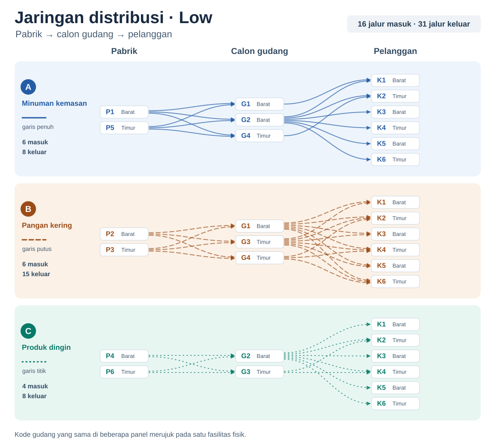
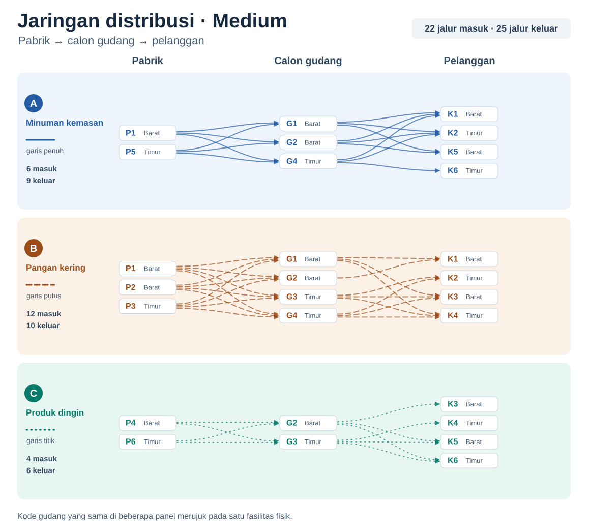
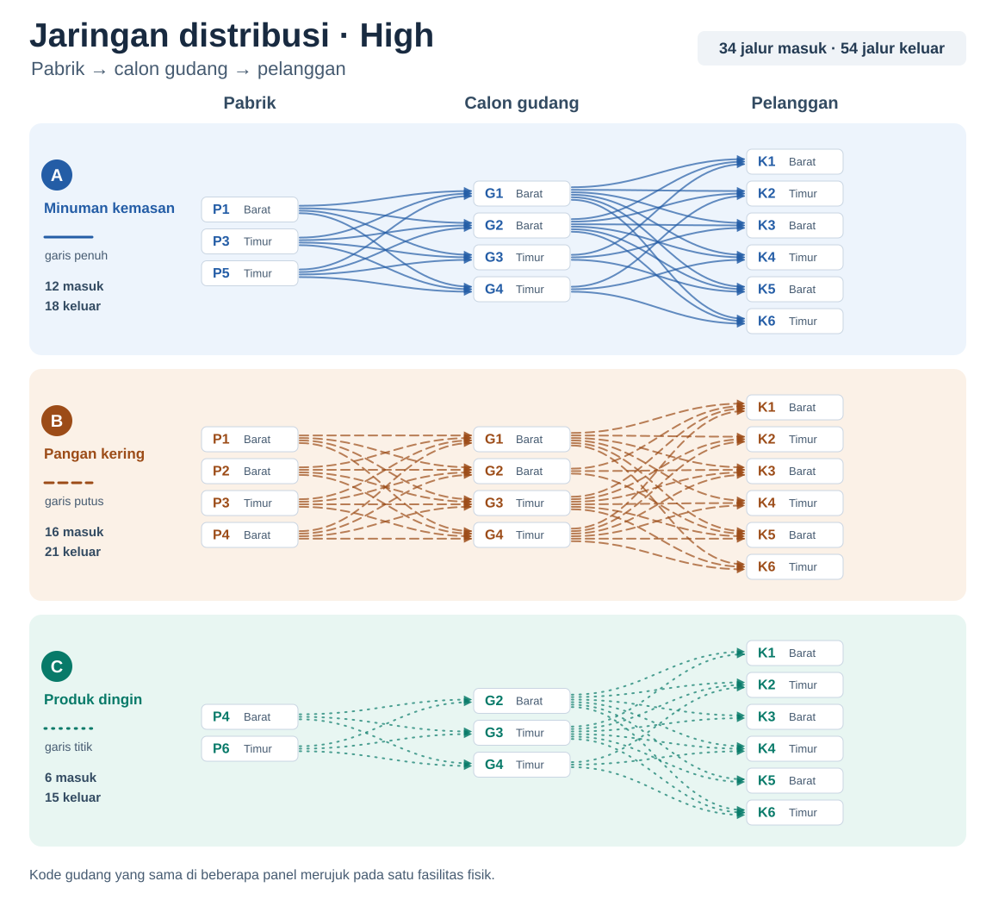

# Kasus P1 — Pemilihan gudang dan pengiriman dengan permintaan pasti

Perusahaan menyalurkan minuman kemasan (A), pangan kering (B), dan produk dingin (C) dari enam pabrik melalui empat calon gudang ke enam pelanggan selama satu periode. Pilih gudang yang dibuka serta jumlah kiriman di setiap tahap untuk meminimalkan biaya total. Jalankan Low, Medium, dan High sebagai tiga instans terpisah.

## Aturan operasi

- Setiap pabrik dapat mengirim paling banyak 8 palet gabungan pada tingkat mana pun. Jumlah kiriman boleh berupa pecahan palet.
- Gudang yang dibuka dapat menerima dan menyalurkan produk melalui rute yang aktif. Jumlah masuk harus sama dengan jumlah keluar untuk setiap produk pada setiap gudang. Gudang yang tutup memiliki arus keluar nol.
- Kapasitas gudang berlaku untuk total arus keluar seluruh produk. Biaya buka dibayar sekali untuk setiap gudang yang dipilih.
- Permintaan masing-masing produk pada setiap pelanggan harus dipenuhi tepat sebesar angka tabel. Pelanggan boleh dilayani dari beberapa gudang melalui rute yang aktif.
- Biaya angkut dibayar per palet pada setiap tahap pengiriman. Biaya penanganan dibayar sekali per palet yang disalurkan gudang. Seluruh tarif memakai satuan biaya yang sama.

| Gudang | Kapasitas (palet) | Biaya buka |
| --- | ---: | ---: |
| G1 | 16 | 25 |
| G2 | 20 | 31 |
| G3 | 18 | 28 |
| G4 | 14 | 17 |

## Jalur masuk dan keluar

**Pola garis**

- A · Minuman kemasan · garis penuh
- B · Pangan kering · garis putus-putus
- C · Produk dingin · garis titik-titik

Setiap panah menunjukkan satu jalur aktif untuk produk di panelnya. Kode fasilitas yang sama di beberapa panel merujuk pada lokasi fisik yang sama.

[Low](../diagram/Jaringan_Low.svg) · [Medium](../diagram/Jaringan_Medium.svg) · [High](../diagram/Jaringan_High.svg)

Lihat diagram Medium

Lihat diagram High

Pada tabel masuk, setiap pabrik di satu baris produk boleh memasok setiap gudang pada baris itu. Tabel keluar menyebut pelanggan yang dapat dilayani untuk setiap gudang dan produk.

| Level | Produk | Pabrik | Gudang yang dapat menerima |
| --- | --- | --- | --- |
| L | A | P1, P5 | G1, G2, G4 |
| L | B | P2, P3 | G1, G3, G4 |
| L | C | P4, P6 | G2, G3 |
| M | A | P1, P5 | G1, G2, G4 |
| M | B | P1, P2, P3 | G1, G2, G3, G4 |
| M | C | P4, P6 | G2, G3 |
| H | A | P1, P3, P5 | G1, G2, G3, G4 |
| H | B | P1, P2, P3, P4 | G1, G2, G3, G4 |
| H | C | P4, P6 | G2, G3, G4 |

| Gudang | Produk | Pelanggan Low | Pelanggan Medium | Pelanggan High |
| --- | --- | --- | --- | --- |
| G1 | A | K1, K2 | K1, K2, K5 | K1, K2, K3, K5, K6 |
| G1 | B | K3, K4 | K1, K3, K4 | K1, K2, K3, K4, K5 |
| G2 | A | K1, K2 | K1, K2, K5 | K1, K2, K3, K5, K6 |
| G2 | B | — | K1 | K1, K2, K3, K4, K5 |
| G2 | C | K5, K6 | K3, K5, K6 | K1, K3, K4, K5, K6 |
| G3 | A | — | — | K2, K4, K6 |
| G3 | B | K3, K4 | K2, K3, K4 | K1, K2, K3, K4, K6 |
| G3 | C | K5, K6 | K4, K5, K6 | K2, K3, K4, K5, K6 |
| G4 | A | K1, K2 | K1, K2, K6 | K1, K2, K4, K5, K6 |
| G4 | B | K3, K4 | K2, K3, K4 | K1, K2, K3, K4, K6 |
| G4 | C | — | — | K2, K4, K6 |

## Permintaan per pelanggan

Masing-masing kolom berisi jumlah palet **A / B / C**.

| Pelanggan | Low | Medium | High |
| --- | ---: | ---: | ---: |
| K1 | 5 / 0 / 0 | 3 / 2 / 0 | 3 / 1 / 1 |
| K2 | 5 / 0 / 0 | 3 / 2 / 0 | 3 / 1 / 1 |
| K3 | 0 / 5 / 0 | 0 / 3 / 2 | 1 / 3 / 1 |
| K4 | 0 / 5 / 0 | 0 / 3 / 2 | 1 / 3 / 1 |
| K5 | 0 / 0 / 5 | 2 / 0 / 3 | 1 / 1 / 3 |
| K6 | 0 / 0 / 5 | 2 / 0 / 3 | 1 / 1 / 3 |

## Tarif per palet

Tarif angkut berlaku untuk seluruh produk pada satu pasangan lokasi. Pemakaian tarif tetap mengikuti jalur aktif pada level yang dipilih. Data tarif benchmark bersifat sintetis.

### Angkut pabrik ke gudang

| Pabrik | G1 | G2 | G3 | G4 |
| --- | ---: | ---: | ---: | ---: |
| P1 | 2 | 3 | 7 | 8 |
| P2 | 3 | 4 | 7 | 8 |
| P3 | 7 | 6 | 2 | 3 |
| P4 | 2 | 2 | 7 | 8 |
| P5 | 7 | 6 | 3 | 2 |
| P6 | 7 | 6 | 2 | 3 |

### Angkut gudang ke pelanggan

| Gudang | K1 | K2 | K3 | K4 | K5 | K6 |
| --- | ---: | ---: | ---: | ---: | ---: | ---: |
| G1 | 2 | 7 | 2 | 7 | 3 | 7 |
| G2 | 1 | 7 | 2 | 7 | 2 | 6 |
| G3 | 7 | 2 | 7 | 2 | 6 | 2 |
| G4 | 7 | 1,79 | 6 | 2 | 7 | 2 |

### Penanganan di gudang

| Gudang | A | B | C |
| --- | ---: | ---: | ---: |
| G1 | 1 | 1 | — |
| G2 | 2 | 2 | 3 |
| G3 | 2 | 1 | 2 |
| G4 | 1 | 1 | 3 |

Salinan data dalam format terstruktur tersedia di [Data bersama P1 dan P2](../Data_Bersama.json).
