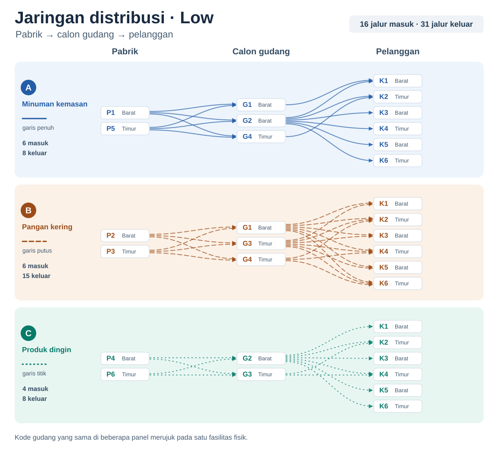
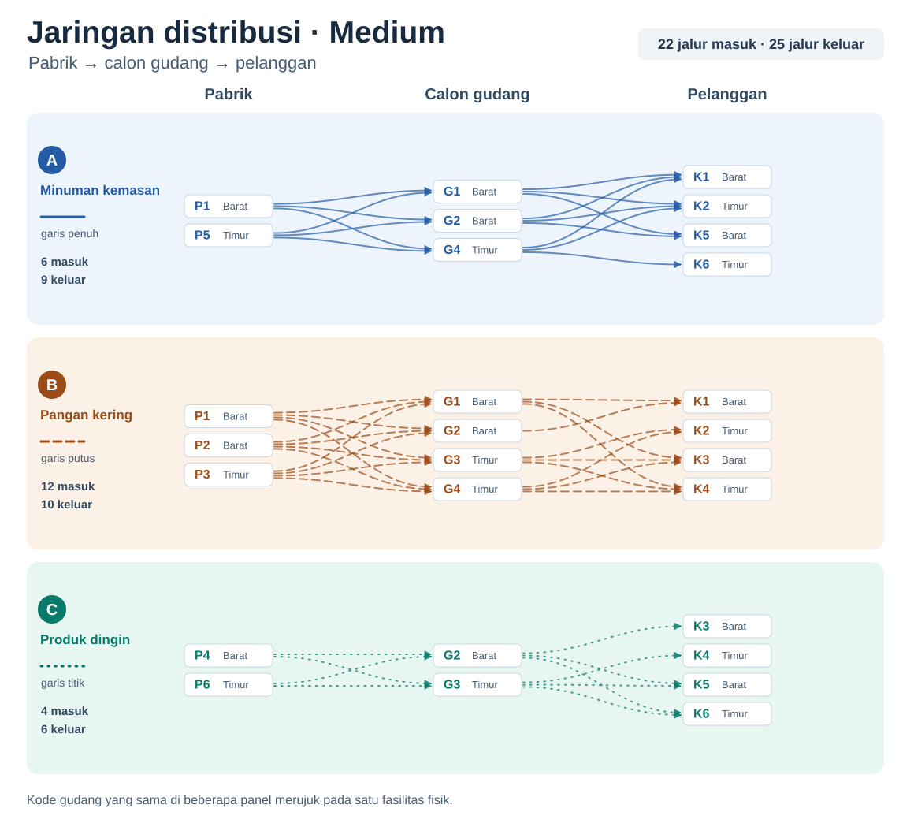
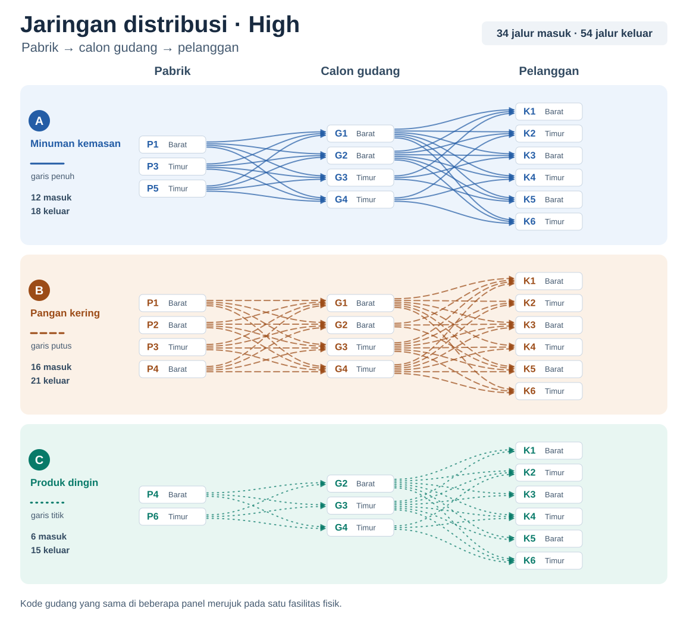

# Kasus P2 — Pemilihan gudang dan pengiriman dengan permintaan stokastik

Gunakan jaringan, kapasitas, biaya buka, tarif angkut, tarif penanganan, dan permintaan dasar dari [kasus P1](../P1/Kasus.md). Jalankan Low, Medium, dan High sebagai tiga instans terpisah. Pada P2, permintaan **produk A di K1** belum diketahui saat perusahaan harus memutuskan gudang mana yang dibuka. Permintaan setiap pelanggan–produk lain tetap sebesar angka bersama pada seluruh tingkat.

## Diagram jaringan

**Pola garis**

- A · Minuman kemasan · garis penuh
- B · Pangan kering · garis putus-putus
- C · Produk dingin · garis titik-titik

Setiap panah menunjukkan satu jalur aktif untuk produk di panelnya. Kode fasilitas yang sama di beberapa panel merujuk pada lokasi fisik yang sama.

[Low](../diagram/Jaringan_Low.svg) · [Medium](../diagram/Jaringan_Medium.svg) · [High](../diagram/Jaringan_High.svg)

Pada P2, lihat simpul **K1 di panel A**. Permintaannya berubah mengikuti skenario pada tabel. Jalur yang tersedia tetap sama pada setiap skenario.

Lihat diagram Medium

Lihat diagram High

## Keputusan yang harus dibuat

1. Sebelum permintaan K1 diketahui, pilih satu kombinasi gudang. Pilihan tersebut berlaku untuk seluruh skenario. Biaya buka dibayar sekali.
2. Setelah skenario terungkap, tentukan jumlah kiriman dari pabrik ke gudang dan dari gudang ke pelanggan. Semua kapasitas dan aturan operasi P1 berlaku di setiap skenario. Penuhi permintaan yang terjadi pada skenario tersebut.
3. Minimalkan biaya buka ditambah biaya operasi rata-rata yang dibobot dengan peluang skenario.

## Data ketidakpastian

Permintaan produk A di K1 mengikuti distribusi normal dengan rata-rata sebesar permintaan dasar P1 dan simpangan baku 1 palet. Untuk optimasi, pakai tiga skenario wakil dengan rentang di bawah batas bawah, rentang antara kedua batas, dan rentang di atas batas atas. Batas bawah adalah rata-rata dikurangi satu simpangan baku. Batas atas adalah rata-rata ditambah satu simpangan baku. Permintaan wakil setiap skenario adalah rata-rata kondisional dalam rentangnya.

Permintaan dasar A di K1 ialah 3 palet pada setiap tingkat.

| Skenario | Peluang (%) | A di K1 untuk Low, Medium, dan High (palet) |
| --- | ---: | ---: |
| Sepi | 15,865525 | 1,474865 |
| Sedang | 68,268949 | 3 |
| Ramai | 15,865525 | 4,525135 |

Gunakan peluang dan pergeseran permintaan dengan presisi penuh dari [Data bersama P1–P3](../Data_Bersama.json). Pilih gudang yang sanggup melayani tiga skenario pada tabel. Ketiganya adalah representasi diskret untuk optimasi. Skenario Ramai memakai rata-rata rentang ekor atas.
