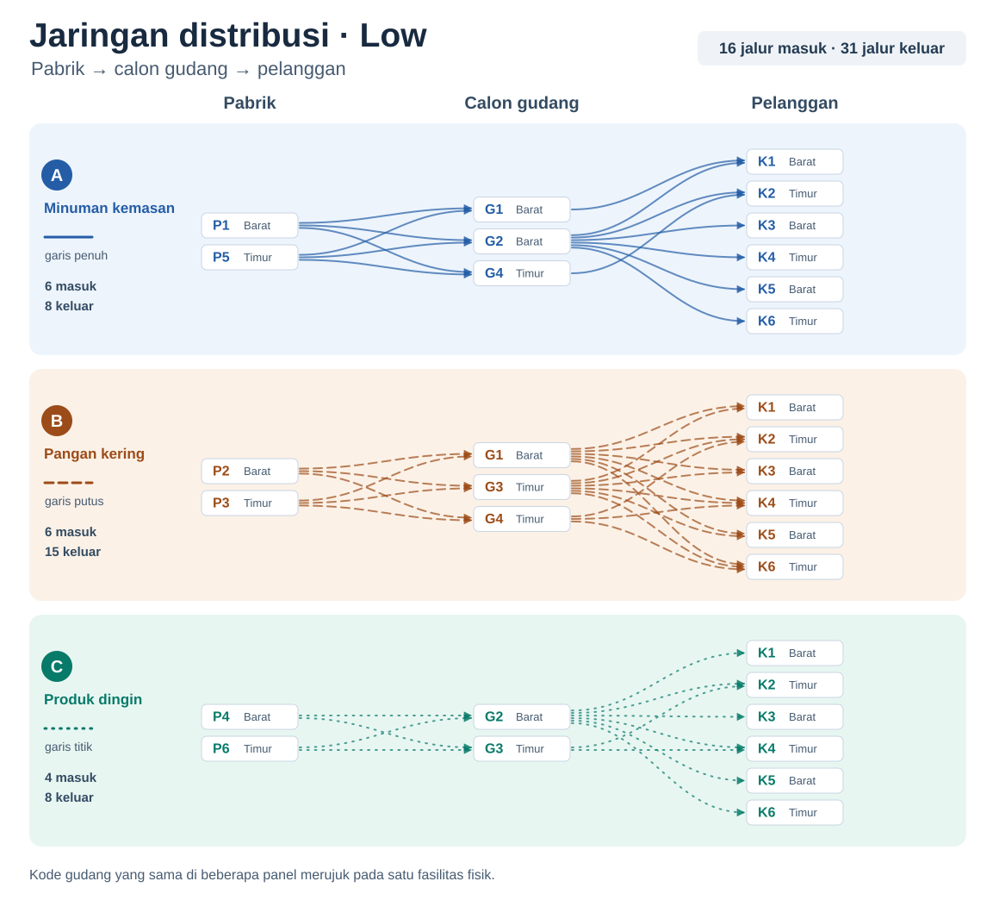
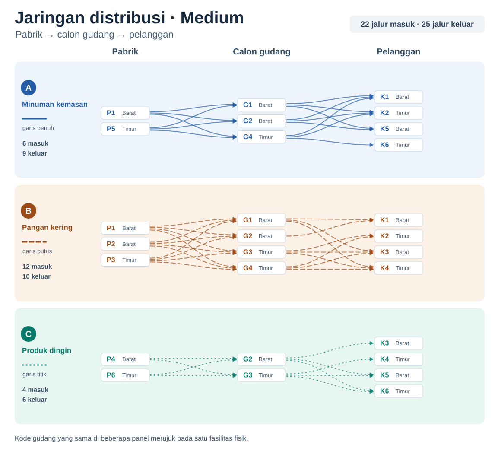
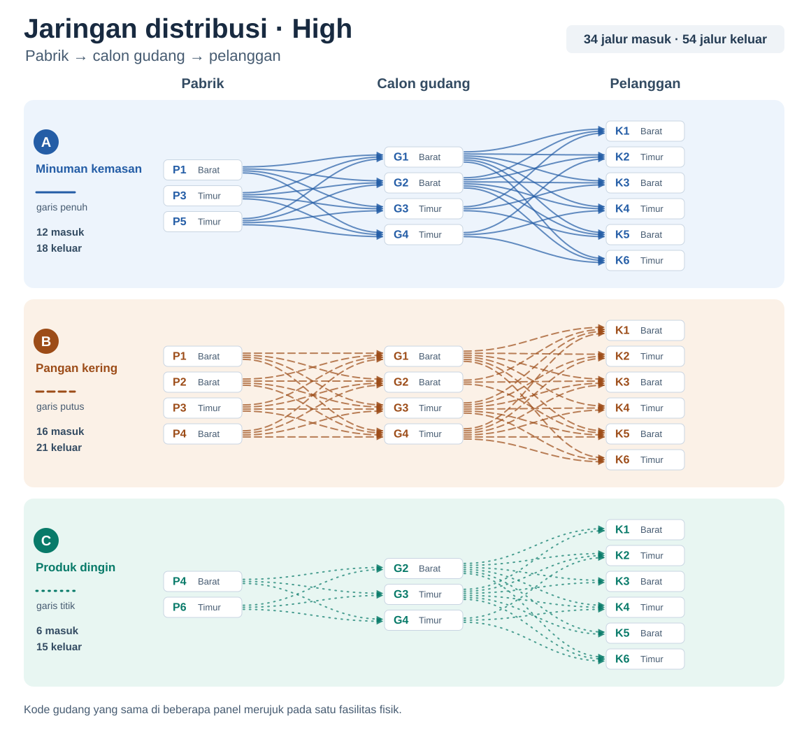

# Kasus P3 — Pemilihan gudang dengan tujuan biaya dan emisi

Perusahaan melayani pesanan pasti yang sama seperti [kasus P1](../P1/Kasus.md). Gunakan fasilitas, rute, kapasitas, tarif, dan biaya buka yang sama. Perusahaan juga ingin mengetahui berapa biaya tambahan yang timbul jika emisi distribusi harus diturunkan.

## Diagram jaringan

**Pola garis**

- A · Minuman kemasan · garis penuh
- B · Pangan kering · garis putus-putus
- C · Produk dingin · garis titik-titik

Setiap panah menunjukkan satu jalur aktif untuk produk di panelnya. Kode fasilitas yang sama di beberapa panel merujuk pada lokasi fisik yang sama.

[Low](../diagram/Jaringan_Low.svg) · [Medium](../diagram/Jaringan_Medium.svg) · [High](../diagram/Jaringan_High.svg)

Lihat diagram Medium

Lihat diagram High

## Keputusan dan tujuan

Pilih gudang yang dibuka serta jumlah kiriman pabrik–gudang dan gudang–pelanggan. Penuhi semua pesanan dan aturan operasi P1. Pertimbangkan dua tujuan, yaitu biaya total minimum dan emisi total minimum. Laporkan alternatif dengan biaya, emisi, dan gudang yang dipilih untuk tiap tingkat jaringan.

## Data emisi

Satuan emisi adalah kg CO₂e. Angka merupakan data sintetis. Emisi tetap mencerminkan penggunaan energi dasar gudang selama satu periode dan dibebankan satu kali per gudang yang dibuka. Faktor angkutan dibebankan per palet pada setiap tahap. Satu rute memiliki faktor yang sama untuk semua produk yang diizinkan menempuhnya.

| Gudang | G1 | G2 | G3 | G4 |
| --- | ---: | ---: | ---: | ---: |
| Emisi tetap | 12 | 20 | 8 | 24 |

### Pabrik ke gudang · kg CO₂e per palet

| Pabrik | G1 | G2 | G3 | G4 |
| --- | ---: | ---: | ---: | ---: |
| P1 | 1,4 | 1,8 | 4,2 | 4,7 |
| P2 | 1,6 | 2,1 | 3,9 | 4,4 |
| P3 | 3,6 | 3,1 | 0,8 | 2,1 |
| P4 | 1,8 | 1,0 | 3,5 | 4,4 |
| P5 | 3,8 | 3,5 | 1,1 | 3,5 |
| P6 | 4,1 | 3,5 | 1,0 | 2,9 |

### Gudang ke pelanggan · kg CO₂e per palet

| Gudang | K1 | K2 | K3 | K4 | K5 | K6 |
| --- | ---: | ---: | ---: | ---: | ---: | ---: |
| G1 | 1,4 | 3,6 | 1,7 | 3,7 | 1,9 | 3,6 |
| G2 | 0,9 | 3,5 | 1,2 | 3,5 | 1,3 | 3,3 |
| G3 | 3,5 | 0,9 | 3,2 | 0,8 | 3,1 | 0,8 |
| G4 | 3,7 | 2,0 | 3,6 | 2,1 | 3,7 | 2,2 |

[Data bersama P1–P3](../Data_Bersama.json)
