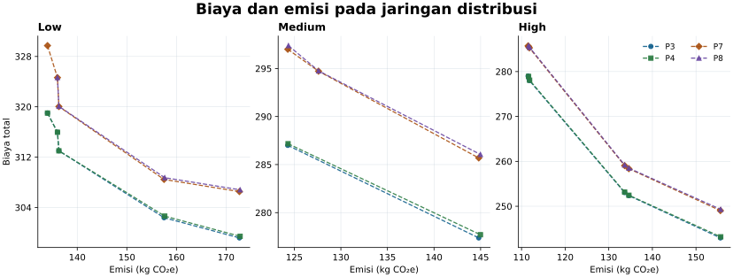

# Hasil verifikasi P1–P8

Verifikasi mencakup **24 kombinasi** dari delapan profil dan tiga tingkat jaringan. Model memakai satu blok operasi pada P1, P3, P5, dan P7 serta tiga blok pada P2, P4, P6, dan P8. Pada model stokastik, empat keputusan buka gudang dipakai bersama oleh semua blok.

## 1. Ukuran model dan WCC

| Tingkat | WCC blok operasi P1–P8 | Variabel model pasti | Variabel model stokastik |
| --- | ---: | ---: | ---: |
| Low | 47,47% | 51 | 145 |
| Medium | 61,29% | 66 | 190 |
| High | 83,41% | 92 | 268 |

Model pasti memiliki 44 posisi baris dan model stokastik memiliki 130. Keduanya mencakup satu baris batas emisi. WCC memakai 43 posisi baris pada satu blok operasi dan memeriksa kesamaan daftar variabel di setiap posisi. Ukuran pada tabel dihitung sebelum solver menambah variabel dan baris untuk menyelesaikan bentuk nonlinear. [Audit dan definisi WCC](../Lampiran_WCC.md)

## 2. Biaya minimum

Profil satu tujuan dan profil dua tujuan yang memakai data dan aturan operasi yang sama mempunyai ujung biaya minimum yang sama. Profil dua tujuan kemudian menelusuri kompromi ketika emisi dibatasi. Karena itu, tabel menyajikan satu baris untuk setiap pasangan profil. Pada profil stokastik, angka menunjukkan biaya harapan.

| Profil yang berbagi ujung biaya minimum | Low | Medium | High |
| --- | ---: | ---: | ---: |
| P1 dan P3 | 299,16 | 277,37 | 242,95 |
| P2 dan P4 | 299,41 | 277,70 | 243,19 |
| P5 dan P7 | 306,52 | 285,69 | 249,03 |
| P6 dan P8 | 306,80 | 286,05 | 249,30 |

Biaya minimum turun dari Low ke Medium dan High karena setiap tingkat menambahkan pilihan rute sambil mempertahankan rute yang telah tersedia. Pada ujung biaya minimum, profil stokastik memakai kombinasi gudang yang sama dengan padanan deterministiknya pada tiap tingkat. Selisih biaya di bawah 0,14% pada kasus ini, yang hanya mengubah pesanan satu pelanggan untuk satu produk. [Ringkasan 24 kombinasi](hasil/Ringkasan.csv)

Biaya minimum diperiksa dengan enumerasi terhadap 16 pola buka dan tutup dari keempat calon gudang. Untuk model nonlinear, solver memakai pendekatan linear dari bawah pada suku kuadratik, lalu memeriksa setiap hasil terhadap kendala asli. Toleransi celah adalah 0,00025, toleransi kelayakan 0,0000002, dan toleransi pemecah seri 0,0006.

## 3. Kompromi biaya dan emisi

Pada setiap jaringan, P3, P4, P7, dan P8 memakai sembilan batas emisi yang sama. Dua titik ujung dihitung khusus untuk setiap profil, yaitu rencana biaya terendah dan rencana emisi terendah. Sebagian batas menghasilkan pasangan biaya dan emisi yang sama.

| Tingkat | Batas awal (kg CO₂e) | Batas akhir (kg CO₂e) | Jumlah batas bersama |
| --- | ---: | ---: | ---: |
| Low | 136,005 | 172,842 | 9 |
| Medium | 124,368 | 144,984 | 9 |
| High | 111,615 | 155,672 | 9 |



Contoh berikut menunjukkan kedua ujung pada High. Biaya dan emisi P8 adalah nilai harapan.

| Profil | Ujung Pareto | Gudang | Biaya | Emisi (kg CO₂e) |
| --- | --- | --- | ---: | ---: |
| P7 | Biaya minimum | G2 dan G4 | 249,03 | 155,60 |
| P7 | Emisi minimum | G2 dan G3 | 285,72 | 111,50 |
| P8 | Biaya minimum | G2 dan G4 | 249,30 | 155,67 |
| P8 | Emisi minimum | G2 dan G3 | 285,78 | 111,61 |

Pada P7 High, berpindah ke rencana emisi minimum mengurangi emisi sekitar 44,10 kg CO₂e dan menambah biaya 36,69. Ketidakpastian juga dapat mengubah pilihan lokasi. Pada ujung emisi Low, P7 memilih G2 dan G3, sedangkan P8 membuka G1, G2, dan G3. [Seluruh titik Pareto](hasil/Pareto.csv) · [Keputusan gudang dan arus pengiriman](hasil/Arus_Pareto.csv)

## 4. Waktu penyelesaian pada tugas yang sepadan

Bandingkan profil pada **tingkat jaringan yang sama** dan ubah satu karakteristik model pada setiap pasangan. Tabel menunjukkan median waktu profil kedua dibagi median waktu profil pertama. Angka 2,33× pada P7–P8 Low berarti median waktu P8 adalah 2,33 kali median waktu P7 untuk menghasilkan keluaran Pareto pada Low.

| Karakteristik yang berubah | Pasangan profil | Tugas pada kedua profil | Low | Medium | High |
| --- | --- | --- | ---: | ---: | ---: |
| Permintaan pasti → stokastik | P1 → P2 | Biaya minimum | 1,77× | 1,48× | 2,63× |
| Permintaan pasti → stokastik | P3 → P4 | Kompromi biaya–emisi | 1,74× | 2,16× | 2,30× |
| Permintaan pasti → stokastik | P5 → P6 | Biaya minimum | 1,84× | 2,03× | 2,12× |
| Permintaan pasti → stokastik | P7 → P8 | Kompromi biaya–emisi | 2,33× | 3,12× | 3,09× |
| Linear → nonlinear | P1 → P5 | Biaya minimum | 2,90× | 2,43× | 3,49× |
| Linear → nonlinear | P2 → P6 | Biaya minimum | 3,01× | 3,31× | 2,80× |
| Linear → nonlinear | P3 → P7 | Kompromi biaya–emisi | 1,40× | 1,80× | 1,87× |
| Linear → nonlinear | P4 → P8 | Kompromi biaya–emisi | 1,87× | 2,60× | 2,51× |

Semua pasangan di tabel menunjukkan waktu median yang lebih tinggi setelah karakteristik tersebut ditambahkan, pada ketiga tingkat kasus ini. P8 memiliki median tertinggi pada setiap tingkat, yaitu **570,0 ms pada Low, 1.319,2 ms pada Medium, dan 1.482,7 ms pada High**.

Tugas biaya minimum berjalan dalam satu langkah optimisasi. Tugas Pareto pada implementasi ini memakai 22 langkah, yaitu 4 untuk dua titik ujung dan 18 untuk sembilan batas emisi bersama. Durasi seluruh tugas tersebut mencakup pekerjaan yang berbeda. Pengukuran memakai median 11 putaran setelah pemanasan. Urutan kombinasi diacak per putaran. Waktu mencakup penyiapan struktur solver dan penyelesaian. Verifikasi dengan enumerasi diukur terpisah. Lingkungannya Linux x86-64, Python 3.12.14, NumPy 2.3.5, SciPy 1.17.0, dan HiGHS 1.8.0 dengan satu thread. [Data 11 pengukuran per kombinasi](hasil/Benchmark.csv) · [Detail waktu per langkah](hasil/Waktu.csv)

<details>
<summary>Catatan tentang urutan waktu P1 antarjaringan</summary>

Pada P1, median Medium 13,8 ms dan High 12,8 ms. High lebih cepat dalam 10 dari 11 putaran awal. Kedua instans selesai pada satu node dan memiliki 111 serta 122 iterasi LP. Pengukuran mencerminkan waktu pada instans dan konfigurasi ini. Pengelompokan tingkat mengikuti WCC blok operasi, sehingga selisih waktu tersebut dicatat terpisah dari perbandingan antarprofil pada jaringan yang sama. [Data pengukuran](hasil/Benchmark.csv) · [Log kerja solver](hasil/Kerja_Solver.csv)

</details>

## 5. Iterasi LP pada batas emisi yang sama

LP adalah optimisasi linear. Selama pencarian, solver dapat melonggarkan sementara pilihan buka gudang dari 0 atau 1 menjadi nilai di antaranya untuk menghitung batas biaya. Satu iterasi LP adalah satu langkah numerik ketika menyelesaikan submasalah linear tersebut. Solver juga mencatat node, yaitu simpul pohon pencarian. Sebuah node dapat memerlukan banyak iterasi.

Tabel berikut menjumlahkan iterasi LP untuk **sembilan minimisasi biaya dengan batas emisi yang sama** pada P7 dan P8. Kedua profil memakai biaya penanganan nonlinear dan keluaran yang sepadan. Tabel menghitung langkah biaya pada grid. Hitungan untuk pemecah seri emisi serta titik ujung tersedia di log.

| Tingkat | P7 · Permintaan pasti | P8 · Permintaan stokastik |
| --- | ---: | ---: |
| Low | 1.238 | 2.689 |
| Medium | 1.776 | 5.239 |
| High | 2.686 | 7.626 |

Satu panggilan HiGHS dapat memuat jumlah iterasi LP yang berbeda. Misalnya, pada batas emisi High sekitar 111,615 kg CO₂e, P7 memakai dua panggilan dengan total 280 iterasi LP, sedangkan P8 memakai satu panggilan dengan 370 iterasi LP. Panggilan tambahan pada profil nonlinear muncul ketika pendekatan linear perlu diperbaiki. Jumlah panggilan dan node tetap tersedia untuk menelusuri proses solver per langkah. [Iterasi LP, node, dan panggilan per langkah](hasil/Kerja_Solver.csv)

## 6. Menjalankan verifikasi

Buka [notebook di Google Colab](https://colab.research.google.com/github/kiittkiidd/Lampiran-Model-Matematika-Tesis/blob/main/math_model_acuan/Verifikasi_P1_P8.ipynb) atau [lihat notebook di GitHub](Verifikasi_P1_P8.ipynb). Untuk menjalankan dari direktori utama repositori dengan Python dan dependensi di atas, gunakan perintah berikut.

```bash
python math_model_acuan/verifikasi.py --hasil hasil_verifikasi --ulangan 11
```

Pengukuran iterasi LP membaca ringkasan HiGHS pada Linux. Waktu bergantung pada mesin yang digunakan. [Kode verifikasi](verifikasi.py) · [Kembali ke daftar isi](../README.md)
