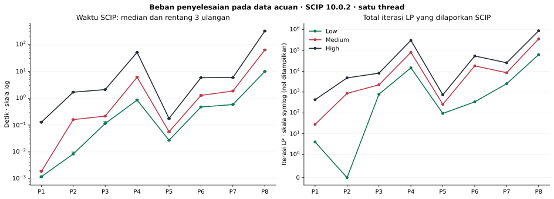
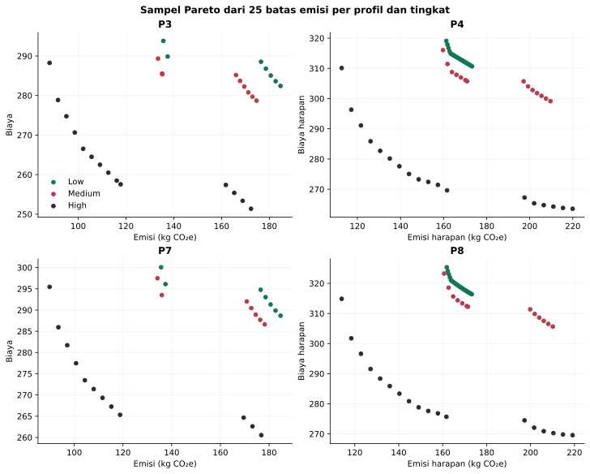

# Hasil verifikasi dan pengukuran SCIP

Data acuan dan representasi solver dipilih melalui kalibrasi awal. Seluruh pengukuran pada halaman ini dilakukan ulang setelah data, kode solver, dan konfigurasi ditetapkan. Hasil berlaku untuk keluarga kasus acuan ini.

## 1. Solver dan prosedur

Seluruh P1–P8 menggunakan SCIP 10.0.2 melalui PySCIPOpt 6.3.0. SCIP memakai SoPlex 8.0.2 untuk pekerjaan LP dan Ipopt 3.14.19 untuk submasalah nonlinear. Perbedaan komponen internal tersebut merupakan bagian dari build SCIP yang sama. Setiap penyelesaian memakai satu thread, seed 0, dan presolve bawaan SCIP.

Presolve adalah penyederhanaan model sebelum pencarian solusi, misalnya menghapus baris yang sudah pasti terpenuhi. WCC dihitung pada baris acuan sebelum penyederhanaan tersebut. Variabel bantu tonase dan kuadrat pada implementasi SCIP dijelaskan pada [model matematika](Model_Matematika.md).

Pada profil stokastik, satu penyelesaian memuat 27 skenario dengan keputusan gudang bersama. Pada profil pasti, satu penyelesaian memuat satu kondisi permintaan. Profil satu tujuan membutuhkan satu langkah optimisasi; profil dua tujuan membutuhkan 50 langkah untuk membangun sampel dari 25 batas emisi. Jumlah langkah Pareto ditetapkan oleh prosedur, sehingga sama pada Low, Medium, dan High.

## 2. Waktu penyelesaian

Tabel memakai median tiga pengukuran setelah satu pemanasan. Urutan 24 kombinasi diacak pada setiap putaran. Tidak ada pengukuran yang dibuang. Waktu SCIP merupakan jumlah `getSolvingTime()` dari seluruh langkah, termasuk presolve. Waktu total juga mencakup pembuatan model, pemeriksaan numerik, dan pencatatan hasil; keduanya tersedia pada CSV. Waktu enumerasi verifikasi tidak dimasukkan ke benchmark.

| Profil | Langkah optimisasi | Low (detik) | Medium (detik) | High (detik) |
| --- | --- | --- | --- | --- |
| P1 | 1 | 0,0012 | 0,0019 | 0,1275 |
| P2 | 1 | 0,0084 | 0,1598 | 1,6722 |
| P3 | 50 | 0,1140 | 0,2147 | 2,0898 |
| P4 | 50 | 0,8510 | 6,0463 | 50,9973 |
| P5 | 1 | 0,0271 | 0,0563 | 0,1763 |
| P6 | 1 | 0,4710 | 1,2710 | 5,7834 |
| P7 | 50 | 0,5788 | 1,8516 | 5,8952 |
| P8 | 50 | 9,9293 | 62,5246 | 315,4545 |

Urutan median waktu Low < Medium < High ditemukan pada 8 dari delapan profil: P1, P2, P3, P4, P5, P6, P7, P8. Rincian minimum, median, maksimum, waktu total, pembuatan model, dan presolve tersedia dalam [ringkasan pengukuran](hasil/Ringkasan.csv). Semua 72 pengukuran tersimpan dalam [Benchmark.csv](hasil/Benchmark.csv).

Grafik waktu memakai skala log dan rentang minimum–maksimum dari tiga pengukuran. Grafik iterasi memakai skala symlog agar nilai nol tetap dapat ditampilkan.

## 3. Pekerjaan yang dilaporkan solver

Iterasi LP adalah langkah numerik untuk menyelesaikan relaksasi linear yang dikerjakan SCIP. Satu node pencarian dapat membutuhkan banyak iterasi LP. Nilai nol berarti tidak ada iterasi LP yang tercatat pada panggilan tersebut; model dapat selesai melalui presolve atau pemrosesan lain.

| Profil | LP Low | LP Medium | LP High | Node Low/Medium/High |
| --- | --- | --- | --- | --- |
| P1 | 4 | 28 | 428 | 1 / 1 / 1 |
| P2 | 0 | 865 | 4.780 | 1 / 1 / 1 |
| P3 | 787 | 2.229 | 8.078 | 40 / 50 / 50 |
| P4 | 14.511 | 80.243 | 306.032 | 49 / 50 / 116 |
| P5 | 94 | 258 | 736 | 1 / 3 / 5 |
| P6 | 338 | 18.034 | 53.834 | 1 / 1 / 9 |
| P7 | 2.520 | 8.467 | 25.509 | 42 / 52 / 114 |
| P8 | 62.499 | 356.708 | 873.507 | 50 / 50 / 406 |

Urutan iterasi LP Low < Medium < High ditemukan pada 8 dari delapan profil. Angka merupakan median jumlah iterasi seluruh langkah pada satu tugas profil–tingkat.

Pekerjaan nonlinear dicatat terpisah sebagai iterasi Ipopt. Angka ini mempunyai arti berbeda dari iterasi LP dan tidak dijumlahkan menjadi satu indikator langkah.

| Profil nonlinear | Iterasi nonlinear Low | Medium | High |
| --- | --- | --- | --- |
| P5 | 16 | 56 | 58 |
| P6 | 49 | 35 | 242 |
| P7 | 30 | 611 | 1.993 |
| P8 | 1.801 | 3.801 | 35.163 |

Pada P6, iterasi nonlinear berjumlah 49 pada Low dan 35 pada Medium, sedangkan iterasi LP meningkat dari 338 menjadi 18.034. Waktu SCIP juga meningkat dari sekitar 0,47 menjadi 1,27 detik. Penghitung nonlinear mengukur satu bagian pekerjaan solver; jumlahnya dapat menurun ketika pekerjaan LP bertambah. Kedua penghitung dipertahankan pada laporan.

Panggilan solver berjumlah satu untuk profil biaya tunggal dan 50 untuk profil Pareto. Jumlah ini adalah beban tugas yang ditetapkan. Rincian setiap langkah, termasuk status, batas objektif, iterasi, node, dan waktu, tersedia dalam [CSV per langkah](hasil/Waktu_dan_Iterasi_Per_Langkah.csv).

## 4. Biaya minimum dan pemeriksaan numerik

Pada profil dua tujuan, tabel mengambil ujung biaya minimum. Pada profil stokastik, biaya adalah nilai harapan.

| Profil | Low | Medium | High |
| --- | --- | --- | --- |
| P1 | 282,4203 | 278,7071 | 251,3682 |
| P2 | 310,6635 | 299,1406 | 263,5482 |
| P3 | 282,4203 | 278,7071 | 251,3682 |
| P4 | 310,6635 | 299,1406 | 263,5482 |
| P5 | 288,6668 | 286,6097 | 260,5319 |
| P6 | 316,3897 | 305,6418 | 269,5926 |
| P7 | 288,6668 | 286,6097 | 260,5319 |
| P8 | 316,3897 | 305,6418 | 269,5926 |

Seluruh 72 hasil pengukuran diperiksa ulang langsung dari kiriman asli, mencakup 936 rencana yang dilaporkan. Pelanggaran kendala terbesar adalah 1.64e-07, dibanding toleransi 0,000001. Selisih rekonstruksi biaya/emisi terbesar adalah 2.27e-13.

Biaya minimum juga diperiksa dengan enumerasi seluruh 16 pola buka/tutup gudang. Untuk satu pola tetap, skenario dipisahkan dan diselesaikan dengan SCIP; biaya tetap dihitung sekali. Model pemeriksaan memakai perhitungan langsung dari data rute, terpisah dari matriks implementasi utama. Interval batas bawah–atas acuan dan hasil utama diperiksa saling beririsan pada toleransi numerik. Batas pemeriksaan celah objektif adalah 0,00025, dengan pemeriksaan kelayakan 0,000001. Parameter celah absolut SCIP adalah 0,00025 pada profil nonlinear dan lebih ketat, 0,00000001, pada profil linear. Semua hasil memenuhi batas pemeriksaan yang sama; profil linear memakai toleransi solver yang lebih ketat.

Setiap profil dan tingkat memakai rentang emisinya sendiri, dari titik ujung emisi minimum sampai emisi pada ujung biaya minimum. Semua memakai 25 batas dan prosedur yang sama. Titik yang tidak didominasi oleh titik hasil lain ditampilkan, dengan titik berulang ditampilkan satu kali.

## 5. WCC yang dipertahankan antarprofil

| Tingkat | Bobot aktual | Penyebut bersama | WCC |
| --- | --- | --- | --- |
| Low | 220 | 436 | 50,458716% |
| Medium | 256 | 436 | 58,715596% |
| High | 364 | 436 | 83,486239% |

WCC diukur pada 38 baris operasi dalam satu skenario: 12 neraca, 18 pesanan, empat kapasitas, dan empat waktu. Pada tingkat yang sama, identitas variabel pada setiap baris tersebut sama untuk P1–P8. Audit memeriksa seluruh 703 pasangan serta setiap salinan skenario. WCC ini tidak mengukur seluruh matriks yang sudah diperluas dengan skenario, batas emisi, atau variabel bantu solver.

## 6. Sensitivitas terhadap perubahan permintaan

Tiga variasi permintaan diuji terpisah dari data acuan. Lima pesanan pertama per produk digeser maksimal 0,06 ton; pesanan zona keenam disesuaikan agar total produk tetap 10 ton. WCC dan daftar rute tetap. Setiap variasi diuji tiga kali untuk P1, P3, P5, dan P7. Hasil lengkap disimpan bersama paket.

Urutan median waktu Low < Medium < High ditemukan pada 11 dari 12 perbandingan profil–variasi. Urutan iterasi LP ditemukan pada 12 dari 12 perbandingan. Pengecualian waktu: P3 pada variasi 893103. Pengukuran ini menilai sensitivitas terhadap perubahan data. Kesimpulan urutan pada data acuan tidak diperluas menjadi jaminan untuk setiap variasi permintaan.

## 7. Peran fasilitas pada data acuan

Di antara rencana biaya minimum dan sampel Pareto pada putaran pertama, seluruh enam pabrik memiliki kiriman positif dan keempat gudang pernah dibuka. Penggunaan dicatat per profil dan tingkat pada berkas audit fasilitas. Setiap rute tetap merupakan pilihan yang dapat bernilai nol.

## 8. Cara menggunakan hasil

Data dan implementasi acuan telah dikalibrasi menggunakan pengujian awal. Pengulangan benchmark mengukur variasi pelaksanaan pada data tersebut. Penambahan rute juga mengubah pilihan distribusi dan jumlah variabel, sehingga hasil waktu ini mendeskripsikan desain jaringan yang digunakan. Hubungan WCC dengan ketepatan formulasi LLM perlu dinilai melalui eksperimen LLM tersendiri.

SCIP memakai [lisensi Apache 2.0](https://www.scipopt.org/doc/html/LICENSE.php). Penghitung LP dan waktu mengikuti [API PySCIPOpt](https://pyscipopt.readthedocs.io/en/v6.3.0/api/model.html). Versi dan komponen build tercantum pada [rekaman lingkungan](hasil/solver_build.txt).

[Kasus](../case/Kasus_Dasar.md) · [Model matematika](Model_Matematika.md) · [Tutorial WCC](../Lampiran_WCC.md) · [Halaman utama](../README.md)
