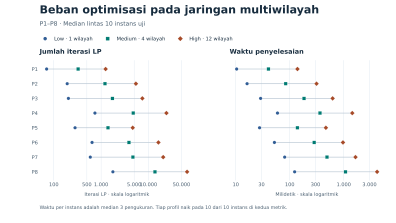

# Protokol dan hasil pengujian

Pada **10 instans uji baru**, kedelapan profil menunjukkan urutan **Low < Medium < High** untuk jumlah iterasi LP dan median waktu penyelesaian. Angka tersebut berlaku pada desain multiwilayah dan cara penyelesaian yang ditetapkan di repositori ini.

## Perbandingan

| Profil | Iterasi Low | Iterasi Medium | Iterasi High | Waktu Low (ms) | Waktu Medium (ms) | Waktu High (ms) | Urutan iterasi | Urutan waktu |
| --- | ---: | ---: | ---: | ---: | ---: | ---: | ---: | ---: |
| P1 | 70,5 | 327,5 | 1.246 | 10,4 | 40,3 | 138,8 | 10/10 | 10/10 |
| P2 | 192 | 1.206,5 | 5.441 | 16,2 | 84,2 | 313,4 | 10/10 | 10/10 |
| P3 | 203,5 | 1.732 | 7.444 | 28,9 | 184,4 | 622,6 | 10/10 | 10/10 |
| P4 | 740,5 | 4.780,5 | 24.009,5 | 59,3 | 363,3 | 1.438,9 | 10/10 | 10/10 |
| P5 | 281,5 | 1.398,5 | 4.657,5 | 27,6 | 138,5 | 467,2 | 10/10 | 10/10 |
| P6 | 644 | 3.873 | 16.262 | 52,1 | 284,1 | 968,0 | 10/10 | 10/10 |
| P7 | 591 | 4.693,5 | 20.528,5 | 80,6 | 489,8 | 1.650,9 | 10/10 | 10/10 |
| P8 | 1.775 | 13.750,5 | 65.702,5 | 123,3 | 1.078,7 | 4.150,4 | 10/10 | 10/10 |

Angka dalam tabel adalah median lintas 10 instans. Dua kolom terakhir menghitung instans dengan urutan ketat pada ketiga tingkat. Jika dilihat per pengulangan, waktu berurutan pada **240 dari 240** perbandingan profil dan instans. Seluruh 240 kombinasi instans × tingkat × profil diselesaikan dan diperiksa, dengan 720 pengukuran waktu setelah pemanasan.



[Data pengukuran](hasil/Pengukuran.csv) · [Ringkasan](hasil/Ringkasan.csv) · [Biaya, emisi, dan celah terhadap batas bawah](hasil/Titik_Tujuan.csv)

## Cara membaca hasil

- **Iterasi LP** menghitung langkah aljabar pada submasalah linear yang dicatat HiGHS, termasuk panggilan solver tambahan pada profil nonlinear. **Waktu** mengukur durasi nyata untuk menyelesaikan dan memeriksa seluruh wilayah aktif.
- **Satu instans** adalah satu paket permintaan dan tarif. Low, Medium, dan High memakai angka yang sama pada wilayah yang sama dalam instans tersebut. Sepuluh paket uji memakai kode 8201–8210. Paket 8001–8003 dialokasikan untuk kalibrasi.
- **Perbandingan dalam satu profil.** Jumlah bobot biaya–emisi per wilayah tetap, yaitu lima pada profil dua tujuan. Profil biaya tunggal memakai satu penyelesaian tujuan per wilayah. Angka antardua jenis profil mencakup keluaran yang berbeda.
- **Robust dalam pengujian ini.** Urutan bertahan pada semua paket uji, dengan rentang variasi data dan lingkungan yang dilaporkan. Setiap perluasan menambah pekerjaan wilayah yang benar-benar diselesaikan. Karena itu, kenaikan iterasi merupakan konsekuensi dari desain wilayah yang bertingkat. Urutan waktunya diperiksa melalui pengukuran, dan WCC operasi juga meningkat seiring perubahan campuran rute.
- **Batas interpretasi.** Benchmark ini mengalibrasi beban kerja bertingkat melalui jumlah wilayah dan struktur rute secara bersamaan. Pengaruh WCC secara terpisah memerlukan perbandingan dengan jumlah wilayah, ukuran, dan tugas yang dikendalikan.

## Protokol

Solver memakai HiGHS 1.8.0 melalui SciPy 1.17.0, NumPy 2.3.5, dan Python 3.12.14. Mesin uji Linux x86-64 memakai AMD EPYC 9V74. Enam pekerja dijalankan pada inti CPU berbeda dan HiGHS memakai satu thread per pekerja. Ketiga tingkat untuk satu paket dan profil diukur pada pekerja yang sama dengan urutan yang diacak. Untuk tiap tingkat dilakukan satu putaran pemanasan dan tiga pengukuran. Pencatatan iterasi berjalan terpisah dari pengukuran waktu. Waktu dimulai saat formulasi wilayah yang sudah dibangun diserahkan ke prosedur solver dan mencakup penyempurnaan relaksasi serta pemeriksaan tiap solusi.

Pada setiap penyelesaian, kode menghitung ulang biaya dan emisi. Untuk kasus nonlinear, kode memeriksa persamaan kuadratik asli, pilihan gudang biner, dan selisih terhadap batas bawah. Nilai fungsi utama dan emisi kemudian diperiksa ulang secara numerik antarulangan. [Model dan toleransi implementasi](benchmark_wilayah.py)

## Dasar rancangan

- **Hooker (1995), *Journal of Heuristics*.** Eksperimen komputasi yang terkendali mengubah karakteristik masalah secara eksplisit dan memeriksa bagaimana perilaku algoritma berubah. Ini mendukung pemisahan pola rute, skala wilayah, konfigurasi solver, dan paket data uji. [Artikel](https://iaorifors.com/paper/29510)
- **Gleixner dkk. (2021), *Mathematical Programming Computation*.** MIPLIB menyusun benchmark dari kumpulan instans yang beragam dan berimbang. Prinsip ini mendukung pelaporan hasil lintas paket data dengan karakteristik yang diketahui. [Artikel](https://doi.org/10.1007/s12532-020-00194-3)
- **Beiranvand, Hare, dan Lucet (2017), *Optimization and Engineering*.** Pemilihan ukuran kinerja, kumpulan masalah uji, dan prosedur perbandingan perlu mengikuti tujuan pengujian. Ini mendukung pencatatan iterasi dan waktu dengan protokol tetap. [Artikel](https://doi.org/10.1007/s11081-017-9366-1)
- **Tsiakis, Shah, dan Pantelides (2001), *Industrial & Engineering Chemistry Research*.** Model jaringan rantai pasok multiproduk dan bertingkat memakai skenario permintaan. Rancangan ini memakai gagasan keputusan fasilitas bersama dan arus yang dapat menyesuaikan permintaan. [Artikel](https://doi.org/10.1021/ie0100030)

## Menjalankan ulang

Buka [notebook di Google Colab](https://colab.research.google.com/github/kiittkiidd/Lampiran-Model-Matematika-Tesis/blob/main/math_model_acuan/Verifikasi_P1_P8.ipynb) atau jalankan dari direktori utama repositori di Linux.

```bash
python -m pip install -r requirements.txt
OPENBLAS_NUM_THREADS=1 python math_model_acuan/benchmark_wilayah.py --set uji --repetisi 3 --pekerja 6 --output uji.jsonl
```

Gunakan satu pekerja bila mesin hanya menyediakan satu inti. Durasi berubah sesuai mesin dan beban sistem. Untuk menjalankan satu profil, gunakan opsi misalnya --hanya P1.

[Daftar isi](../README.md)
