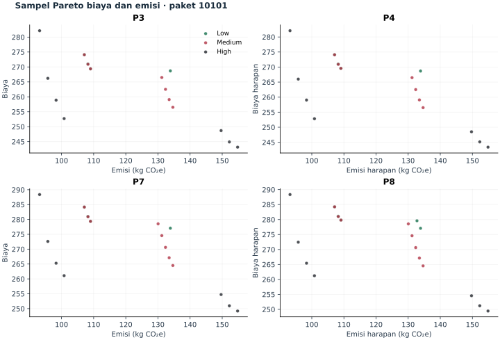

# Hasil validasi jaringan PT XYZ

Pengujian mencakup **480 kombinasi** dari 20 paket data, delapan profil, dan tiga tingkat rute. Satu paket memvariasikan biaya buka, tarif angkut, dan pembagian pesanan antar zona. Total permintaan dasar setiap produk tetap. Dalam tiap paket, permintaan, kapasitas, dan tarif yang sama dipakai pada Low, Medium, dan High. Kolom waktu mengambil median dari 3 ulangan untuk tiap paket, lalu median dari 20 paket. Kolom iterasi LP mengambil median dari 20 penghitungan terpisah.

| Profil | Waktu Low → Medium → High (detik) | Iterasi LP Low → Medium → High | Paket urut waktu | Paket urut iterasi |
| --- | ---: | ---: | ---: | ---: |
| P1 | 0,006 → 0,008 → 0,015 | 25,5 → 71,5 → 134,5 | 16/20 | 20/20 |
| P2 | 0,020 → 0,029 → 0,037 | 233 → 327 → 732 | 18/20 | 20/20 |
| P3 | 0,181 → 0,377 → 0,683 | 1.072 → 3.608,5 → 9.604 | 20/20 | 20/20 |
| P4 | 0,412 → 1,171 → 2,192 | 3.896,5 → 13.578,5 → 31.525 | 20/20 | 20/20 |
| P5 | 0,016 → 0,028 → 0,049 | 178 → 308,5 → 507 | 19/20 | 20/20 |
| P6 | 0,072 → 0,099 → 0,113 | 855,5 → 1.222 → 2.359 | 11/20 | 18/20 |
| P7 | 0,294 → 0,560 → 1,381 | 2.383 → 6.272 → 17.638 | 20/20 | 20/20 |
| P8 | 1,350 → 3,247 → 7,825 | 13.416 → 34.190 → 87.112,5 | 20/20 | 20/20 |

Median waktu naik secara ketat pada **8/8 profil**. Pada tingkat paket individual, urutan itu terjadi pada **144/160 perbandingan**.

Median iterasi LP naik secara ketat pada **8/8 profil**. Pada tingkat paket individual, urutan itu terjadi pada **158/160 perbandingan**.

Satu perbandingan memeriksa tiga tingkat dalam satu paket dan satu profil. Hasil ini menunjukkan pola pada jaringan dan paket yang diuji. Setiap tingkat menambah pilihan rute sekaligus menaikkan WCC. Waktu dan iterasi LP juga mencerminkan jumlah skenario dan prosedur Pareto yang dikerjakan oleh tiap profil.

## Sampel Pareto

P3, P4, P7, dan P8 memakai 25 batas ε per kombinasi. Batas tersebut berjarak sama di antara dua ujung rentang emisi untuk kombinasi yang sedang diselesaikan. Grafik menampilkan satu paket contoh (10101). Setiap titik mewakili satu pasangan biaya dan emisi yang lolos pemeriksaan. Batas ε yang memberikan titik sama tetap tercatat di CSV.

Sebagai contoh terpisah, gunakan data dasar High dengan permintaan pasti dan penanganan linear. Solusi biaya terendah membuka G2 dan G4 dengan biaya 242,95 dan emisi 155,60 kg CO₂e. Salah satu solusi yang lebih mengutamakan emisi membuka G2 dan G3 dengan biaya 259,00 dan emisi 96,00 kg CO₂e.

## Nilai alternatif fasilitas dan rute

- Pada setiap tingkat, penutupan satu fasilitas dari 10 fasilitas diuji satu per satu. P1 tetap dapat memenuhi pesanan, dan P6 tetap dapat memenuhi pesanan di ketiga skenario.
- Pada P1, setiap pesanan zona–produk bisa dipenuhi sepenuhnya dari minimal dua pilihan gudang pada Low dan Medium serta tiga pada High. Setiap pilihan diuji bergantian sambil tetap memenuhi semua pesanan lain.
- Untuk setiap kombinasi rute dan tingkat, CSV mencatat dua kondisi uji. Pada kondisi pertama, menutup rute menaikkan nilai tujuan atau membuat pesanan mustahil dipenuhi. Pada kondisi kedua, mewajibkan sedikitnya satu ton pada rute itu menaikkan nilai tujuan. Totalnya **208 kombinasi rute dan tingkat**.

Audit rute membandingkan biaya minimum atau skor gabungan berbobot. Skor gabungan menjumlahkan biaya dibagi 300 dan emisi dibagi 150 setelah masing-masing dikalikan bobotnya. Kedua pembagi adalah skala tetap pada uji rute. Pada benchmark Pareto, P3, P4, P7, dan P8 memakai batas ε seperti pada model matematika.

## Cara pengukuran dan menjalankan ulang

Pengujian memakai Linux, Python 3.12, SciPy 1.17.0, dan HiGHS 1.8.0 dengan satu thread per penyelesaian. Setiap kombinasi mempunyai 3 ulangan waktu setelah satu pemanasan. Urutan tingkat diseimbangkan antarulangan di setiap paket, dan data serta model operasi disiapkan sebelum pencatatan waktu. Waktu mencakup seluruh penyelesaian, pemilihan solusi jika biaya sama, dan pemeriksaan solusi. Iterasi LP dihitung dari laporan solver pada lintasan terpisah, termasuk panggilan tambahan jika solusi perlu diperiksa ulang.

Profil satu tujuan menyelesaikan biaya minimum. Profil dua tujuan mencakup penentuan dua ujung dan seluruh 25 batas ε. P5 sampai P8 memeriksa bentuk kuadrat asli dengan toleransi kelayakan 0,0000002 dan celah tujuan absolut maksimum 0,00025. Tercatat **65 panggilan ulang numerik** pada seluruh benchmark.

[Jalankan di Google Colab](https://colab.research.google.com/github/kiittkiidd/Lampiran-Model-Matematika-Tesis/blob/main/math_model_acuan/Verifikasi_P1_P8.ipynb) · [Notebook di repo](Verifikasi_P1_P8.ipynb)

Contoh lokal untuk Python 3.12 di Linux, dari direktori utama repo.

~~~bash
python -m pip install -r requirements.txt
OPENBLAS_NUM_THREADS=1 python math_model_acuan/benchmark.py --paket 10101 --profil P3 --output contoh.jsonl
~~~

Untuk benchmark lengkap, hilangkan opsi paket dan profil. Gunakan path keluaran baru untuk pengujian baru. Waktu absolut bergantung pada lingkungan. Paket final memakai kode 10101–10110 dan 10301–10310. Paket tersebut dipisahkan dari paket yang dipakai untuk memilih rancangan rute.

Untuk membuat ulang tabel dan gambar dari benchmark lengkap, jalankan perintah berikut.

~~~bash
python math_model_acuan/ringkas.py --input benchmark_lengkap.jsonl --output cek/hasil
~~~

## Data pemeriksaan

[Median dan urutan per profil](hasil/Ringkasan.csv) · [Pengukuran per paket](hasil/Pengukuran.csv) · [Biaya dan emisi pada setiap batas](hasil/Titik_Tujuan.csv) · [Audit WCC](hasil/WCC.csv) · [Audit per fasilitas dan zona](hasil/Audit_Fasilitas_Dan_Zona.json) · [Audit per rute](hasil/Audit_Per_Rute.csv)

[Model matematika](Model_Matematika.md) · [Halaman utama](../README.md)
