# Model matematika acuan P1–P8

Model ini memakai data pada [Kasus](../case/Kasus_Dasar.md). Jumlah barang diukur dalam ton dan boleh pecahan. Gudang dipilih untuk satu periode. Setiap produk yang diterima gudang harus dikirim kembali dalam periode tersebut.

| Profil | Banyak skenario | Koefisien biaya kuadratik α | Koefisien waktu kuadratik β | Tujuan |
|---|---:|---:|---:|---|
| P1 | 1 | 0 | 0 | Biaya |
| P2 | 27 | 0 | 0 | Biaya harapan |
| P3 | 1 | 0 | 0 | Biaya dan emisi |
| P4 | 27 | 0 | 0 | Biaya dan emisi harapan |
| P5 | 1 | 0,04 | 0,025 | Biaya |
| P6 | 27 | 0,04 | 0,025 | Biaya harapan |
| P7 | 1 | 0,04 | 0,025 | Biaya dan emisi |
| P8 | 27 | 0,04 | 0,025 | Biaya dan emisi harapan |

Profil pasti menggunakan peluang satu pada satu kondisi permintaan. Profil stokastik menggunakan peluang dan pesanan dari dokumen kasus. Rute yang diizinkan pada satu tingkat sama untuk semua profil dan skenario.

## 1. Indeks, parameter, dan keputusan

| Simbol | Arti |
|---|---|
|  | Pabrik P1–P6 |
|  | Himpunan rute pabrik–gudang–produk dan gudang–zona–produk yang diizinkan pada tingkat L/M/H |
| 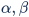 | Koefisien tambahan biaya dan jam kerja kuadratik pada tabel profil |
|  | Gudang G1–G4 |
|  | Zona pelanggan K1–K6 |
|  | Produk A, B, atau C |
|  | Kondisi permintaan; satu kondisi pada profil pasti dan 27 skenario pada profil stokastik |
|  | Peluang skenario; bernilai satu pada profil pasti |
|  | Pesanan produk  di zona  pada skenario  |
|  | Kapasitas tonase dan jam kerja gudang  |
| 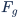 | Biaya membuka gudang  |
| 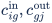 | Tarif angkut masuk dan keluar per ton |
|  | Biaya penanganan dasar per ton |
| 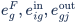 | Emisi tetap gudang dan emisi angkutan per ton |
|  | Keputusan buka gudang: 1 berarti buka, 0 berarti tutup |
|  | Kiriman produk  dari pabrik  ke gudang  pada skenario  |
|  | Kiriman produk  dari gudang  ke zona  pada skenario  |

Variabel kiriman hanya disediakan untuk rute yang diizinkan pada tingkat yang dipilih. Keputusan  dipakai bersama pada seluruh skenario. Setiap jumlah kiriman memiliki indeks skenarionya sendiri. Contoh  dibaca ton minyak dari Pabrik P1 ke G2 pada skenario ;  dibaca ton minyak dari G1 ke K2 pada skenario yang sama. Huruf dan semua indeks menentukan identitas keputusan.

Tonase produk di gudang ditulis dengan singkatan berikut:

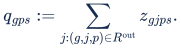

 adalah jumlah semua kiriman keluar untuk satu produk dari satu gudang. Pada representasi acuan, simbol ini merupakan singkatan penjumlahan. Contohnya, jika G1 mengirim 1,20 ton dan 0,80 ton minyak ke dua zona, tonase minyak di G1 adalah 2,00 ton.

## 2. Fungsi biaya dan emisi

Biaya total adalah biaya membuka gudang sekali, ditambah biaya operasi yang dirata-ratakan menurut peluang skenario.

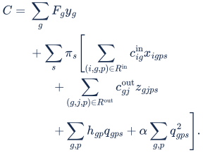

Gunakan  pada profil linear dan  pada profil nonlinear. Karena jumlah peluang satu, biaya operasi pada profil pasti adalah biaya dari satu kondisi yang diketahui. Sebagai contoh, tonase 5, 4, dan 3 ton di satu gudang memberikan tambahan biaya nonlinear sebesar 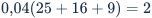.

Emisi total menghitung emisi tetap gudang satu kali dan emisi angkutan sesuai peluang skenario.

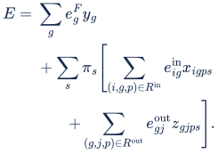

Pada profil stokastik,  dan  adalah biaya harapan dan emisi harapan. Pada profil satu tujuan, minimalkan . Pada profil dua tujuan, cari kompromi antara  dan  dengan prosedur pada Bagian 4.

## 3. Kendala operasi

### Keseimbangan setiap produk di setiap gudang

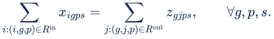

Kedua ruas menyatakan produk yang sama di gudang dan skenario yang sama. Jika G1 menerima 2 ton sirup, seluruh kiriman sirup keluar G1 harus berjumlah 2 ton. Ada 12 baris per skenario: empat gudang dikalikan tiga produk.

### Pemenuhan pesanan

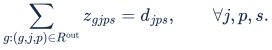

Pesanan boleh dibagi antargudang. Pesanan 3,17 ton minyak di K1 dapat dipenuhi, misalnya, dengan 1,20 ton dari satu gudang dan 1,97 ton dari gudang lainnya jika kedua rutenya diizinkan. Ada 18 baris per skenario: enam zona dikalikan tiga produk.

### Kapasitas tonase gudang

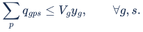

Jumlah seluruh produk berbagi kapasitas gudang. Jika G1 dibuka, batasnya 16 ton; jika ditutup, ruas kanan nol. Karena semua kiriman nonnegatif dan barang masuk sama dengan barang keluar, penutupan gudang juga membuat arus masuknya nol. Ada empat baris per skenario.

### Waktu penanganan gudang

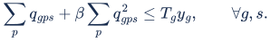

Gunakan 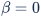 pada profil linear dan 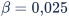 pada profil nonlinear. Waktu dasar satu jam per ton. Untuk 5 ton minyak, 4 ton sirup, dan 3 ton susu, waktu linear 12 jam; waktu nonlinear  jam. Aturan berlaku pada seluruh empat gudang dan seluruh skenario.

Pada profil linear, waktu tersedia lebih besar daripada kapasitas tonase, sehingga batas tonase juga cukup untuk memenuhi batas waktu. Kedua baris tetap dicatat sebagai dua aturan fisik yang dibedakan. Pada profil nonlinear, tambahan waktu kuadratik dapat membuat batas waktu aktif.

### Domain keputusan

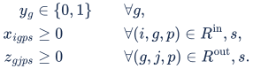

Keputusan gudang biner, sedangkan kiriman dapat pecahan. Penghitungan WCC menggunakan 38 baris operasi per skenario: 12 neraca, 18 permintaan, empat kapasitas, dan empat waktu. Domain dicatat terpisah dari 38 baris tersebut.

## 4. Profil dua tujuan dan 25 batas emisi

Untuk setiap batas emisi , selesaikan:

Setelah biaya minimum pada langkah tersebut diperoleh, pilih emisi minimum di antara rencana yang biayanya berada dalam toleransi biaya yang ditetapkan:

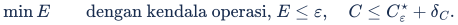

 adalah toleransi pemecah seri dalam satuan biaya. Toleransi selisih objektif pada penyelesaian biaya adalah 0,00025 satuan biaya; pada penyelesaian emisi adalah 0,00025 kg CO2e. Batas celah absolut SCIP pada profil linear ditetapkan lebih ketat, yaitu ; pada profil nonlinear sebesar 0,00025. Seluruh hasil harus memenuhi batas pemeriksaan 0,00025 pada tujuan yang sedang diminimalkan.

Empat langkah awal menghitung biaya minimum, emisi minimum, rencana biaya minimum dekat ujung emisi minimum, serta emisi minimum dekat ujung biaya minimum. Ambil 25 batas berjarak sama di antara emisi kedua rencana ujung itu. Pada 23 batas interior, lakukan masing-masing dua langkah di atas. Jumlahnya 50 langkah optimisasi per profil dan tingkat. Rentang batas dihitung untuk masing-masing profil dan tingkat; jumlah batas serta prosedurnya sama. Pada profil stokastik, batas diterapkan pada emisi harapan dan seluruh skenario tetap diselesaikan dalam satu model dengan keputusan gudang bersama.

Titik biaya–emisi yang sama ditampilkan sekali. Titik yang didominasi dikeluarkan dari grafik Pareto. Toleransi numerik dinyatakan dalam konfigurasi yang dibekukan.

## 5. Representasi internal SCIP

SCIP menangani keputusan biner dan kontinu secara bersama. Implementasi menggunakan variabel bantu tonase pada seluruh profil:

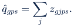

Variabel bantu ditentukan sepenuhnya oleh kiriman. Menggantikan  dengan ruas kanannya mengembalikan persamaan acuan. Pada profil nonlinear, setiap kuadrat tonase diberi variabel bantu berikut:

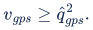

Tambahan biaya menjadi  dan tambahan jam kerja menjadi . Seluruh fungsi tujuan dan batas lain kemudian linear terhadap variabel bantu ini; hubungan kuadrat berada pada pertidaksamaan di atas.

Representasi ini setara dalam keputusan bisnis. Setiap rencana asli dapat diperluas dengan memilih 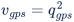. Sebaliknya, jika suatu rencana memenuhi batas dengan 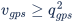, menggantinya dengan kuadrat sebenarnya tidak menambah biaya atau jam kerja. Pada minimisasi biaya, koefisien positif mendorong nilai bantu ke batas kuadratnya. Pada pemilihan emisi dengan batas biaya, proyeksi rencana ke kiriman asli tetap memenuhi biaya serta waktu asli. Biaya dan waktu yang dilaporkan selalu dihitung ulang dari kuadrat tonase sebenarnya.

Batas atas kiriman diturunkan dari kendala acuan. Kiriman keluar tidak melampaui pesanan tujuan. Tonase produk di gudang tidak melampaui kapasitas gudang dan total pesanan produk tersebut. Setiap batas mengikuti nonnegativitas, neraca, pesanan, dan kapasitas yang sudah berlaku.

WCC dihitung pada representasi acuan sebelum variabel bantu dan presolve. Pemeriksaan solusi menghitung ulang neraca, kapasitas, waktu, biaya, dan emisi langsung dari kiriman asli. Data, kode, konfigurasi, dan hasil pengukuran dicatat dengan checksum pada versi yang dibekukan.

[Kasus untuk pemodel](../case/Kasus_Dasar.md) · [Tutorial WCC](../Lampiran_WCC.md) · [Persamaan Low R1–R38](Persamaan_WCC.md) · [Hasil verifikasi](Hasil_Verifikasi.md)

[Sumber persamaan LaTeX](source/persamaan_sumber.tex).
