# Persamaan operasi Low, R1–R38

Seluruh baris pada halaman ini berasal dari daftar rute Low. Indeks  berturut-turut menunjukkan pabrik, gudang, zona, dan produk.  adalah ton kiriman masuk;  adalah ton kiriman keluar;  memilih gudang yang dibuka. Permintaan pasti menggunakan tabel dasar. Untuk satu skenario stokastik, tambahkan indeks skenario pada setiap kiriman dan gunakan pesanan skenario tersebut.

### R1. Neraca produk A di G1

Jumlah yang diterima untuk produk dan gudang ini harus sama dengan jumlah yang dikirim keluar.

### R2. Neraca produk B di G1

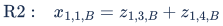

Jumlah yang diterima untuk produk dan gudang ini harus sama dengan jumlah yang dikirim keluar.

### R3. Neraca produk C di G1

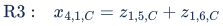

Jumlah yang diterima untuk produk dan gudang ini harus sama dengan jumlah yang dikirim keluar.

### R4. Neraca produk A di G2

Jumlah yang diterima untuk produk dan gudang ini harus sama dengan jumlah yang dikirim keluar.

### R5. Neraca produk B di G2

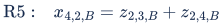

Jumlah yang diterima untuk produk dan gudang ini harus sama dengan jumlah yang dikirim keluar.

### R6. Neraca produk C di G2

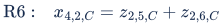

Jumlah yang diterima untuk produk dan gudang ini harus sama dengan jumlah yang dikirim keluar.

### R7. Neraca produk A di G3

Jumlah yang diterima untuk produk dan gudang ini harus sama dengan jumlah yang dikirim keluar.

### R8. Neraca produk B di G3

Jumlah yang diterima untuk produk dan gudang ini harus sama dengan jumlah yang dikirim keluar.

### R9. Neraca produk C di G3

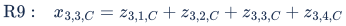

Jumlah yang diterima untuk produk dan gudang ini harus sama dengan jumlah yang dikirim keluar.

### R10. Neraca produk A di G4

Jumlah yang diterima untuk produk dan gudang ini harus sama dengan jumlah yang dikirim keluar.

### R11. Neraca produk B di G4

Jumlah yang diterima untuk produk dan gudang ini harus sama dengan jumlah yang dikirim keluar.

### R12. Neraca produk C di G4

Jumlah yang diterima untuk produk dan gudang ini harus sama dengan jumlah yang dikirim keluar.

### R13. Pesanan produk A di K1

Semua kiriman produk ini menuju zona yang sama dijumlahkan untuk memenuhi pesanannya.

### R14. Pesanan produk B di K1

Semua kiriman produk ini menuju zona yang sama dijumlahkan untuk memenuhi pesanannya.

### R15. Pesanan produk C di K1

Semua kiriman produk ini menuju zona yang sama dijumlahkan untuk memenuhi pesanannya.

### R16. Pesanan produk A di K2

Semua kiriman produk ini menuju zona yang sama dijumlahkan untuk memenuhi pesanannya.

### R17. Pesanan produk B di K2

Semua kiriman produk ini menuju zona yang sama dijumlahkan untuk memenuhi pesanannya.

### R18. Pesanan produk C di K2

Semua kiriman produk ini menuju zona yang sama dijumlahkan untuk memenuhi pesanannya.

### R19. Pesanan produk A di K3

Semua kiriman produk ini menuju zona yang sama dijumlahkan untuk memenuhi pesanannya.

### R20. Pesanan produk B di K3

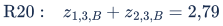

Semua kiriman produk ini menuju zona yang sama dijumlahkan untuk memenuhi pesanannya.

### R21. Pesanan produk C di K3

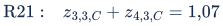

Semua kiriman produk ini menuju zona yang sama dijumlahkan untuk memenuhi pesanannya.

### R22. Pesanan produk A di K4

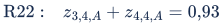

Semua kiriman produk ini menuju zona yang sama dijumlahkan untuk memenuhi pesanannya.

### R23. Pesanan produk B di K4

Semua kiriman produk ini menuju zona yang sama dijumlahkan untuk memenuhi pesanannya.

### R24. Pesanan produk C di K4

Semua kiriman produk ini menuju zona yang sama dijumlahkan untuk memenuhi pesanannya.

### R25. Pesanan produk A di K5

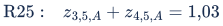

Semua kiriman produk ini menuju zona yang sama dijumlahkan untuk memenuhi pesanannya.

### R26. Pesanan produk B di K5

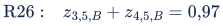

Semua kiriman produk ini menuju zona yang sama dijumlahkan untuk memenuhi pesanannya.

### R27. Pesanan produk C di K5

Semua kiriman produk ini menuju zona yang sama dijumlahkan untuk memenuhi pesanannya.

### R28. Pesanan produk A di K6

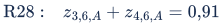

Semua kiriman produk ini menuju zona yang sama dijumlahkan untuk memenuhi pesanannya.

### R29. Pesanan produk B di K6

Semua kiriman produk ini menuju zona yang sama dijumlahkan untuk memenuhi pesanannya.

### R30. Pesanan produk C di K6

Semua kiriman produk ini menuju zona yang sama dijumlahkan untuk memenuhi pesanannya.

### R31. Batas kapasitas tonase G1

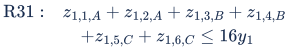

Ketiga produk berbagi batas gudang yang sama. Nilai buka nol membuat seluruh arus gudang nol.

### R32. Batas kapasitas tonase G2

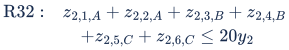

Ketiga produk berbagi batas gudang yang sama. Nilai buka nol membuat seluruh arus gudang nol.

### R33. Batas kapasitas tonase G3

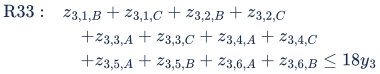

Ketiga produk berbagi batas gudang yang sama. Nilai buka nol membuat seluruh arus gudang nol.

### R34. Batas kapasitas tonase G4

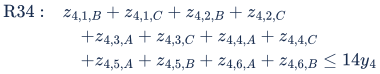

Ketiga produk berbagi batas gudang yang sama. Nilai buka nol membuat seluruh arus gudang nol.

### R35. Batas waktu linear G1

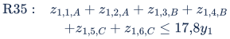

Ketiga produk berbagi batas gudang yang sama. Nilai buka nol membuat seluruh arus gudang nol.

### R36. Batas waktu linear G2

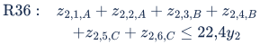

Ketiga produk berbagi batas gudang yang sama. Nilai buka nol membuat seluruh arus gudang nol.

### R37. Batas waktu linear G3

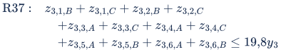

Ketiga produk berbagi batas gudang yang sama. Nilai buka nol membuat seluruh arus gudang nol.

### R38. Batas waktu linear G4

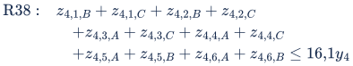

Ketiga produk berbagi batas gudang yang sama. Nilai buka nol membuat seluruh arus gudang nol.

Pada profil nonlinear, R35–R38 menambahkan 0,025 kali jumlah kuadrat tonase setiap produk. Tonase masing-masing produk adalah jumlah kiriman yang sudah tercantum pada baris waktu, sehingga identitas variabel yang diukur WCC tetap. Fungsi biaya menambahkan kuadrat dengan koefisien 0,04.

[Penghitungan WCC](../Lampiran_WCC.md) · [Model matematika](Model_Matematika.md)

[Sumber persamaan LaTeX](source/persamaan_sumber.tex).
